# FormaMech

**An open-source, physics-informed engineering simulation platform combining neural-speed predictions with transparent numerical verification and FEM-backed reliability — across 2D & 3D CAD.**

[](pyproject.toml) [](LICENSE) [](CHANGELOG.md)

[Get started](#installation) · [Plots](#examples-with-plots) · [Viscoelastic Showcase](#end-to-end-viscoelastic-cad-showcase) · [Own CAD](#train-on-your-own-cad) · [Specialized workflows](#specialized-engineering-workflows) · [Advanced workflows](#advanced-workflows-p1p6) · [Materials](#material-models) · [Cite](#how-to-cite) · [Limitations](docs/limitations.md)

Import a planar STEP or DXF profile, define its material and boundary conditions,
and train a model over the loads and material ranges you choose. Compare its
predictions with finite element solutions, then save a bundle to reuse the
model for displacement and stress prediction within its input envelope.

The CAD workflow trains **one model per fixed geometry**. DogBone and notched-plate
models are included so you can try prediction before training your own model.


## Choose your workflow

| I want to… | Start here |
| --- | --- |
| Predict with an existing model | [Quick start](#quick-start-predict-with-an-existing-model) |
| See displacement, stress and load-response plots | [Runnable plotting examples](#examples-with-plots) |
| See all FormaMech features working together on a CAD viscoelastic part | [End-to-end viscoelastic CAD showcase](#end-to-end-viscoelastic-cad-showcase) |
| Train for my own CAD profile | [CAD walkthrough](#train-on-your-own-cad) |
| Inspect a plan before running numerical work | [Prepare a complete example](docs/campaigns/s29-custom-material.md#prepare-and-inspect-a-plan) |
| Define a custom strain-energy formula | [Custom-material tutorial](docs/campaigns/s29-custom-material.md) |
| Refine a mesh around holes or other features | [Meshing and convergence guide](docs/campaigns/own-cad-meshing.md) |
| Resume training or move a model to another machine | [Compiler guide](docs/campaigns/s28-compiler-guide.md) · [Bundle reuse](#save-and-reuse-your-model) |
| Use hierarchical CAD training, LoRA adaptation, active FEM, live DWR trust reports, design optimization or viscoelastic rollouts | [Advanced workflows (P1–P6)](#advanced-workflows-p1p6) · [Guide](docs/advanced-workflows.md) |
| Run continuous model qualification, split-conformal calibration & fail-closed deployment gates | [Model qualification guide](docs/qualification.md) |
| Use the interactive browser GUI instead of hand-editing JSON/CLI | [Interactive 2D workbench](docs/workbench.md) |
| Simulate cyclic J2 elastoplasticity (linear & Voce hardening) with guarded neural rollouts | [J2 elastoplasticity guide](docs/plasticity.md) |
| Train one reusable surrogate across a parametric CAD family & run FEM-guarded optimization | [Parametric CAD exploration guide](docs/parametric_cad.md) |
| Import 3D STEP solids, solve dual nonlinear 3D `TET10` FEM & train 3D PI-GINOT operators | [3D CAD & nonlinear FEM guide](docs/workflow_3d.md) |

## Installation

Use **Python 3.11, 3.12 or 3.13** and Git. These instructions install the current
`0.2.0.dev0` development version from the repository, including its CAD/compiler
workflows. The checkout also supplies the example inputs and shipped bundles.

```text
git clone https://github.com/BBahtiri/formamech.git
cd formamech
python -m venv .venv
```

Activate the virtual environment:

```bash
# Linux / macOS
source .venv/bin/activate
```

```powershell
# Windows PowerShell
.\.venv\Scripts\Activate.ps1
```

Install CAD import, training and FEM comparison:

```text
python -m pip install -e ".[cad,verify]"
formamech --version
```

**FormaMech is installed from source until a package-index release is published.**
If you used the earlier `piginot` distribution, use a fresh virtual environment
for FormaMech to avoid overlapping installed files.

For prediction only, use `python -m pip install -e ".[runtime]"` instead.
For metadata-only planning, the base install `python -m pip install -e "."`
is sufficient. On Linux, the Gmsh CAD backend may also need the OS GLU library
(`libglu1-mesa` on Ubuntu/Debian); see the [CAD setup guide](docs/campaigns/own-cad-workflow.md#import-and-inspect).

## Quick start: predict with an existing model

From the repository root, verify a shipped bundle and predict a notched-plate
field using its supplied request:

```text
python -c "from pathlib import Path; Path('.formamech-runs/demo').mkdir(parents=True, exist_ok=True)"
formamech bundle verify bundles/notched-v1-cp-freeze
formamech inspect bundles/notched-v1-cp-freeze
formamech predict bundles/notched-v1-cp-freeze --request bundles/requests/notched-in-domain.json --mode fast --no-confidence --output .formamech-runs/demo/prediction.json
```

The JSON contains displacement and stress fields, mesh connectivity, quantities
of interest, units, the envelope verdict and the model's claim level. The
[DogBone demo](docs/campaigns/s29-fast-demo.md) provides a second model and shows
how an out-of-range request is refused. The [user guide](docs/user-guide.md)
explains the output fields and plotting.

### Use the same model from Python

```python
import json

from formamech.bundle import load_bundle, predict
from formamech.cli import parse_request

bundle = load_bundle("bundles/notched-v1-cp-freeze")
with open("bundles/requests/notched-in-domain.json", encoding="utf-8") as handle:
    inputs, queries = parse_request(json.load(handle))

result = predict(bundle, inputs, queries, confidence=False).document()
print(result["verdict"], result["claim_level"])
```

## Examples with plots

Generate DogBone and notched-plate field plots, plus a load-response figure,
using the shipped models:

```text
python -m pip install -e ".[runtime,plot]"
python -m examples.prediction_plots --output .formamech-runs/prediction-plots
```

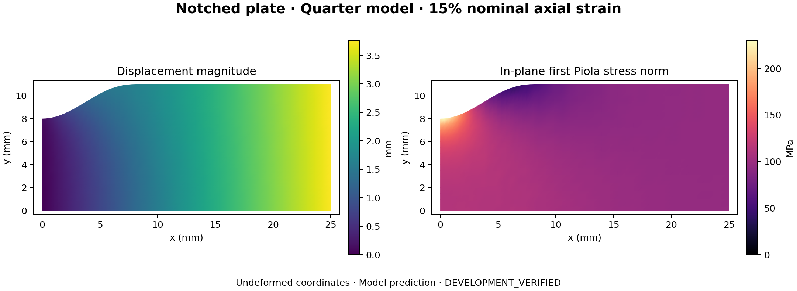

These are model predictions on the original quarter-specimen mesh. The demo
holds geometry/material fixed and samples five strains per model. It performs
no training or FEM solves. Choose a new output directory when rerunning it.

The [plot gallery](docs/examples.md#prediction-plots) shows all three figures.
The [plotting guide](examples/prediction_plots/README.md#plot-your-own-prediction)
also shows how to turn a saved prediction from your own CAD model into PNG,
SVG or PDF. New CAD candidates retain their own `NOT_VERIFIED` claim.

## End-to-end viscoelastic CAD showcase

If you are new to FormaMech and want to see **how every subsystem fits together
on one realistic engineering part** — from STEP CAD generation through
viscoelastic physics, multi-CAD neural operators, mathematical verification
gates, active learning, CAD lightweighting, contact/3D mechanics, and
production deployment — start with the runnable showcase in
[examples/viscoelastic_cad_showcase/](examples/viscoelastic_cad_showcase/README.md).

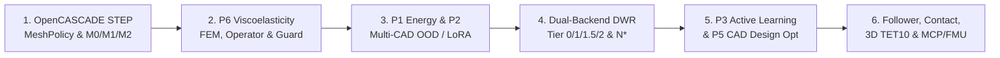

### Run it locally in one command (~2.5 min on CPU, no GPU required)

```text
python -m pip install -e ".[cad,verify,plot]"
python -m examples.viscoelastic_cad_showcase --output .formamech-runs/showcase
```

Running this command writes every artifact locally under `.formamech-runs/showcase/`
(gitignored): the generated STEP CAD files (`cad/`), all six multi-panel plots
(`plots/01..06.png`), full numerical metrics (`showcase_summary.json`), a
tamper-checked `safetensors` viscoelastic model & trajectory checkpoint, an
RFC 8785 SHA-256 Trust Receipt (`showcase-trust-receipt.json`), a `TRAIN`-only
Tier 2 fallback ledger (`tier2-fallback-ledger.json`), a Verification Inspector
dossier (`inspector-trust-dossier.md`), and an FMI 3.0 Co-Simulation FMU
(`notched-plate.fmu`). See the [detailed showcase walkthrough and code guide](examples/viscoelastic_cad_showcase/README.md)
for API snippets and instructions on swapping in your own STEP file or material.

### The engineering problem used throughout the showcase

Instead of disconnected toy squares, all six stages operate on the same
parametric elastomer part generated via OpenCASCADE (`gmsh.model.occ`):

| Aspect | Showcase specification |
| --- | --- |
| **CAD part (`nominal-bracket.step`)** | **40 × 20 mm genus-2 elastomer mount bracket** with a top semi-circular relief notch (`R = 4.0 mm` at `(20, 20) mm`) and two asymmetric internal mounting holes (`R_L = 3.2 mm` at `(11, 10) mm`, `R_R = 2.6 mm` at `(29, 10) mm`); exact analytical area `721.46 mm²` |
| **Boundary conditions** | Left vertical edge (`left_clamp`) fixed in `x, y`; right vertical edge (`right_load`) displaced axially (`u_x`); top, bottom, notch, and both internal hole boundaries traction-free (or pressurized/contacted in Stage 6) |
| **Material model** | **2-branch Generalized Maxwell finite-strain viscoelasticity**: equilibrium modulus `E_inf = 8.0 MPa`, Poisson's ratio `nu = 0.38`, branch stiffness weights `gamma = (0.65, 0.35)`, relaxation times `tau = (0.4, 2.0) s` |
| **Cyclic load history (Stage 2)** | **Ramp (`0 -> 0.5 s`) → Constant-strain Hold (`0.5 -> 1.5 s`) → Unload (`1.5 -> 2.0 s`)** evaluated at an unseen peak displacement `u_max = 3.6 mm` (9% nominal strain) |
| **Epistemic scope (ASME V&V 10)** | Newly trained showcase artifacts carry `claim_level = "NOT_VERIFIED"` and `experimental_validation = False` — all accuracy and error metrics represent **numerical verification against converged P2 FEM** (`147.2 s` total wall time in `float64` on 1 CPU thread) |

### Feature-contribution summary

| Stage | Time | FormaMech feature | What problem it solves | Measured contribution (live run) |
| --- | :---: | --- | --- | --- |
| **1** | `4.8 s` | STEP import, `MeshPolicy` & `M0/M1/M2` hierarchy | Prevents coarse hole approximation or silent CAD defeaturing | Maps 8 STEP edges to 7 semantic boundaries; builds `M0 = 369 -> M1 = 1,476 -> M2 = 5,904` tris; distinct-remesh area error drops **`1.56% -> 0.51%`** & chord error drops **`0.348 -> 0.161 mm`** |
| **2** | `77.1 s` | P6 viscoelastic FEM, energy operator & `GuardedStatefulStepper` | Captures rate-dependent hysteresis/relaxation & prevents neural rollout drift | Algorithmic tangent FD error **`7.57e-11`**; **`27.3%`** hold stress relaxation; **`12.3x`** online speedup (`0.231 s` vs `2.84 s` FEM); guarded hybrid (`3` operator + `5` FEM fallback) zeros peak residuals & cuts max reaction error **`8.44% -> 7.46%`** |
| **3** | `31.9 s` | P1 hierarchical energy & P2 multi-CAD tokens / OOD / LoRA | Generalizes across CAD variants, refuses extrapolation, adapts cheaply | `M0 -> M1` energy cuts displacement error **`2.35% -> 1.68%` (`-28.5%`)**; 12-ch tokens cover all 3 loops; OOD gate separates ID (`0.97`) from extreme CAD (**`24.97`**, refused); `1,256`-param LoRA (`0.35 s`) reaches **`2.38%`** error vs Zero-Shot **`3.07%`** & From-Scratch **`3.51%`** (`9.6x` faster) |
| **4** | `3.5 s` | Dual-backend DWR, Tier 0/1/1.5/2 funnel, spectral repair & `N*` | Certifies errors, repairs bad starts & proves when surrogates pay off | `TorchFem` vs `ScikitFem` parity **`1.77e-15`**; Tier 0 gate **`11.6 ms`**; live DWR tracks true error across 4 QoIs (Reaction DWR `0.437` vs True `0.435`); Tier 1.5 TTA cuts energy **`3.41%`** & residual **`3.82 -> 3.12`**; Warm Newton cuts Cold FEM **`14 -> 4` iters (`3.5x`)** while **Spectral Repair** rescues a folded start (`det F: -1.00 -> +0.66`) to **`7` iters**; RFC 8785 receipt verified; break-even **`N* = 34.2` queries** |
| **5** | `22.0 s` | P3 DWR active learning & P5 FEM-guarded CAD lightweighting | Targets FEM budget to hard cases & prevents unsafe AI design optimization | `physics_dwr_diversity` selects **`8.02%`** mean true FEM error (**`1.81x`** vs Random `4.42%`) & **`0.589`** geometry spread (**`1.93x`** vs `0.306`) + `TRAIN`-only fallback ledger; P5 certifies **`-9.1%` P2-FEM-verified area reduction** (`749.1 -> 681.3 mm²`, Hole `R: 2.60 -> 4.26 mm`, Notch `R: 3.20 -> 4.00 mm`) |
| **6** | `3.8 s` | Follower pressure, 2.5D contact, 3D `TET10` & deployment gates | Handles nonlinear loads/contact/3D locking & safe production serving | Follower unsymmetric tangent FD err **`1.47e-10`**; 2.5D contact penetration **`5.74e-6 mm`** (`F_y = -3.54 N/mm`); `TET4` locking refused at `nu = 0.49`; 3D `O(N*S)` operator grad FD err **`5.35e-13`**; **7/7 deployment gates PASS** (Trust Receipt, `safetensors` checkpoint, Inspector dossier, sandboxed MCP server, FMI 3.0 FMU) |

---

### Stage 1 — OpenCASCADE STEP import, local `MeshPolicy` & `M0/M1/M2` hierarchy

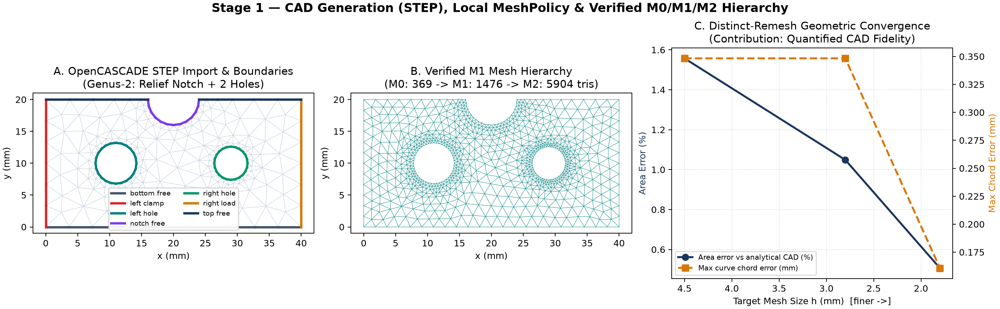

- **What is done:** FormaMech generates `nominal-bracket.step` via OpenCASCADE using exact analytical `Circle` curves (never coarse polygonal approximations), validates curve qualification and sagitta chord tolerances via `MeshPolicy`, labels all 8 CAD edges into 7 semantic boundary groups, builds a nested `M0 -> M1 -> M2` `MeshHierarchy`, and runs three independent STEP remeshes (`h = 4.5, 2.8, 1.8 mm`) to measure true CAD-to-mesh discretization error.
- **How to read the plot:**
  - **Panel A** shows the imported CAD geometry colored by semantic boundary group (`left_clamp` red, `right_load` orange, `notch_free` purple, `left_hole` teal, `right_hole` emerald, `top/bottom_free` dark slate) over the `M0` mesh (`369` triangles).
  - **Panel B** shows the `M1` mesh (`1,476` triangles) with visibly denser local `PointSize` refinement clustered around the relief notch and both holes where stress gradients concentrate (`M2` further refines to `5,904` triangles).
  - **Panel C** plots area error vs. the exact analytical CAD area (navy solid curve, left axis) and maximum curve chord error (amber dashed curve, right axis) as mesh size `h` gets finer from left to right.
- **What it contributes:** Before a single neural weight is trained, users get quantitative proof of geometric fidelity — area error drops from **`1.56% -> 1.05% -> 0.51%`** and maximum curved-edge chord error drops from **`0.348 -> 0.161 mm`**.

---

### Stage 2 — P6 finite-strain viscoelasticity & guarded hybrid rollout

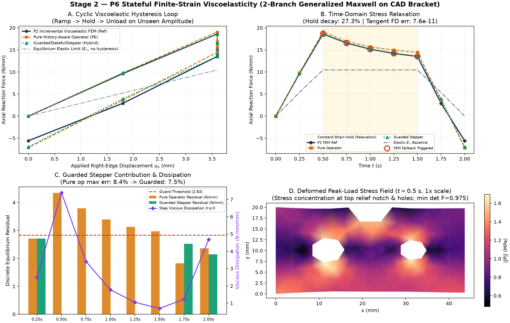

- **What is done:** Assigns a **2-branch Generalized Maxwell** viscoelastic model to the bracket, verifies its closed-form algorithmic tangent against central finite differences (`7.57e-11`), runs a P2 incremental FEM reference over a cyclic **Ramp → Hold → Unload** history at an unseen 9% strain amplitude (`u_max = 3.6 mm`, checking both exact CPU state-hash replay and `dt`-halving sensitivity), trains `HistoryAwareViscoelasticOperator` **purely via incremental variational potential energy (zero FEM displacement labels)** over three training amplitudes (`2.0, 3.2, 4.4 mm`), saves/reloads a tamper-checked `safetensors` artifact, and compares pure neural rollout against `GuardedStatefulStepper`.
- **How to read the plot:**
  - **Panel A (Hysteresis Loop):** Axial reaction force vs. applied displacement `u_x`. The dash-dot grey baseline shows the equilibrium elastic limit (`E_inf`, zero memory, no hysteresis loop). The navy curve (P2 FEM reference) opens a wide hysteresis loop and drops vertically during the hold at `u_x = 3.6 mm`; orange dashes are the pure neural operator (`12.3x` faster) and green triangles are `GuardedStatefulStepper`.
  - **Panel B (Stress Relaxation in Time):** Reaction force vs. time `t`. Inside the shaded yellow constant-strain hold (`0.5–1.5 s`), force relaxes by **`27.3%`** as the two Maxwell branches dissipate internal viscous energy. **Red circles** mark the exact steps where `GuardedStatefulStepper` detected elevated residual and triggered exact P2 FEM fallback.
  - **Panel C (Residual & Dissipation):** Compares per-step discrete equilibrium residuals of the pure operator (orange bars) vs. the guarded stepper (green bars) against the guard threshold (red dashed line, `2.83 N/mm`). Whenever an orange bar crosses the red line (`t = 0.50–1.50 s`), the guarded stepper falls back to FEM and collapses the green residual bar to `~0`. The purple curve (right axis) verifies thermodynamically nonnegative viscous dissipation (`D >= 0`) at every step.
  - **Panel D (Deformed Stress Field):** Actual 1×-scale deformed bracket at peak load (`t = 0.5 s`) shaded by first Piola-Kirchhoff stress norm `||P||` over the faint grey undeformed outline, highlighting stress concentrations at the top notch root and mounting-hole ligaments (`min det F = 0.975 > 0`).
- **What it contributes:** Combines **`12.3x` online neural rollout speed** (`0.231 s` vs. `2.84 s` FEM) with an automatic physics guard that prevents unbounded rollout drift (`8.44% -> 7.46%` worst-step reaction error, zero peak residuals, verified state-bound checkpointing).

---

### Stage 3 — P1 hierarchical energy & P2 multi-CAD tokenization, OOD gate & LoRA

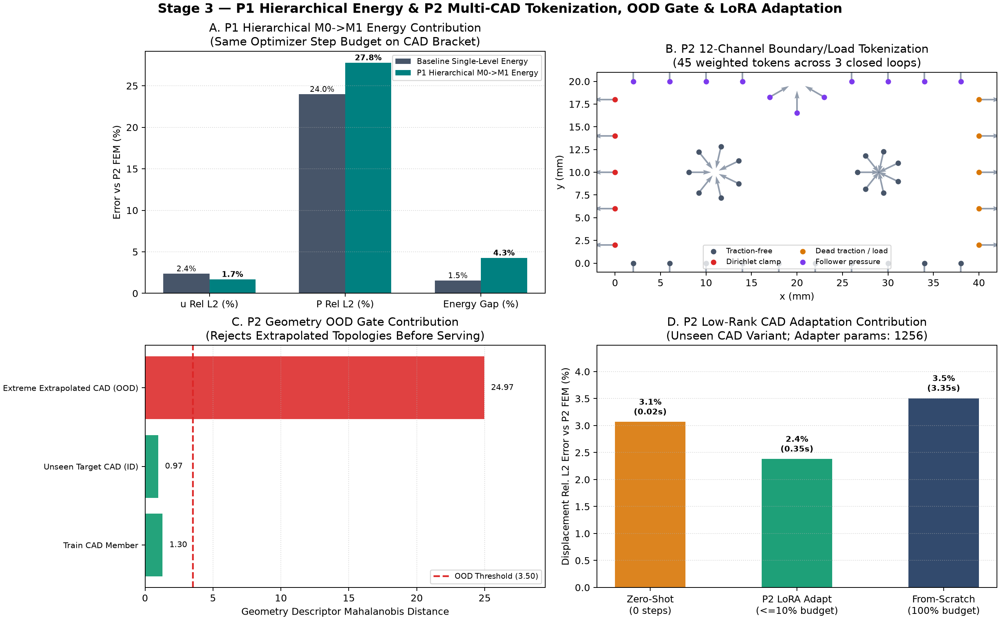

- **What is done:** Evaluates two core modeling upgrades on the bracket family: (1) **P1 hierarchical `M0 -> M1` energy training** compared head-to-head against single-level training at the same 80-step budget; and (2) **P2 multi-CAD generalization** — encoding arbitrary genus-2 CAD brackets with 12-channel boundary/load tokens, fitting a `GeometryOODDetector` across 4 training bracket variants, testing an unseen in-distribution variant plus an extreme out-of-distribution bracket, and adapting a pretrained operator with a **`<= 10%`-budget Low-Rank Adapter (LoRA)** vs. zero-shot and from-scratch training.
- **How to read the plot:**
  - **Panel A (P1 Hierarchical Energy):** Compares Baseline (slate) vs. P1 Hierarchical `M0 -> M1` (teal) across displacement error (`u Rel L2`), first-Piola stress error (`P Rel L2`), and total energy gap.
  - **Panel B (12-Channel Boundary/Load Tokens):** Shows the `45` area-weighted boundary tokens distributed around all 3 closed loops (outer perimeter + notch + 2 holes), colored by physical boundary role with arrows depicting unit outward normals.
  - **Panel C (OOD Gate):** Horizontal bars show each CAD part's Mahalanobis distance from the training geometry manifold vs. the red dashed refusal threshold (`3.50`). Green bars pass; red bars are rejected before serving.
  - **Panel D (LoRA Adaptation):** Compares displacement error and wall time on an unseen CAD bracket for Zero-Shot (orange, `0` steps), P2 LoRA (green, `1,256` adapter parameters, `0.35 s`), and From-Scratch training (navy, 100% step budget, `3.35 s`).
- **What it contributes:** P1 cuts displacement error by **`-28.5%`** (`2.35% -> 1.68%`; stress error `27.8%` vs `24.0%` at this short 80-step budget is reported transparently rather than hidden). P2 cleanly blocks extrapolated CAD (`24.97 > 3.50` vs. `0.97` in-distribution) and adapts to unseen CAD parts **`9.6x` faster** than training from scratch while achieving **lower error** (`2.38%` vs. `3.07%` zero-shot and `3.51%` from-scratch).

---

### Stage 4 — Dual-backend parity, three-tier verification funnel & break-even `N*`

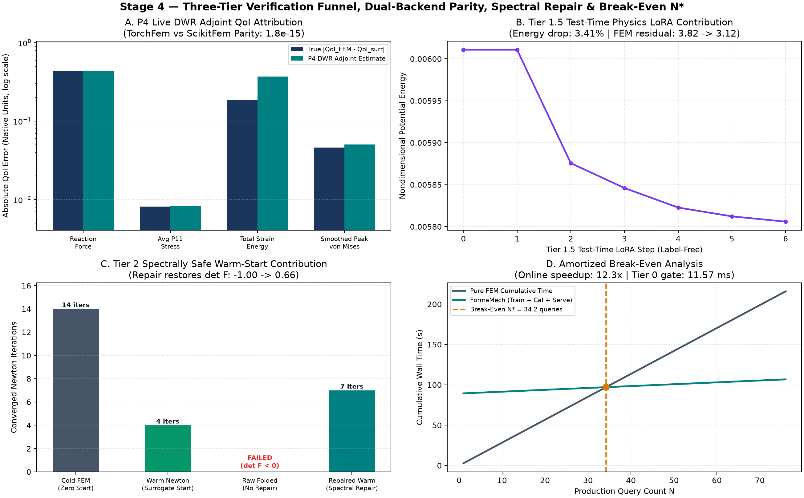

- **What is done:** Runs FormaMech's complete verification and certification stack on the bracket: (1) cross-checks `TorchFemBackend` against `ScikitFemBackend`; (2) times the **Tier 0** zero-FEM admissibility gate on both clean and deliberately inverted fields; (3) runs **Tier 1** conformal bands and **P4 live DWR adjoint error attribution** across four engineering QoIs; (4) pushes the operator to an unseen **12% strain** and applies label-free **Tier 1.5 Test-Time Physics LoRA**; (5) benchmarks **Tier 2** cold FEM vs. warm Newton vs. a severely corrupted folded prediction (`det F = -1.00`) with and without **Spectrally Safe Warm-Start Repair**; and (6) emits an **RFC 8785 SHA-256 Trust Receipt** alongside the honest **amortized break-even query count `N*`**.
- **How to read the plot:**
  - **Panel A (P4 Live DWR Attribution):** Log-scale comparison of true surrogate-vs-FEM absolute error (navy) vs. the live P4 DWR adjoint estimate (teal) across Reaction Force, Avg `P11` Stress, Total Strain Energy, and Smoothed Peak von Mises stress (computed purely via one linear adjoint solve per QoI — no nonlinear FEM solve).
  - **Panel B (Tier 1.5 TTA):** Label-free nondimensional potential energy decreasing monotonically across Test-Time Physics LoRA steps at unseen 12% strain.
  - **Panel C (Tier 2 Spectral Repair):** Converged Newton iterations required for exact FEM solution from four starting guesses: Cold Zero Start (`14` iters), Surrogate Warm Start (`4` iters), Raw Folded Start (red **`FAILED (det F < 0)`**), and Spectrally Repaired Warm Start (`7` iters).
  - **Panel D (Break-Even `N*`):** Cumulative wall-clock cost of Pure FEM (slate line) vs. FormaMech including full upfront training + calibration + serving (teal line). The orange dot marks `N*` — the exact query count where the surrogate becomes strictly faster end-to-end than running FEM directly.
- **What it contributes:** Independent backends agree to machine precision (**`1.77e-15`**); Tier 0 filters bad fields in **`11.6 ms`**; P4 DWR closely predicts true QoI error (Reaction Force `0.437` vs. `0.435`); Tier 1.5 drops unseen-strain energy by **`3.41%`** and residual **`3.82 -> 3.12`**; Spectral Repair rescues an unsolvable folded prediction (`det F: -1.00 -> +0.66`) and still halves Cold FEM iterations; and `N* = 34.2` queries (`10.9` calibration-only) tells users honestly when amortization pays off.

---

### Stage 5 — P3 DWR active learning + fallback loop & P5 FEM-guarded CAD design

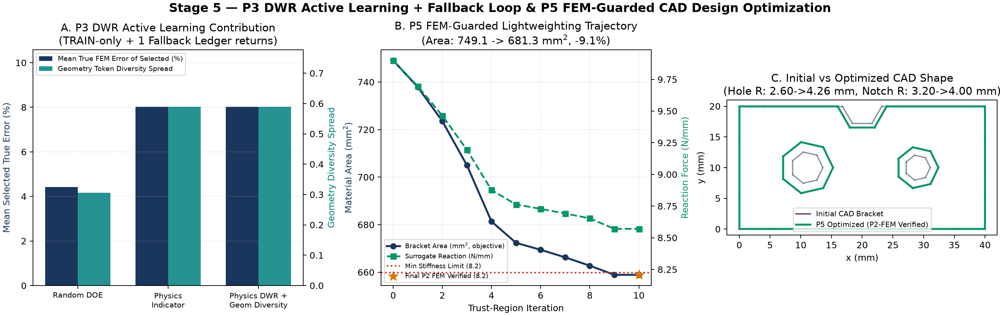

- **What is done:** Demonstrates two closed-loop workflows connecting neural surrogates back to authoritative FEM: (1) **P3 Active Learning** evaluates an 8-design `TRAIN`-only CAD candidate pool under a 3-solve FEM budget, comparing `random_doe`, `physics_indicator`, and `physics_dwr_diversity`, while logging Tier 2 escalations in a `TRAIN`-only `FallbackFeedbackLedger` (with explicit non-label-free disclosure for multi-fidelity loss); and (2) **P5 FEM-Guarded CAD Lightweighting** minimizes bracket material area by enlarging the mounting holes and top relief notch while enforcing a hard P2-FEM-verified axial stiffness floor (`>= 8.22 N/mm`, 80% of initial `10.28 N/mm`).
- **How to read the plot:**
  - **Panel A (P3 Active Learning):** For each selection strategy, the navy bar (left axis) shows the mean true FEM error of the 3 chosen designs (higher = better error discovery), and the teal bar (right axis) shows their geometric diversity spread (higher = broader shape coverage).
  - **Panel B (P5 Lightweighting Trajectory):** Tracks bracket area (navy solid, left axis — lower is lighter) and surrogate reaction force (green dashed, right axis) across trust-region iterations relative to the red dotted minimum stiffness limit (`8.22 N/mm`). The **orange star** marks the final **P2-FEM-verified** feasible optimum (`8.21 N/mm`, within `0.05 N/mm` constraint tolerance). Notice how the surrogate explored further down to `659 mm²`, but P2 FEM rejected those overly flexible candidates and certified the safe `681.3 mm²` optimum instead.
  - **Panel C (Shape Overlay):** Directly overlays the Initial CAD Bracket contour (grey) with the P5 Optimized P2-FEM-Verified contour (emerald green), visually showing the enlarged left/right mounting holes and deeper relief notch.
- **What it contributes:** P3 discovers **`1.81x` higher true error** (`8.02%` vs. `4.42%`) and **`1.93x` broader geometry coverage** (`0.589` vs. `0.306`) than random sampling; P5 delivers a **`-9.1%` P2-FEM-verified mass/area reduction** (`749.1 -> 681.3 mm²`, Hole `R: 2.60 -> 4.26 mm`, Notch `R: 3.20 -> 4.00 mm`) while guaranteeing **zero unverified surrogate designs are ever accepted**.

---

### Stage 6 — Extended nonlinear physics & production deployment gates

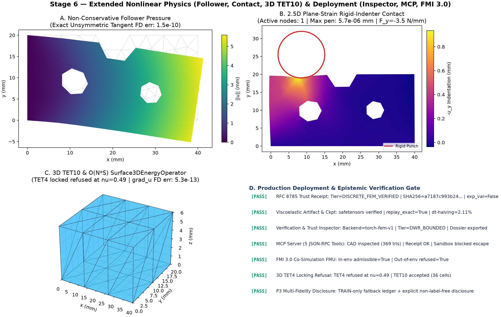

- **What is done:** Exercises FormaMech's extended nonlinear mechanics and production deployment interfaces: (1) **non-conservative follower pressure** (`0.06 MPa` remaining normal to the deformed top and notch edges, verifying the exact unsymmetric load-stiffness tangent against finite differences); (2) **2.5D plane-strain frictionless rigid-indenter contact** (pressing a rigid `R = 6.5 mm` circular punch into the elastomer shoulder using Armijo energy-backtracking Augmented Lagrangian Newton); (3) **3D volumetric `TET10` mechanics** (confirming linear `TET4` locking refusal at `nu = 0.49` and finite-difference accuracy of the `O(N*S)` `Surface3DEnergyOperator` 3D autograd gradients); and (4) **7 automated production & epistemic deployment checks** (RFC 8785 Trust Receipt, tamper-checked viscoelastic `safetensors` checkpoint, Verification & Trust Inspector Markdown dossier, sandboxed 5-tool MCP Server with path-escape refusal, and FMI 3.0 Co-Simulation FMU export + in-/out-of-envelope evaluation).
- **How to read the plot:**
  - **Panel A (Follower Pressure):** Deformed bracket under live normal pressure colored by displacement magnitude `||u||` (`max = 5.59 mm`) over the faint undeformed mesh; unsymmetric tangent FD error = **`1.47e-10`**.
  - **Panel B (2.5D Rigid-Indenter Contact):** Rigid red circular punch indenting the top-left shoulder (`-u_y` up to `0.95 mm`), converging in `2` Augmented Lagrangian iterations to **`5.74e-6 mm`** maximum penetration and **`F_y = -3.54 N/mm`** contact reaction (`admissible = True`).
  - **Panel C (3D `TET10` & Surface Operator):** 3D volumetric bracket block (`36` quadratic `TET10` elements); linear `TET4` is refused at `nu = 0.49` to prevent volumetric locking, and 3D `Surface3DEnergyOperator` displacement gradients match finite differences to **`5.35e-13`**.
  - **Panel D (Deployment Scoreboard):** Live pass/fail summary of all 7 production, provenance, security-sandbox, and epistemic verification gates (**7/7 PASS**).
- **What it contributes:** Proves the same codebase scales beyond static 2D displacement pulls into follower loads, large-deformation elastomer contact, locking-safe 3D mechanics, interactive trust dossiers, sandboxed LLM/agent tooling (MCP), and standard FMI 3.0 co-simulation digital twins.

## Train on your own CAD

Use a separate working folder containing your CAD file: outside the source
checkout, or under its ignored `.formamech-runs/` directory. Run the commands in
this section from that folder, with the installed virtual environment active.
Keep the source checkout clean and committed for numerical execution.

### 1. Import and inspect the profile

```text
formamech cad import profile.step --unit mm --mesh-size-mm 1 --output geometry
formamech cad inspect geometry
```

Use a supported `.step`, `.stp` or `.dxf` profile. Inspection lists boundary
identifiers and coordinates; use those identifiers to choose your clamps,
prescribed displacements and free edges. A [mesh policy](docs/campaigns/own-cad-meshing.md)
adds curvature and local feature sizing. Choose and inspect the mesh before
training.

### 2. Describe the physics and training budget

Create `physics.json` using the [CAD settings guide and boundary example](docs/campaigns/own-cad-workflow.md#define-material-boundaries-and-ranges).
You provide:

- **Material:** the constitutive model, parameters and their units/ranges.
- **Boundary conditions:** straight clamped/displaced edges, valid symmetry
  conditions, and every traction-free boundary, including holes.
- **Loads:** displacement parameters and the ranges the model should learn.
- **Training and comparison:** optimizer budget, seeds, sampling counts, FEM
  settings, quantities of interest and accuracy targets.

Boundary labels are explicit entries in JSON, selected from `cad inspect`;
there is currently no graphical edge selector. Every boundary group must be
assigned a condition.

### 3. Prepare inputs and review the plan

```text
formamech cad prepare --project geometry --settings physics.json --output inputs --execution-profile
formamech compile --spec inputs/problem.json --config inputs/config.json --output preview --plan-only
```

Preparation captures the installed execution environment and binds the inputs
to the geometry. `--plan-only` writes `preview/plan.json` without training or
FEM solves. Review it before starting the run.

### 4. Train and compare with FEM

```text
formamech compile --spec inputs/problem.json --config inputs/config.json --output run
```

The compiler checks the material and boundary lifting, trains the energy-form
operator, compares it with FEM, and exports a candidate when export succeeds.
Read `run/report.md` and `run/report.json` for the stage outcomes and per-case
comparisons. An execution finishing does not by itself establish accuracy;
exit code `3` indicates scientific refusal or incomplete evidence.

To continue an interrupted run, repeat this command with `--resume`, keeping
the same inputs, budget and execution profile. Changing the geometry, material
ranges or budget requires a new run. See the [full workflow](docs/campaigns/own-cad-workflow.md)
for format limits, settings and reference-convergence checks.

## Save and reuse your model

When export succeeds, `run/candidate-bundle/` contains the trained weights,
fixed mesh, material/problem specification, input envelope and supporting
records. Its manifest binds the files by their hashes.

```text
formamech bundle verify run/candidate-bundle
formamech inspect run/candidate-bundle
formamech predict run/candidate-bundle --request request.json --mode fast --no-confidence --output prediction.json
```

Create `request.json` with the names, units and values declared by **your
candidate's envelope**, following the [request format](docs/bundle.md#request).
The specimen demo requests belong to their own models.

Copy or archive the **entire bundle directory**, preserving its files and
relative paths. On the destination machine, install a compatible FormaMech
version with the `runtime` extra, verify the bundle, and predict again. Runtime
prediction needs neither the original CAD file nor the mesher/FEM stack. Keep
the CAD, inputs, checkpoints and comparison reports separately to reproduce
or resume training.

## Advanced workflows (P1–P6)

Beyond fixed-geometry hyperelastic compilation, FormaMech includes six
integrated physics-informed and FEM-guarded workflows exposed through both the
`formamech` CLI and Python APIs. All newly generated candidates, adapters,
optimization reports and trajectory rollouts carry explicit
`claim_level = "NOT_VERIFIED"` provenance until formally qualified.

| Track | Capability | CLI / Entry Point |
| --- | --- | --- |
| **P1** | Hierarchical `M0/M1/M2` CAD mesh convergence & multi-level energy training | `formamech cad import --hierarchy`, `formamech cad hierarchy`, `formamech cad convergence` |
| **P2** | Multi-CAD geometry tokens, OOD gate & budgeted (`<= 10%`) low-rank adapters (`safetensors`) | `formamech cad adapt` |
| **P3** | Certificate-driven `TRAIN`-only active FEM acquisition (`FEMCostLedger`, multi-fidelity disclosure) | `formamech active select`, `formamech.active.run_active_fem_campaign` |
| **P4** | CAD-level numerical trust reports (`CADTrustReport`) with live DWR adjoints in certified/exact serving | `formamech predict --mode certified --trust-report` |
| **P5** | FEM-guarded differentiable design optimization with periodic FEM FD gradient checks & final FEM verification | `formamech optimize` |
| **P6** | Stateful finite-strain generalized-Maxwell viscoelasticity, history-aware operator & guarded checkpoints | `formamech stateful rollout` |
| **Q1** | Continuous numerical model qualification, split-conformal calibration, CI regression diffs & deployment gates | `formamech qualify run\|verify\|diff`, `--require-qualified` |
| **W1** | Interactive 2D Engineering Workbench (CAD import, clickable boundary picker, material/plan forms, background train/qualify, trust inspector) | `formamech ui --workspace ...` |
| **J2** | Small-strain J2 elastoplasticity (linear & Voce hardening; 3D, plane strain, Schur-condensed plane stress; Ortiz–Steinmann operator + guarded FEM rollout) | `formamech stateful verify-tangent`, `formamech.stateful` |
| **PCAD** | Parametric 2D CAD families with `TopologyStabilityGuard`, `GeometryOODDetector`, `cad-parametric-v1` bundles & FEM-guarded lightweighting | `formamech cad parametric init\|sample\|train\|predict\|qualify` |
| **3D** | End-to-end 3D solid STEP import, `TET10` meshing (`TET4` locking guard), dual nonlinear FEM (`torch-fem-3d` & `scikit-fem-3d`) & $O(N\cdot S)$ `Surface3DEnergyOperator` | `formamech cad sample-3d\|import-3d\|inspect-3d`, `piginot.training.energy_engine_3d` |

## Specialized engineering workflows

Beyond fixed-geometry 2D hyperelastic compilation, FormaMech ships five
documented, end-to-end specialized workflows covering qualification, visual
onboarding, elastoplasticity, parametric CAD exploration, and 3D solid
mechanics:

| Specialized workflow | Guide | Key capability & verified highlight |
| --- | --- | --- |
| **Continuous model qualification & deployment gates** | [docs/qualification.md](docs/qualification.md) | Policy-driven 7-family verification (`reduce_families`), `DEV`-fitted split-conformal calibration, CI regression diffs (`qualify diff`), and fail-closed `--require-qualified` gates on `predict`, `export`, and `mcp`. |
| **Interactive 2D Engineering Workbench** | [docs/workbench.md](docs/workbench.md) | Guided 5-stage Streamlit + Plotly browser GUI (`formamech ui`) with clickable boundary assignment, live lifting validation, background compile/qualify jobs, and Trust Inspector writing 100% CLI-reproducible projects (plus `docker/Dockerfile.ui`). |
| **Small-strain J2 elastoplasticity** | [docs/plasticity.md](docs/plasticity.md) | Unified radial-return kernel (3D, plane strain, Schur-condensed plane stress; tangent FD errors `4.7e-11–1.6e-9`), P2 cyclic hysteresis matching analytical to `<= 2.2e-12`, Ortiz–Steinmann variational operator, and `GuardedStatefulStepper` fallback capturing permanent 45° shear bands. |
| **Parametric CAD & geometry-aware exploration** | [docs/parametric_cad.md](docs/parametric_cad.md) | Reusable `BoundaryEnergyOperator` + `GeometryOODDetector` across a parametric CAD family: **`1.72%`** mean displacement rel-$L^2$ across 12 unseen notched brackets (`HOLDOUT_VERIFIED`), **`100%`** OOD/genus-change refusal, and **`-25.29%`** P2-FEM-verified area reduction. |
| **End-to-end 3D CAD, nonlinear FEM & 3D PI-GINOT** | [docs/workflow_3d.md](docs/workflow_3d.md) | OpenCASCADE 3D STEP $\to$ `TET10` (`TET4` locking refused at $\nu \ge 0.45$), dual 3D FEM (`0.0066%` L-bracket parity at 45% arm bending; `< 1.8e-15 mm` 25%-stretch patch parity), and a `316,851`-param `Surface3DEnergyOperator` on a `9,498`-DOF 3D mounting lug (`5.20%` mean unseen u rel-$L^2$, `4.19%` peak $\sigma_{vM}$ error, **`165.4×`** speedup, `-46%` warm-start Newton iters, $N^* = 59$). |

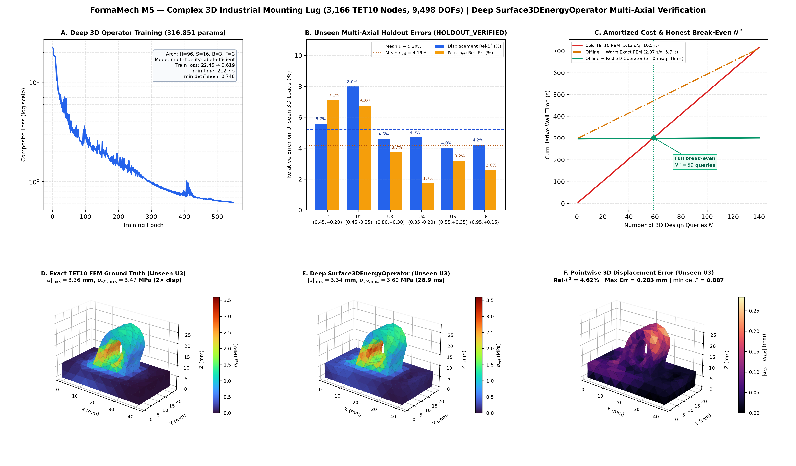

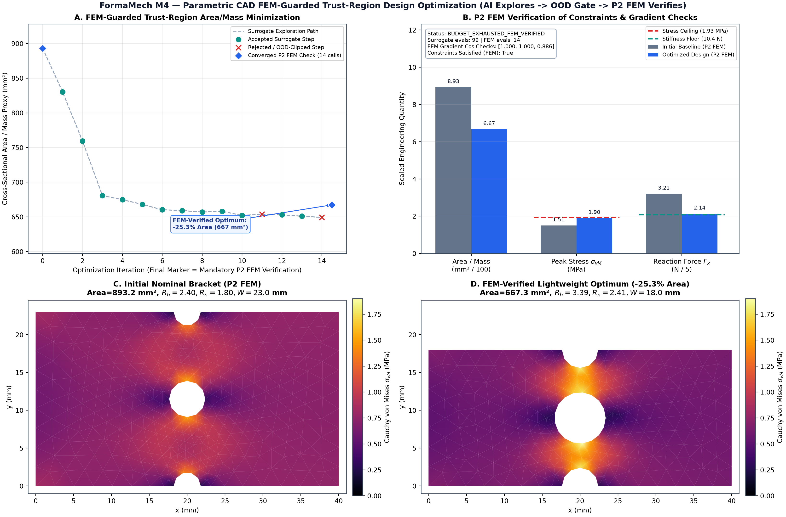

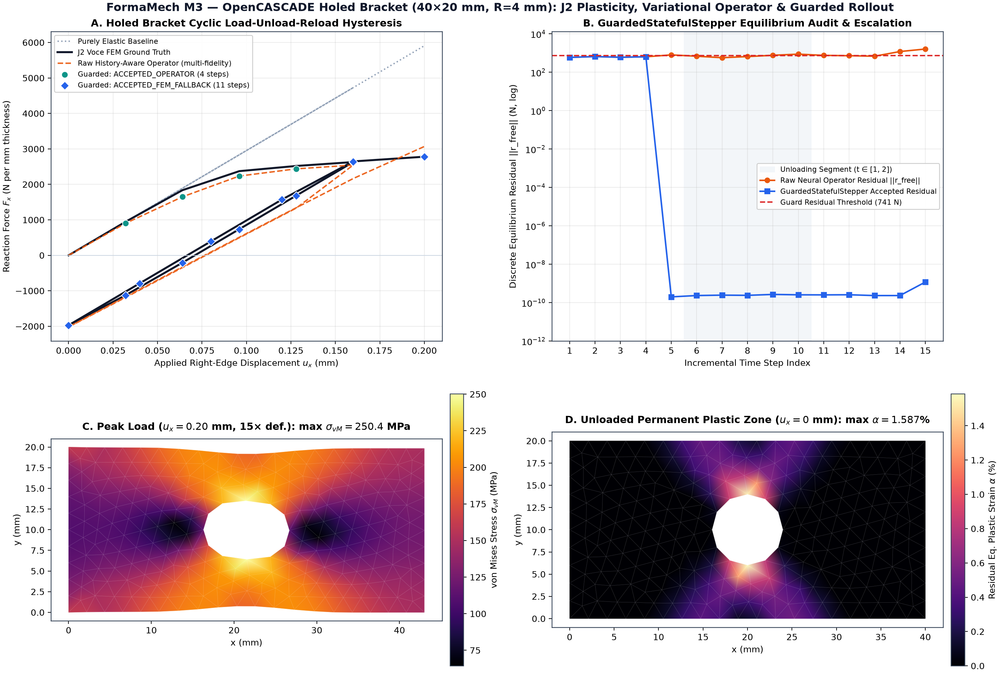

Try live certified DWR trust reporting, FEM-guarded design optimization on a
shipped bundle, and deterministic `TRAIN`-only active selection using the
supplied configs in [examples/advanced_workflows/](examples/advanced_workflows/README.md):

```text
formamech predict bundles/notched-v1-cp-freeze --request bundles/requests/notched-in-domain.json --mode certified --trust-report --output .formamech-runs/certified-trust.json
formamech optimize bundles/notched-v1-cp-freeze --problem examples/advanced_workflows/notched_design_problem.json --output .formamech-runs/opt-report.json
formamech active select --plan examples/advanced_workflows/active_plan.json --pool examples/advanced_workflows/active_train_pool.json --output .formamech-runs/selected-batch.json
```

To run the reproducible CPU-sized diagnostic pilot suite across all six tracks
(writes strictly to `.formamech-runs/pilots/`):

```text
python scripts/run_cpu_pilots.py
```

See the [advanced workflows guide](docs/advanced-workflows.md) for all flags,
artifact schemas, and claim boundaries.

## Material models

| Family | Available models |
| --- | --- |
| Isotropic hyperelasticity | Compressible Neo-Hookean, Mooney–Rivlin, Yeoh, Gent |
| In-plane fibre reinforcement | HGO, single-family HGO, GOH |
| Custom energy functions | Declared isotropic or fibre strain-energy formulas with units, symmetry and small-strain moduli |
| Stateful viscoelasticity (P6 / F1) | Finite-strain generalized-Maxwell incremental variational potential with closed-form algorithmic tangent and nonnegative discrete dissipation |
| Small-strain J2 elastoplasticity (M3 / F2) | Linear & Voce isotropic hardening in 3D, 2D plane strain, and Schur-condensed 2D plane stress with consistent algorithmic tangent, Ortiz–Steinmann variational potential, and guarded rollouts |

Training uses the declared strain-energy model; stresses come from displacement
gradients and the constitutive law. Custom materials must pass admission checks
before fitting. See [material definitions](docs/problem-spec.md#materials) and
the [runnable custom-material example](examples/custom_material/README.md).

## Scope and interpretation

FormaMech covers **2D planar STEP/DXF profiles** (finite-strain plane-stress
hyperelasticity, generalized-Maxwell viscoelasticity, small-strain J2
elastoplasticity in plane stress/plane strain, and parametric CAD families) as
well as **single-solid 3D STEP components** (quadratic `TET10` finite-strain
hyperelasticity with dead surface tractions, dual pure-MIT 3D FEM backends,
and $O(N \cdot S)$ surface-conditioned 3D neural operators). Rate-independent
finite-strain crystal/damage plasticity, 3D non-conservative follower loads,
and 3D multi-body contact remain outside the current interface.

New CAD/compiler candidates, low-rank geometry adapters, active-FEM
multi-fidelity runs (explicitly disclosed as `multi-fidelity-label-efficient`,
never `label-free`), design optimization reports and viscoelastic rollouts
retain **`NOT_VERIFIED`** until formally qualified. Assess each output against
its own FEM comparisons, `CADTrustReport` error components and mesh/reference
checks. The shipped specimen bundles have separate, recorded claim levels;
their calibration and FEM-backed serving modes do not transfer to a newly
trained geometry. Numerical verification compares with the declared FEM model
and does not establish experimental validation. Read the
[limitations](docs/limitations.md) when deciding whether results suit your use.

## How to cite

If FormaMech contributes to your research, cite the software and record the
version and commit you used. [CITATION.cff](CITATION.cff) supplies the metadata
for GitHub's **Cite this repository** button.

```bibtex
@misc{bahtiri_formamech,
  author  = {Bahtiri, Betim},
  title   = {{FormaMech}},
  year    = {2026},
  version = {0.2.0.dev0},
  url     = {https://github.com/BBahtiri/formamech}
}
```

Replace the version with the one used in your work. For a source checkout,
record the outputs of `formamech --version` and `git rev-parse HEAD` alongside
your configuration and results.

## Contributing

See [CONTRIBUTING.md](CONTRIBUTING.md) and the [Code of Conduct](CODE_OF_CONDUCT.md).
For a development environment and the common checks:

```text
python -m pip install -e ".[dev,geometry,cad,physics,fem,ml,verify,plot]"
python -m ruff check .
python -m ruff format --check .
python -m mypy --strict src/
python -m mkdocs build --strict -f mkdocs.yml
python -m pytest --cov=src/formamech --cov=src/piginot --cov-fail-under=90
```

## License and attribution

FormaMech is licensed under the [MIT License](LICENSE). Adapted components and
optional dependencies retain their own licences; see [upstream sources](docs/adr/upstream-sources.md).

FormaMech does not claim a faithful reproduction of GNOT or GINO, nor
of GINOT. The shipped DogBone and notched bundles use this project's energy-form
operator:

```text
architecture_id: pi-ginot-energy-parametric-film-v1
```

The Python package and command are now `formamech`. The `piginot` command
and imports remain compatibility aliases. Existing bundle schemas, architecture
identifiers and recorded limitation text retain their original names so stored
models and provenance records remain readable.
