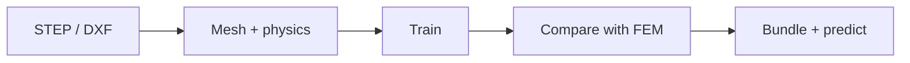

# PI-GINOT

**Train physics-informed neural surrogates for your own 2D CAD geometry.**

[](pyproject.toml) [](LICENSE) [](CHANGELOG.md)

[Get started](#installation) · [Own CAD](#train-on-your-own-cad) · [Materials](#material-models) · [Cite](#how-to-cite) · [Limitations](docs/limitations.md)

Import a planar STEP or DXF profile, define its material and boundary conditions,
and train a model over the loads and material ranges you choose. Compare its
predictions with finite element solutions, then save a bundle to reuse the
model for displacement and stress prediction within its input envelope.

The CAD workflow trains **one model per fixed geometry**. DogBone and notched-plate
models are included so you can try prediction before training your own model.



## Choose your workflow

| I want to… | Start here |
| --- | --- |
| Predict with an existing model | [Quick start](#quick-start-predict-with-an-existing-model) |
| Train for my own CAD profile | [CAD walkthrough](#train-on-your-own-cad) |
| Inspect a plan before running numerical work | [Prepare a complete example](docs/campaigns/s29-custom-material.md#prepare-and-inspect-a-plan) |
| Define a custom strain-energy formula | [Custom-material tutorial](docs/campaigns/s29-custom-material.md) |
| Refine a mesh around holes or other features | [Meshing and convergence guide](docs/campaigns/own-cad-meshing.md) |
| Resume training or move a model to another machine | [Compiler guide](docs/campaigns/s28-compiler-guide.md) · [Bundle reuse](#save-and-reuse-your-model) |

## Installation

Use **Python 3.11, 3.12 or 3.13** and Git. These instructions install the current
`0.2.0.dev0` development version from the repository, including its CAD/compiler
workflows. The checkout also supplies the example inputs and shipped bundles.

```text
git clone https://github.com/BBahtiri/verified-neural-operators.git
cd verified-neural-operators
python -m venv .venv
```

Activate the virtual environment:

```bash
# Linux / macOS
source .venv/bin/activate
```

```powershell
# Windows PowerShell
.\.venv\Scripts\Activate.ps1
```

Install CAD import, training and FEM comparison:

```text
python -m pip install -e ".[cad,verify]"
piginot --version
```

For prediction only, use `python -m pip install -e ".[runtime]"` instead.
For metadata-only planning, the base install `python -m pip install -e "."`
is sufficient. On Linux, the Gmsh CAD backend may also need the OS GLU library
(`libglu1-mesa` on Ubuntu/Debian); see the [CAD setup guide](docs/campaigns/own-cad-workflow.md#import-and-inspect).

## Quick start: predict with an existing model

From the repository root, verify a shipped bundle and predict a notched-plate
field using its supplied request:

```text
python -c "from pathlib import Path; Path('.piginot-runs/demo').mkdir(parents=True, exist_ok=True)"
piginot bundle verify bundles/notched-v1-cp-freeze
piginot inspect bundles/notched-v1-cp-freeze
piginot predict bundles/notched-v1-cp-freeze --request bundles/requests/notched-in-domain.json --mode fast --no-confidence --output .piginot-runs/demo/prediction.json
```

The JSON contains displacement and stress fields, mesh connectivity, quantities
of interest, units, the envelope verdict and the model's claim level. The
[DogBone demo](docs/campaigns/s29-fast-demo.md) provides a second model and shows
how an out-of-range request is refused. The [user guide](docs/user-guide.md)
explains the output fields and plotting.

### Use the same model from Python

```python
import json

from piginot.bundle import load_bundle, predict
from piginot.cli import parse_request

bundle = load_bundle("bundles/notched-v1-cp-freeze")
with open("bundles/requests/notched-in-domain.json", encoding="utf-8") as handle:
    inputs, queries = parse_request(json.load(handle))

result = predict(bundle, inputs, queries, confidence=False).document()
print(result["verdict"], result["claim_level"])
```

## Train on your own CAD

Use a separate working folder containing your CAD file: outside the source
checkout, or under its ignored `.piginot-runs/` directory. Run the commands in
this section from that folder, with the installed virtual environment active.
Keep the source checkout clean and committed for numerical execution.

### 1. Import and inspect the profile

```text
piginot cad import profile.step --unit mm --mesh-size-mm 1 --output geometry
piginot cad inspect geometry
```

Use a supported `.step`, `.stp` or `.dxf` profile. Inspection lists boundary
identifiers and coordinates; use those identifiers to choose your clamps,
prescribed displacements and free edges. A [mesh policy](docs/campaigns/own-cad-meshing.md)
adds curvature and local feature sizing. Choose and inspect the mesh before
training.

### 2. Describe the physics and training budget

Create `physics.json` using the [CAD settings guide and boundary example](docs/campaigns/own-cad-workflow.md#define-material-boundaries-and-ranges).
You provide:

- **Material:** the constitutive model, parameters and their units/ranges.
- **Boundary conditions:** straight clamped/displaced edges, valid symmetry
  conditions, and every traction-free boundary, including holes.
- **Loads:** displacement parameters and the ranges the model should learn.
- **Training and comparison:** optimizer budget, seeds, sampling counts, FEM
  settings, quantities of interest and accuracy targets.

Boundary labels are explicit entries in JSON, selected from `cad inspect`;
there is currently no graphical edge selector. Every boundary group must be
assigned a condition.

### 3. Prepare inputs and review the plan

```text
piginot cad prepare --project geometry --settings physics.json --output inputs --execution-profile
piginot compile --spec inputs/problem.json --config inputs/config.json --output preview --plan-only
```

Preparation captures the installed execution environment and binds the inputs
to the geometry. `--plan-only` writes `preview/plan.json` without training or
FEM solves. Review it before starting the run.

### 4. Train and compare with FEM

```text
piginot compile --spec inputs/problem.json --config inputs/config.json --output run
```

The compiler checks the material and boundary lifting, trains the energy-form
operator, compares it with FEM, and exports a candidate when export succeeds.
Read `run/report.md` and `run/report.json` for the stage outcomes and per-case
comparisons. An execution finishing does not by itself establish accuracy;
exit code `3` indicates scientific refusal or incomplete evidence.

To continue an interrupted run, repeat this command with `--resume`, keeping
the same inputs, budget and execution profile. Changing the geometry, material
ranges or budget requires a new run. See the [full workflow](docs/campaigns/own-cad-workflow.md)
for format limits, settings and reference-convergence checks.

## Save and reuse your model

When export succeeds, `run/candidate-bundle/` contains the trained weights,
fixed mesh, material/problem specification, input envelope and supporting
records. Its manifest binds the files by their hashes.

```text
piginot bundle verify run/candidate-bundle
piginot inspect run/candidate-bundle
piginot predict run/candidate-bundle --request request.json --mode fast --no-confidence --output prediction.json
```

Create `request.json` with the names, units and values declared by **your
candidate's envelope**, following the [request format](docs/bundle.md#request).
The specimen demo requests belong to their own models.

Copy or archive the **entire bundle directory**, preserving its files and
relative paths. On the destination machine, install a compatible PI-GINOT
version with the `runtime` extra, verify the bundle, and predict again. Runtime
prediction needs neither the original CAD file nor the mesher/FEM stack. Keep
the CAD, inputs, checkpoints and comparison reports separately to reproduce
or resume training.

## Material models

| Family | Available models |
| --- | --- |
| Isotropic hyperelasticity | Compressible Neo-Hookean, Mooney–Rivlin, Yeoh, Gent |
| In-plane fibre reinforcement | HGO, single-family HGO, GOH |
| Custom energy functions | Declared isotropic or fibre strain-energy formulas with units, symmetry and small-strain moduli |

Training uses the declared strain-energy model; stresses come from displacement
gradients and the constitutive law. Custom materials must pass admission checks
before fitting. See [material definitions](docs/problem-spec.md#materials) and
the [runnable custom-material example](examples/custom_material/README.md).

## Scope and interpretation

The current CAD workflow covers **fixed 2D planar profiles, finite-strain
plane-stress hyperelasticity and displacement-controlled loading**. Essential
boundaries must be straight; curved free boundaries and holes are supported.
Full 3D solids and applied force/traction loading are outside this CAD interface.

New CAD/compiler candidates retain **`NOT_VERIFIED`** and support uncalibrated
`fast` prediction. Assess each candidate against its own FEM comparisons and
mesh/reference checks. The shipped specimen bundles have separate, recorded
claim levels; their calibration and FEM-backed serving modes do not transfer
to a newly trained geometry. Numerical verification compares with the declared
FEM model and does not establish experimental validation. Read the
[limitations](docs/limitations.md) when deciding whether results suit your use.

## How to cite

If PI-GINOT contributes to your research, cite the software and record the
version and commit you used. [CITATION.cff](CITATION.cff) supplies the metadata
for GitHub's **Cite this repository** button.

```bibtex
@misc{bahtiri_piginot,
  author  = {Bahtiri, Betim},
  title   = {{PI-GINOT}},
  year    = {2026},
  version = {0.2.0.dev0},
  url     = {https://github.com/BBahtiri/verified-neural-operators}
}
```

Replace the version with the one used in your work. For a source checkout,
record the outputs of `piginot --version` and `git rev-parse HEAD` alongside
your configuration and results.

## Contributing

See [CONTRIBUTING.md](CONTRIBUTING.md) and the [Code of Conduct](CODE_OF_CONDUCT.md).
For a development environment and the common checks:

```text
python -m pip install -e ".[dev,geometry,cad,physics,fem,ml,verify]"
python -m ruff check .
python -m ruff format --check .
python -m mypy --strict src/
python -m mkdocs build --strict -f mkdocs.yml
python -m pytest --cov=src/piginot --cov-fail-under=90
```

## License and attribution

PI-GINOT is licensed under the [MIT License](LICENSE). Adapted components and
optional dependencies retain their own licences; see [upstream sources](docs/adr/upstream-sources.md).

The name PI-GINOT does not claim a faithful reproduction of GNOT or GINO, nor
of GINOT. The shipped DogBone and notched bundles use this project's energy-form
operator:

```text
architecture_id: pi-ginot-energy-parametric-film-v1
```
