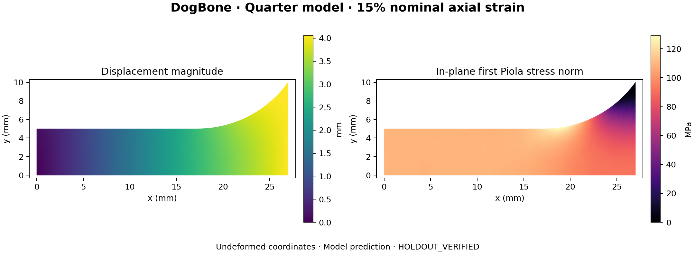
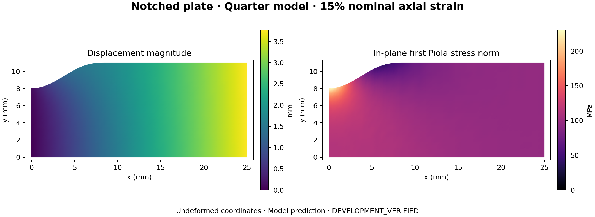
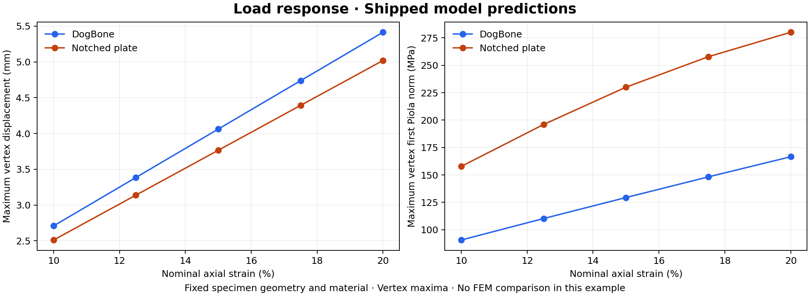

# Examples

Start with the plotting demo below, or choose a compiler/CAD workflow.
The historical reference examples later on this page cover training and
specimen campaigns. All examples run on CPU.

## Prediction plots

From the source checkout, generate figures with the shipped DogBone and
notched-plate models:

```text
python -m pip install -e ".[runtime,plot]"
python -m examples.prediction_plots --output .formamech-runs/prediction-plots
```

Use a new output directory for each run. The demo makes five in-envelope
predictions per model at fixed geometry and material, and saves the 15% strain
vertex fields plus a load-response summary. It performs no training or FEM
solves. The model bundles retain their existing claim levels.

### DogBone: displacement and stress



### Notched plate: displacement and stress



Each field figure shows displacement magnitude in mm and the Frobenius norm
of the in-plane first-Piola stress tensor in MPa. The axes are undeformed
coordinates in mm, and the saved mesh connectivity preserves the boundary.

### Model load response



The curve connects model predictions at 10%, 12.5%, 15%, 17.5% and 20% nominal
axial strain. It shows maxima over mesh vertices. It is a model-response
illustration, with no FEM reference comparison or accuracy estimate.

### Plot a saved CAD prediction

The same plotter works with the JSON from a new CAD candidate. For a saved
prediction, from the repository root:

```text
python -m examples.prediction_plots.fields --prediction prediction.json --output .formamech-runs/my-part.png --title "My CAD part"
```

The plotter needs only the `plot` extra and accepts PNG, SVG or PDF output.
It refuses invalid fields or units and preserves the input JSON. New CAD
candidates remain `NOT_VERIFIED`. The
[example guide](https://github.com/BBahtiri/formamech/blob/main/examples/prediction_plots/README.md)
lists every output and explains reuse. Keep raw model outputs locally in
`.formamech-runs/` or outside the checkout.

## Current compiler and CAD workflows

- [Custom material](campaigns/s29-custom-material.md): prepare the complete
  `examples/custom_material/` inputs, inspect a plan, run and resume training,
  read FEM comparisons and reuse a candidate bundle.
- [Own 2D CAD](campaigns/own-cad-workflow.md): import STEP/DXF, inspect boundary
  identifiers, declare material/load ranges and displacement conditions, then
  train one model for that fixed profile.
- [Mesh controls](campaigns/own-cad-meshing.md): set local sizes and curve
  approximation limits and compare FEM refinements on a fixed polygon.
- [Bundle prediction](campaigns/s29-fast-demo.md): inspect the shipped bundles,
  make a runtime prediction and inspect an out-of-envelope refusal.
- [Advanced workflows (P1–P6)](advanced-workflows.md): ready-to-run configs under
  `examples/advanced_workflows/` for `cad hierarchy`/`convergence`/`adapt`,
  `active select`, `predict --mode certified --trust-report`, `optimize`, and
  `stateful rollout`.

Keep new numerical outputs and trained candidates locally in `.formamech-runs/`
or outside the checkout. The historical examples below describe the shipped
specimen workflows.

## Example 1 — fixed-mesh strain sweep

One notched-plate geometry (width 23 mm, notch radius 5 mm, notch depth 3 mm)
on a coarse structured mesh of 225 vertices, under a nominal axial strain from
10% to 20%. The example compiles a single-point geometry family and its
envelope, solves the P2 FEM reference at six training and three held-out
strains, trains a small energy-form operator with the framework trainer,
verifies it against FEM on the held-out strains, calibrates the confidence
indicator, builds a bundle, serves a held-out strain through `predict` and
checks that a strain outside the envelope is refused.

```bash
OMP_NUM_THREADS=1 python -m examples.fixed_mesh_sweep.sweep --output example1-output
```

It takes about three minutes on one thread; it fails if it takes more than ten.
CI runs it on every push. Its bundle claims `NOT_VERIFIED`, because the S14
protocol is not part of the example.

## Example 2 — DogBone campaign

The first production campaign (`campaigns/dogbone_v1/`): a quarter dog-bone
specimen with four geometry inputs (total length, grip width, gauge width,
fillet radius) and the nominal axial strain. It runs every step of the evidence
chain: the S9 preregistration with a sealed HOLDOUT commitment, 344 S10 FEM
cases, the S13c energy-form operator selected on TRAIN evidence only, the
signed S14 protocol with DEVELOPMENT and one HOLDOUT evaluation, and the S15
bundle with claim level `HOLDOUT_VERIFIED`. The campaign plug-in exposes the
steps on the command line:

```bash
formamech verify --campaign dogbone_v1 -- development --run-root OUT ...
formamech bundle verify BUNDLE
formamech predict BUNDLE --request request.json --output prediction.json
```

The plans record every step: [S13c](https://github.com/BBahtiri/formamech/blob/7f7127820e706a71543941e2d917ca84fc298aa9/docs/campaigns/s13c-enhanced-model-plan.md),
[S14](https://github.com/BBahtiri/formamech/blob/7f7127820e706a71543941e2d917ca84fc298aa9/docs/campaigns/s14-verification-plan.md), [S15](https://github.com/BBahtiri/formamech/blob/7f7127820e706a71543941e2d917ca84fc298aa9/docs/campaigns/s15-bundle-plan.md)
and [S16](https://github.com/BBahtiri/formamech/blob/7f7127820e706a71543941e2d917ca84fc298aa9/docs/campaigns/s16-mutation-plan.md).

## Example 3 — centre-notched plate campaign

The second family (`campaigns/notched_v1/`, [ADR 0025](https://github.com/BBahtiri/formamech/blob/7f7127820e706a71543941e2d917ca84fc298aa9/docs/adr/0025-s17-examples-and-second-family.md)):
a 50 mm plate of width `W` with a C2-blended double-edge notch of depth `d` and
root radius `r` at mid-length, inputs width 16–30 mm, notch radius 2–8 mm,
notch depth 1–5 mm and nominal axial strain 10–20%. It runs the same evidence
chain through the same framework calls as the DogBone; the only framework
additions are the `BlendedNotchMap` morph map and absolute selection
guardrails. Its artifacts and its campaign-scoped gates are in
`artifacts/campaigns/notched-v1/`, and the [S17 plan](https://github.com/BBahtiri/formamech/blob/7f7127820e706a71543941e2d917ca84fc298aa9/docs/campaigns/s17-plan.md)
lists the module of every step.

```bash
python -m campaigns.notched_v1.s9 ceremony --created-utc T --private-backup PATH
python -m campaigns.notched_v1.s10 produce --run-root RUN
python -m campaigns.notched_v1.s13 train --run-root TRAINING
python -m campaigns.notched_v1.s14 development --s10-run-root RUN --training-run-root TRAINING --run-root S14
```

The notched plate misses the S14 tolerances on DEVELOPMENT (all-cases p90:
stress field 5.24%, peak 5.34%, accepted by the decision owner in
[ADR 0030](https://github.com/BBahtiri/formamech/blob/7f7127820e706a71543941e2d917ca84fc298aa9/docs/adr/0030-notched-development-budget-acceptance.md)) and on HOLDOUT
(6.01%, 6.40% against 5%), so its bundle serves `DEVELOPMENT_VERIFIED`
through the same API as the DogBone ([results](https://github.com/BBahtiri/formamech/blob/7f7127820e706a71543941e2d917ca84fc298aa9/docs/campaigns/s17-plan.md#4-results)).
The [benchmarks](benchmarks.md) page gives the measured numbers of both
campaigns and how they are reproduced.
