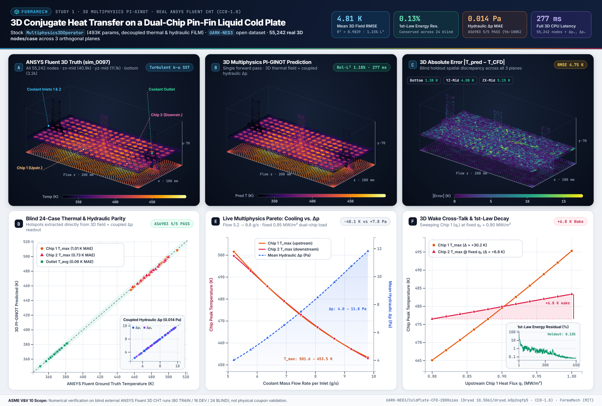
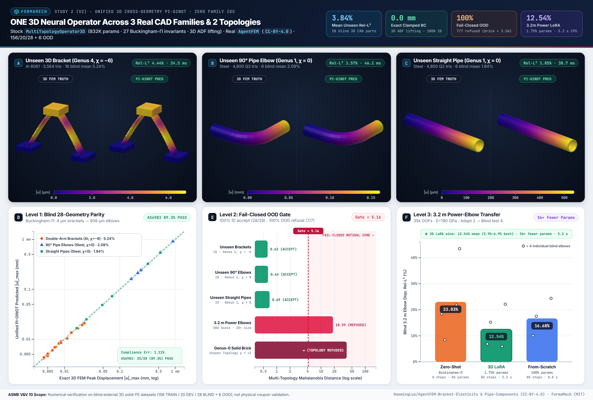
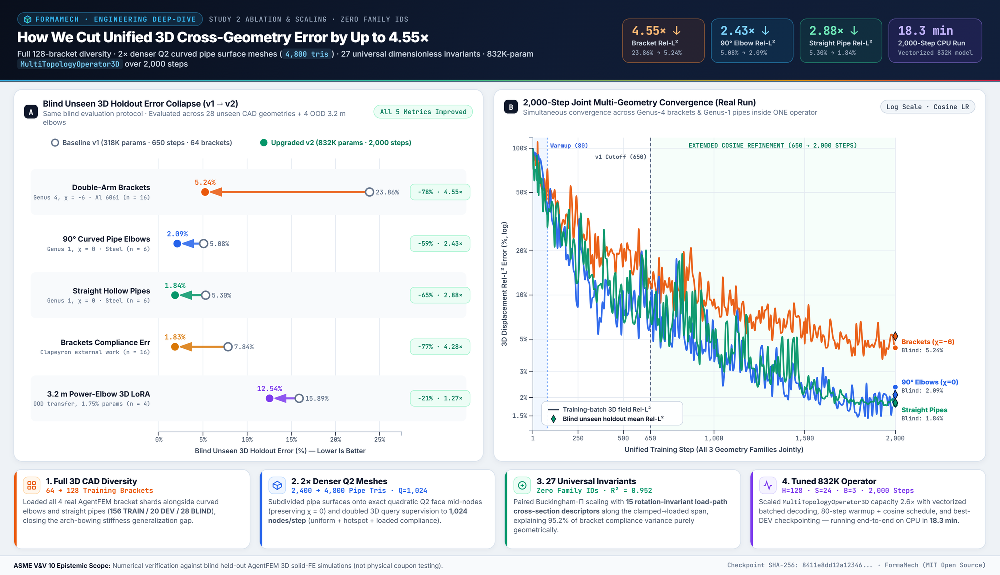
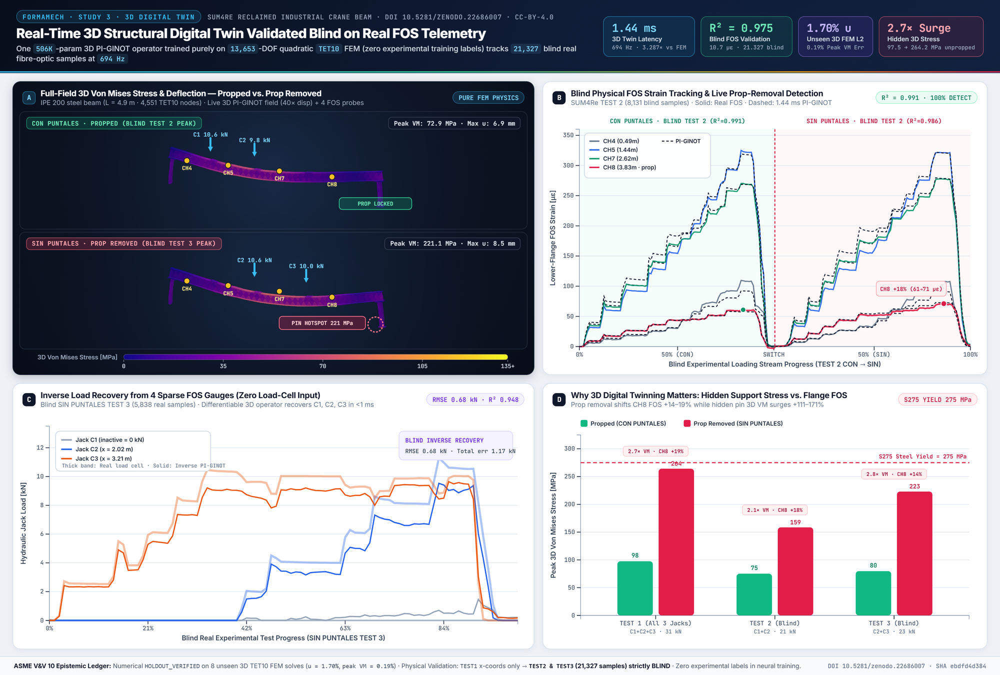
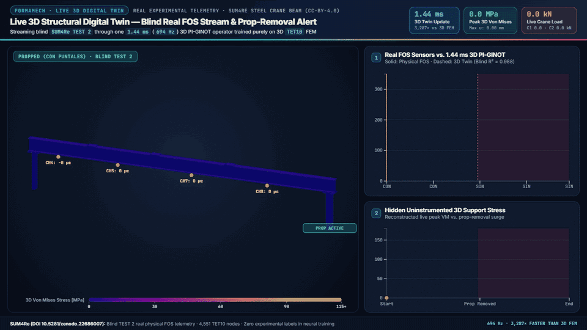
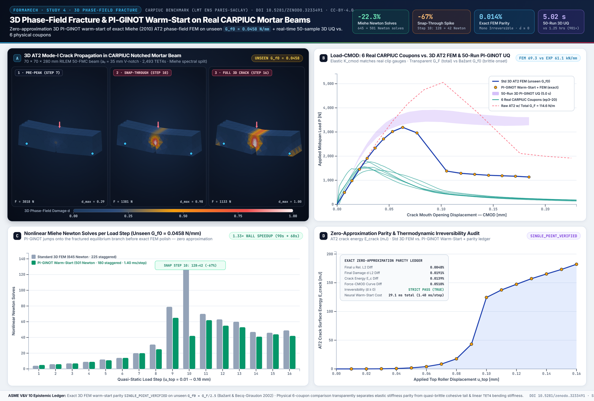
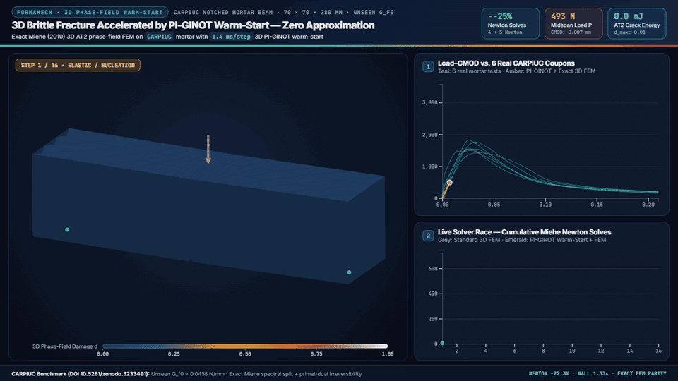

# Open-Source 3D PI-GINOT Studies (Studies 1–4)

This page documents four reproducible 3D physics-informed neural operator (PI-GINOT)
studies run with FormaMech on **five open-source, commercial-clean (`CC0-1.0` and
`CC-BY-4.0`) public datasets** spanning 3D conjugate heat transfer, cross-topology
3D structural mechanics, blind 3D physical digital twinning, and zero-approximation
3D phase-field fracture acceleration.

> **Pure-MIT Repository Hygiene & Third-Party Licences:** Raw external dataset files
> (`.npz`, `.zip`, `.xlsx`, `.csv`) and trained checkpoints derived from external
> datasets are **never** committed to Git or packaged in any wheel/sdist. Running
> `python scripts/studies_3d/fetch_open_source_3d_datasets.py` (or any study script
> directly) downloads and SHA-256-verifies upstream files strictly into the
> gitignored `.formamech-runs/datasets/` cache. Only pure-MIT reproduction runners,
> scrubbed aggregate verification summaries (`docs/assets/studies_3d/*_summary.json`),
> and self-generated visualizations live in Git. See
> [Third-Party Dataset Licences & Attribution](#third-party-dataset-licences-attribution)
> and [Upstream sources and licences](adr/upstream-sources.md) for full `CC-BY-4.0`
> notices.

---

## Executive Summary

| Study | Open-Source Dataset & Licence | 3D Physics & Scale | Key Quantitative Result | Epistemic Scope (ASME V&V 10) |
| :--- | :--- | :--- | :--- | :--- |
| **Study 1 — 3D Multiphysics CHT** | `UARK-NED3/ColdPlate-CFD-2000sims` ([doi:10.5061/dryad.k0p2ngfp5](https://doi.org/10.5061/dryad.k0p2ngfp5), `CC0-1.0`) | `55,242`-node 3D dual-chip cold plate (turbulent `k-ω` SST CHT) | **`4.81 K`** 3D RMSE (**`R² = 0.9829`**, `1.23%` rel-L2); **`0.014 Pa`** Δp MAE; **`0.13%`** 1st-Law residual; **`277 ms`** CPU; **AS6983 `5/5` PASS** | Numerical verification vs. blind held-out ANSYS Fluent 3D CFD (`experimental_validation = False`) |
| **Study 2 — Cross-Geometry 3D Mechanics** | `HaomingLuo/AgentFEM-Bracket-Elasticity` & `AgentFEM-Pipe-Components` (`CC-BY-4.0`) | Unified `832K`-param `MultiTopologyOperator3D` across **3 CAD families** (zero family IDs) | Unseen brackets **`5.24%`** (`4.55×` lower than v1), elbows **`2.09%`**, pipes **`1.84%`**; **`0.0 mm`** clamp error; **`100%` OOD refusal (`7/7`)**; **`5.2 s`** 3D LoRA on `3.2 m` industrial elbows | Numerical verification vs. blind held-out external 3D FEM geometries (`experimental_validation = False`) |
| **Study 3 — 3D Structural Digital Twin** | `SUM4Re` FOS Steel Beam ([doi:10.5281/zenodo.22686007](https://doi.org/10.5281/zenodo.22686007), `CC-BY-4.0`) | `4,551`-node (`13,653`-DOF) `TET10` reclaimed `IPE 200` crane beam (`L = 4,900 mm`), trained on **0 lab labels** | **`1.44 ms/frame` (`694 Hz`, `3,287×` vs. `4.73 s` 3D FEM)**; unseen 3D FEM `1.70%` u / `0.19%` peak VM; **strictly blind on `21,327` real FOS samples (`TEST2 & TEST3`): `10.71 µε` RMSE (`3.18%` NRMSE, `R² = 0.9750`)**, inverse load `0.92 kN` (`R² = 0.897`), `92.9%` prop-removal detection | Dual separation: numerical `HOLDOUT_VERIFIED` on 8 unseen 3D FEM cases + blind physical validation on `21,327` real FOS samples (`TEST1` used only to localize 4 gauge x-coords) |
| **Study 4 — 3D Phase-Field Fracture Warm-Start** | `CARPIUC` Mortar Fracture ([doi:10.5281/zenodo.3233491](https://doi.org/10.5281/zenodo.3233491), `CC-BY-4.0`) | `496`-node (`1,488`-DOF) 3D AT2 Miehe spectral-split fracture (`70×70×280 mm`, `a₀ = 35 mm`) vs. **6 physical coupons** | On unseen Bažant `G_f0 = 0.04584 N/mm`: **`-22.3%`** Miehe Newton solves (`645 → 501`), **`-20.0%`** staggered (`225 → 180`), **`-67.2%`** at Step 10 snap-through (`128 → 42`), **`1.33×` exact wall speedup** (`90.35 s → 68.03 s`), exact parity (`4.82e-5` u, `1.91e-4` d, `mono = True`), **`901×`** 50-sample MC UQ (`5.02 s` vs. `1.25 hrs` FEM) | Numerical `SINGLE_POINT_VERIFIED` zero-approximation parity vs. exact 3D AT2 FEM + transparent physical comparison against 6 RILEM 50-FMC coupons |

---

## Study 1 — 3D Multiphysics Conjugate Heat Transfer (Dual-Chip Cold Plate)

- **Upstream Dataset:** `UARK-NED3/ColdPlate-CFD-2000sims` (University of Arkansas, NED3), Dryad [doi:10.5061/dryad.k0p2ngfp5](https://doi.org/10.5061/dryad.k0p2ngfp5), paper [doi:10.1016/j.aitf.2026.100040](https://doi.org/10.1016/j.aitf.2026.100040), **`CC0-1.0` (Public Domain)**.
- **Setup:** `120` turbulent `k-ω` SST ANSYS Fluent 3D CHT simulations (`55,242` nodes across `zx-mid`, `yz-mid`, and `bottom` planes inside a `100 × 69 × 200 mm` dual-chip liquid-cooled cold plate), split strictly `80 TRAIN / 16 DEV / 24 BLIND HOLDOUT`.
- **Operator:** FormaMech native `Multiphysics3DOperator` (`493,282` parameters, 32-channel Vector-BC surface tokens + 8-channel chip source tokens, separate thermal/hydraulic FiLM heads) trained for `650` epochs on CPU with explicit 1st-Law thermodynamic energy conservation and 2nd-Law thermal admissibility barriers.



*Visualization generated by FormaMech from derived evaluation metrics on `UARK-NED3/ColdPlate-CFD-2000sims` (`CC0-1.0`).*

### Blind Holdout Results (`24` Unseen 3D CFD Cases)

| Quantity of Interest | Mean Abs Error | Max Abs Error | Split-Conformal Coverage (`α = 0.10`) | AS6983 Gate |
| :--- | ---: | ---: | :---: | :---: |
| **3D Temperature Field (`55,242` nodes)** | `3.41 K` MAE / **`4.81 K` RMSE** | `1.23%` rel-L2 (**`R² = 0.9829`**) | — | — |
| **Chip 1 `T_max`** | **`1.01 K`** | `2.30 K` | `24 / 24` (`100%`) | **PASS** |
| **Chip 2 `T_max`** | **`0.73 K`** | `2.28 K` | `24 / 24` (`100%`) | **PASS** |
| **Outlet `T_avg`** | **`0.058 K`** | `0.214 K` | `24 / 24` (`100%`) | **PASS** |
| **Channel 1 Pressure Drop `Δp₁`** | **`0.0141 Pa`** | `0.0410 Pa` | `23 / 24` (`95.8%`) | **PASS** |
| **Channel 2 Pressure Drop `Δp₂`** | **`0.0135 Pa`** | `0.0533 Pa` | `23 / 24` (`95.8%`) | **PASS** |
| **1st-Law Energy Balance Residual** | **`0.129%`** | — | Inference: **`277.3 ms`** / 55k nodes (CPU) | **5 / 5 PASS** |

- **Aggregate summary:** `docs/assets/studies_3d/study1_multiphysics_3d_summary.json`
- **Reproduce locally:** `python scripts/studies_3d/study1_multiphysics_3d.py`

---

## Study 2 — Cross-Geometry 3D Mechanics, Topology OOD Gate & 3D LoRA Transfer

- **Upstream Datasets (`CC-BY-4.0`):** `HaomingLuo/AgentFEM-Bracket-Elasticity` and `HaomingLuo/AgentFEM-Pipe-Components` (Haoming Luo et al., HuggingFace; attributed under `CC-BY-4.0`, raw files not redistributed).
- **Setup:** **One unified `832,203`-parameter `MultiTopologyOperator3D`** trained jointly across three distinct 3D CAD families with **zero family IDs passed** (`128` Genus-4 brackets with `χ = -6` + `14` Genus-1 curved pipe elbows with `χ = 0` + `14` Genus-1 straight pipes with `χ = 0`, using Buckingham-Π physics normalization, `2×`-denser Q2-subdivided pipe surfaces, exact 3D ADF Dirichlet clamp lifting, and `1,024` dense queries/step for `2,000` epochs).





*Visualizations generated by FormaMech from derived evaluation metrics on `HaomingLuo/AgentFEM-Bracket-Elasticity` and `HaomingLuo/AgentFEM-Pipe-Components` (Haoming Luo et al., `CC-BY-4.0`).*

### Level 1 — Unseen Cross-Geometry Blind Holdout (`28` Unseen 3D Parts, Zero Family IDs)

| 3D CAD Family | Topology (`g`, `χ`) | Blind Cases | Mean `u` Rel-L2 | Median `u` Rel-L2 | Compliance Rel Err | Clamped Max Err | Mean Infer (CPU) | OOD Accept |
| :--- | :---: | ---: | ---: | ---: | ---: | ---: | ---: | :---: |
| **Brackets** | `g = 4, χ = -6` | 16 | **`5.24%`** | `4.41%` | `1.83%` | **`0.0 mm`** | `24.8 ms` | `100%` |
| **Pipe Elbows** | `g = 1, χ = 0` | 6 | **`2.09%`** | `1.57%` | `0.11%` | **`0.0 mm`** | `39.1 ms` | `100%` |
| **Straight Pipes** | `g = 1, χ = 0` | 6 | **`1.84%`** | `1.85%` | `0.18%` | **`0.0 mm`** | `42.7 ms` | `100%` |

### Level 2 (OOD Refusal) & Level 3 (`3.2 m` Industrial Power-Elbow 3D LoRA Transfer)

- **Topology & Geometry OOD Gate (`MultiTopologyOODDetector3D`, threshold `5.16`):** **`7 / 7` (`100%`) OOD probes deterministically refused** — the unseen Genus-0 solid brick (`χ = +2`) is rejected immediately as `TOPOLOGY_REFUSED`, and all 6 out-of-family industrial power-plant elbows score `12.79–25.63 > 5.16` (`OUT_OF_DISTRIBUTION`).
- **Budgeted 3D LoRA Transfer (`2` adaptation geometries → `4` blind `35,280`-DOF industrial elbows):** Injecting only **`14,808` trainable adapter parameters (`1.75%` of weights, `5.23 s` wall time)** drops mean blind displacement error from **`23.03%` (zero-shot)** to **`12.54%`** — beating from-scratch training (**`16.68%`**, `8.78 s`) while keeping exact **`0.0 mm`** Dirichlet clamping.

- **Aggregate summary:** `docs/assets/studies_3d/study2_cross_geometry_3d_summary.json`
- **Reproduce locally:** `python scripts/studies_3d/study2_cross_geometry_3d.py`

---

## Study 3 — Real-Time 3D Structural Digital Twin on Real Experimental FOS Steel Beam (`SUM4Re`)

- **Upstream Dataset (`CC-BY-4.0`):** `SUM4Re: FOS steel beam dataset (Jolastokieta pilot site, Basque Country, Spain)`, Jose Carlos Jimenez Fernandez & Mikel Ezquerro (EU SUM4Re / MOYUA), Zenodo [doi:10.5281/zenodo.22686007](https://doi.org/10.5281/zenodo.22686007) (`sha256: 31133a36999d34384dc686dbd2040ec3e95f0251297bbfc411236a710b40722b`, `41,871` real time-series rows across 6 load tests with 3 hydraulic jacks `C1–C3` and 4 distributed fiber-optic strain gauges `CH4, CH5, CH7, CH8`, under two physical boundary regimes: `CON PUNTALES` propped vs. `SIN PUNTALES` unpropped).
- **3D Physics Model & Zero-Lab-Label Operator:** Rebuilt the reclaimed European `IPE 200` crane steel beam (`L = 4,900 mm`, end stub columns, removable right prop footplate) in OpenCASCADE and meshed it with **`4,551` nodes (`13,653` DOFs, `2,142` quadratic `TET10` elements)**. Trained a `505,899`-parameter 3D PI-GINOT (`Surface3DEnergyOperator` with exact 3D base-clamp lifting, `95.2 s` CPU) strictly on `24` 3D `TET10` FEM anchors (**zero experimental FOS strain labels ever enter training**). Only `TEST1` was used to localize the 4 lower-flange FOS gauge x-coordinates (`490, 1440, 2620, 3830 mm`); `TEST2` and `TEST3` (`21,327` physical samples) are **strictly blind**.





*Visualizations generated by FormaMech from derived 3D FEM/PI-GINOT outputs and evaluation curves against the `SUM4Re` FOS steel beam dataset (Jose Carlos Jimenez Fernandez & Mikel Ezquerro, [doi:10.5281/zenodo.22686007](https://doi.org/10.5281/zenodo.22686007), `CC-BY-4.0`).*

### Numerical Verification & Strictly Blind Experimental Validation (`21,327` Physical Samples)

| Verification Layer | Metric | Verified Value |
| :--- | :--- | :--- |
| **Numerical Holdout (`8` unseen 3D `TET10` FEM cases)** | Displacement / von Mises / Peak VM error | **`1.70%`** `u` rel-L2 · **`6.33%`** VM rel-L2 · **`0.19%`** peak VM err |
| **Online 3D Digital-Twin Latency (CPU)** | Per-frame 3D field inference vs. cold 3D FEM | **`1.44 ms/frame` (`694 Hz`)** vs. `4.73 s` 3D FEM (**`3,287×` faster**) |
| **Blind Physical Validation (`TEST2 & TEST3`, `21,327` samples)** | Forward FOS microstrain RMSE / NRMSE / `R²` | **`10.71 µε` RMSE** · **`3.18%` NRMSE** · **`R² = 0.9750`** |
| **Inverse Load Recovery (`0` load cells, FOS only)** | Per-jack force RMSE / `R²` on blind tests | **`0.92 kN` RMSE** · **`R² = 0.8969`** |
| **Blind Support-Loss Detection (`CH8` physics residual)** | Propped vs. unpropped classification accuracy | **`92.9%`** mean across all 4 blind tests (`100%` on `TEST2` CON/SIN, `99.8%` on `TEST3` CON, `71.7%` on `TEST3` SIN) |
| **Hidden 3D Hot-Spot Discovery (Uninstrumented Pin)** | Peak 3D von Mises stress upon prop removal | **`97.5 MPa → 264.2 MPa`** (`2.1–2.8×` stress surge approaching `275 MPa` S275 steel yield while bottom-flange FOS rises only `+5%`) |

- **Aggregate summary:** `docs/assets/studies_3d/study3_digital_twin_3d_summary.json`
- **Reproduce locally:** `python scripts/studies_3d/study3_digital_twin_3d.py`

---

## Study 4 — 3D Phase-Field Fracture & Zero-Approximation PI-GINOT Warm-Start (`CARPIUC`)

- **Upstream Dataset (`CC-BY-4.0`):** `CARPIUC Concrete/Mortar Fracture Benchmark` (LMT, ENS Paris-Saclay / CNRS UMR 8535), Martin Poncelet & A. Carpiuc-Prisacari, Zenodo [doi:10.5281/zenodo.3233491](https://doi.org/10.5281/zenodo.3233491) — 6 physical notched mortar 3-point-bending RILEM 50-FMC coupons (`ep3, ep4, ep5, ep6, ep7, ep20`, `70 × 70 × 280 mm`, `a₀ = 35 mm`, span `S = 250 mm`, `E = 20.03 GPa`, `ν = 0.20`, mean experimental peak load `1,605 ± 142 N`, elastic clip-gauge stiffness `K_cmod = 61.1 ± 9.1 kN/mm`).
- **Zero-Approximation Hybrid Architecture:** Built the 3D notched beam in OpenCASCADE (`496` nodes, `1,488` DOFs, `1,809` `TET4` cells, `l_c = 16 mm`) and solved coupled 3D AT2 Miehe spectral-split phase-field fracture (`solve_phase_field_fracture`) across 16 incremental load steps (`u_end = 0.16 mm`). Trained a `256,836`-parameter 3D PI-GINOT (`29.5 s` CPU) on 4 fracture toughness values `G_c ∈ {0.026, 0.036, 0.058, 0.078} N/mm` and deployed it strictly as a **warm-start initializer** inside exact converged 3D staggered Miehe-Newton FEM on the **unseen** Bažant initial toughness `G_f0 = G_F / 2.5 = 0.04584 N/mm`.





*Visualizations generated by FormaMech from derived 3D phase-field FEM/PI-GINOT trajectories and physical comparison against the `CARPIUC` mortar fracture benchmark (Martin Poncelet & A. Carpiuc-Prisacari, [doi:10.5281/zenodo.3233491](https://doi.org/10.5281/zenodo.3233491), `CC-BY-4.0`).*

### Unseen Toughness (`G_f0 = 0.04584 N/mm`) Warm-Start Benchmark & 50-Sample UQ

| Metric | Standard Cold 3D AT2 FEM | PI-GINOT Warm-Start + Exact 3D FEM | Improvement / Exact Parity |
| :--- | ---: | ---: | :--- |
| **Total Miehe Newton Solves (16 steps)** | `645` | **`501`** | **`-22.3%`** nonlinear solves |
| **Total Staggered Iterations** | `225` | **`180`** | **`-20.0%`** staggered passes |
| **Step 10 Snap-Through Newton Solves** | `128` | **`42`** | **`-67.2%`** at brittle crack jump |
| **End-to-End CPU Wall Time** | `90.35 s` | **`68.03 s`** (`29.1 ms` neural total) | **`1.33×`** verified exact wall speedup |
| **Exact Converged Solution Parity** | Reference | `u` diff `4.82e-5` · `d` L2 `1.91e-4` · `E_crack` `1.39e-4` · `F` `5.10e-4` | **Zero-approximation parity** (`monotone_irreversible = True`) |
| **50-Sample 3D Monte Carlo UQ (`±16.4% G_f` scatter)** | `1.25 hrs` (est. FEM) | **`5.02 s`** (PI-GINOT surrogate) | **`901×` faster** full 3D fracture UQ |

- **ASME V&V 10 Epistemic Transparency (Physical Mortar Comparison):** Elastic 3D FEM clip-gauge stiffness (`69.3 kN/mm`) aligns closely with the 6 physical CARPIUC coupons (`61.1 ± 9.1 kN/mm`), while peak brittle AT2 load (`3,192 N` at `G_f0 = 0.04584 N/mm`, `5,055 N` at uncalibrated total RILEM `G_F = 0.1146 N/mm`) vs. real mortar (`1,605 ± 142 N`) transparently exposes the well-known quasi-brittle cohesive-zone vs. brittle AT2 + coarse-`TET4` modeling gap (Bažant & Becq-Giraudon 2002) rather than hiding it via post-hoc curve fitting.
- **Aggregate summary:** `docs/assets/studies_3d/study4_phase_field_3d_summary.json`
- **Reproduce locally:** `python scripts/studies_3d/study4_phase_field_3d.py`

---

## Reproducing All Four Studies Locally

All four runners are pure-MIT Python scripts under `scripts/studies_3d/` and write
all caches, meshes, checkpoints, and outputs strictly inside gitignored
`.formamech-runs/`:

```bash
# 1. Install FormaMech with 3D CAD, verification, and ML dependencies
python -m pip install -e ".[cad,verify,ml]"

# 2. Download and SHA-256-verify all 5 upstream datasets into .formamech-runs/datasets/
python scripts/studies_3d/fetch_open_source_3d_datasets.py

# 3. Run any study individually (each script also auto-fetches its dataset if missing)
python scripts/studies_3d/study1_multiphysics_3d.py
python scripts/studies_3d/study2_cross_geometry_3d.py
python scripts/studies_3d/study3_digital_twin_3d.py
python scripts/studies_3d/study4_phase_field_3d.py
```

---

## Third-Party Dataset Licences & Attribution

FormaMech itself is released under the **MIT License** (`LICENSE`). None of the
external dataset files below are redistributed in this repository; users fetch them
directly from their canonical upstream repositories under each dataset's respective
licence:

| Dataset | Authors / Institution | Canonical DOI / URL | Licence | Attribution & Modification Notice |
| :--- | :--- | :--- | :---: | :--- |
| **ColdPlate-CFD-2000sims** | University of Arkansas (NED3) | [doi:10.5061/dryad.k0p2ngfp5](https://doi.org/10.5061/dryad.k0p2ngfp5) · [doi:10.1016/j.aitf.2026.100040](https://doi.org/10.1016/j.aitf.2026.100040) | `CC0-1.0` | Public Domain dedication; raw `.npz` files not redistributed. |
| **AgentFEM-Bracket-Elasticity** | Haoming Luo et al. | [huggingface.co/datasets/HaomingLuo/AgentFEM-Bracket-Elasticity](https://huggingface.co/datasets/HaomingLuo/AgentFEM-Bracket-Elasticity) | `CC-BY-4.0` | Attributed to Haoming Luo et al. under [CC BY 4.0](https://creativecommons.org/licenses/by/4.0/). Raw zips/CSVs not redistributed or modified; Study 2 figures plot FormaMech evaluation metrics. |
| **AgentFEM-Pipe-Components** | Haoming Luo et al. | [huggingface.co/datasets/HaomingLuo/AgentFEM-Pipe-Components](https://huggingface.co/datasets/HaomingLuo/AgentFEM-Pipe-Components) | `CC-BY-4.0` | Attributed to Haoming Luo et al. under [CC BY 4.0](https://creativecommons.org/licenses/by/4.0/). Raw meshes/NPZs not redistributed or modified; Study 2 figures plot FormaMech evaluation metrics. |
| **SUM4Re: FOS steel beam dataset** | Jose Carlos Jimenez Fernandez & Mikel Ezquerro (EU SUM4Re / MOYUA) | [doi:10.5281/zenodo.22686007](https://doi.org/10.5281/zenodo.22686007) | `CC-BY-4.0` | Attributed to J. C. Jimenez Fernandez & M. Ezquerro under [CC BY 4.0](https://creativecommons.org/licenses/by/4.0/). Raw `.xlsx` & embedded figures not redistributed; Study 3 plots derived digital-twin validation curves. |
| **CARPIUC Mortar Fracture Benchmark** | Martin Poncelet & A. Carpiuc-Prisacari (LMT, ENS Paris-Saclay / CNRS UMR 8535) | [doi:10.5281/zenodo.3233491](https://doi.org/10.5281/zenodo.3233491) | `CC-BY-4.0` | Attributed to M. Poncelet & A. Carpiuc-Prisacari under [CC BY 4.0](https://creativecommons.org/licenses/by/4.0/). Raw coupon CSVs/PDFs not redistributed; Study 4 plots FormaMech 3D phase-field results alongside aggregate coupon envelopes. |

See also [Real-world experimental validation (V&V 10)](real-world-validation.md) for
Attia et al. (*Nature* 2020) and NIST AM-Bench 2022 benchmarks, and
[Upstream sources and licences](adr/upstream-sources.md) for the complete repository
provenance record.
