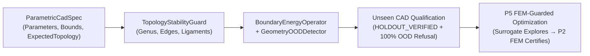
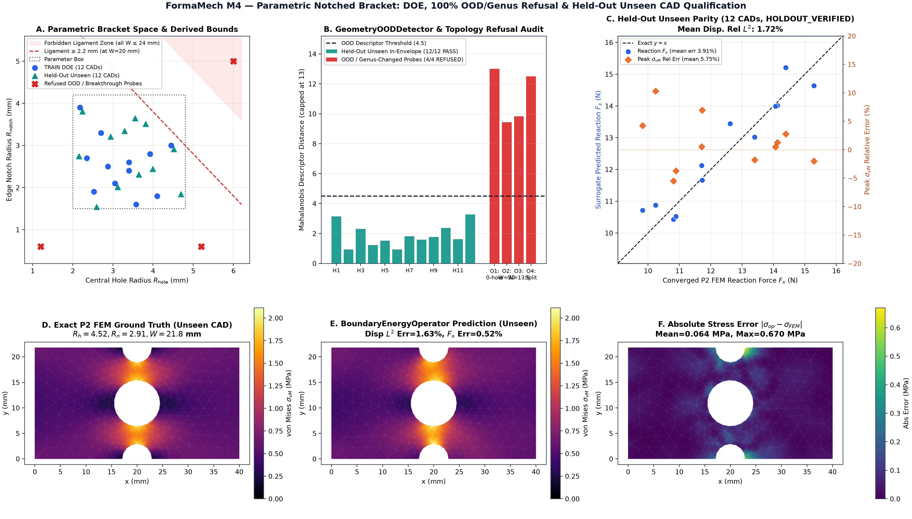
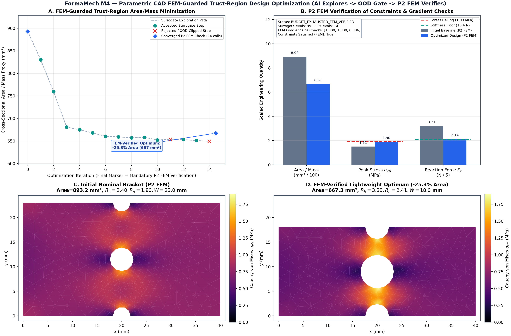

# Parametric CAD & Geometry-Aware Design Exploration (M4 / Feature 3)

FormaMech supports reusable geometry-aware neural operators across parametric
2D CAD families with fail-closed topology verification, geometry-level OOD
detection, held-out unseen CAD qualification, and FEM-guarded trust-region
design optimization.

Instead of training one model per fixed CAD shape, you declare a bounded
parametric CAD family once, train a single `BoundaryEnergyOperator` across a
Halton QMC Design of Experiments (DOE), and evaluate or optimize unseen CAD
variants in milliseconds with automatic topology/OOD refusal and authoritative
P2 FEM verification.

> **Epistemic scope (ASME V&V 10):** Newly trained parametric bundles start at
> `claim_level = "NOT_VERIFIED"` and promote up to `HOLDOUT_VERIFIED` only
> after passing unseen in-envelope geometry qualification and 100% OOD/genus
> refusal checks (`qualify_parametric_bundle`). Multi-fidelity FEM anchors are
> explicitly disclosed (`multi-fidelity-label-efficient`).



## 1. Core architecture

1. **Parametric CAD Contract (`formamech.parametric-cad-v1`)**
   - `ParametricCadSpec` binds design parameter bounds (`DesignParameter`), safe
     algebraic `GeometricBound` expressions (e.g. minimum ligament thickness
     `plate_width / 2 - hole_radius - notch_radius >= 2.2 mm`),
     `ExpectedTopology` (Euler `component_count`, `hole_count`, exact semantic
     boundary group names and curve kinds), boundary roles, and meshing policy.
   - Ships with OpenCASCADE templates (`gmsh-occ-template-v1`):
     `notched-mounting-bracket` and `holed-plate`, plus pluggable external CAD
     generators via the `formamech.cad.generators` entry-point group.
2. **Topology Stability Guard (`TopologyStabilityGuard`)**
   - Every generated CAD variant is checked for parameter-box membership,
     derived geometric bounds, Euler genus invariance (`component_count` and
     `hole_count`), semantic boundary group invariance, closed-manifold boundary
     tokenization, and minimum triangle angle. Any violation fails closed with
     `ParametricTopologyError`.
3. **Geometry-Aware Surrogate & OOD Envelope (`cad-parametric-v1`)**
   - Trains `BoundaryEnergyOperator` across a Halton QMC DOE of valid CAD
     variants via exact hyperelastic Deep Ritz potential energy
     (`plane_stress_potential_energy`) with optional disclosed FEM anchors.
   - Fits `GeometryOODDetector` strictly on `TRAIN` geometric descriptors and
     pooled latent tokens and persists tamper-checked `safetensors` + JSON
     bundles (`formamech.parametric-bundle-v1`).
4. **Held-Out Qualification & FEM-Guarded Optimization**
   - `qualify_parametric_bundle` evaluates unseen in-envelope CAD geometries
     against converged P2 `ScikitFemBackend` FEM and checks 100% OOD/genus-change
     refusal before promoting claims up to `HOLDOUT_VERIFIED`.
   - `ParametricBundleDesignBridge` plugs any parametric bundle directly into P5
     `run_fem_guarded_design_optimization` so every returned optimal CAD design
     carries an independent converged P2 FEM verification.

## 2. Step-by-step CLI workflow

```text
# 1. Initialize a parametric notched mounting bracket project
formamech cad parametric init --template notched-mounting-bracket --output .formamech-runs/param-project

# 2. Sample and topology-verify a 16-geometry DOE before training
formamech cad parametric sample .formamech-runs/param-project --count 16 --output .formamech-runs/doe-samples

# 3. Train a reusable geometry-aware surrogate + OOD detector bundle
formamech cad parametric train .formamech-runs/param-project --count 12 --epochs 60 --output .formamech-runs/param-bundle

# 4. Predict & OOD-gate an unseen CAD variant
formamech predict .formamech-runs/param-bundle --cad-params variant.json --mode certified --output .formamech-runs/pred.json

# 5. Qualify across held-out unseen geometries & OOD probes
formamech cad parametric qualify .formamech-runs/param-bundle --count 10 --output .formamech-runs/qualification.json

# 6. Run FEM-guarded design optimization (AI explores -> OOD gate decides -> P2 FEM verifies)
formamech optimize .formamech-runs/param-bundle --problem design_problem.json --output .formamech-runs/opt-report.json
```

### Python API example

```python
from formamech.cad import (
    ParametricPhysicsConfig,
    ParametricTrainingConfig,
    default_notched_bracket_spec,
    predict_parametric_cad,
    qualify_parametric_bundle,
    sample_parametric_cad_doe,
    save_parametric_bundle,
    train_parametric_cad_surrogate,
)

spec = default_notched_bracket_spec(mesh_size_mm=2.5)
doe = sample_parametric_cad_doe(spec, count=12, seed_offset=1)
bundle = train_parametric_cad_surrogate(
    spec,
    ParametricPhysicsConfig(),
    doe.instances,
    config=ParametricTrainingConfig(epochs=80, use_fem_supervision=True),
)
save_parametric_bundle(bundle, ".formamech-runs/param-bundle")

# Predict on an unseen in-envelope CAD geometry
report = predict_parametric_cad(
    bundle,
    {"hole_radius": 3.1, "notch_radius": 2.2, "plate_width": 20.5},
    mode="certified",
)
print(report.ood_accepted, report.displacement_rel_l2_error)
```

## 3. Verified benchmarks & plot walkthroughs

### Unseen CAD qualification & OOD/genus refusal (Notched Mounting Bracket)



- **How to read the plot:**
  - **Panel A (Parametric DOE & Bounds):** Shows Halton QMC training designs and unseen held-out designs inside the safe algebraic ligament region (`plate_width / 2 - hole_radius - notch_radius >= 2.2 mm`).
  - **Panel B (Geometry OOD & Topology Gate):** All `12 / 12` unseen in-envelope CAD variants pass cleanly; all `4 / 4` adversarial OOD/genus probes (`0-hole` topology change, `W=32`, `W=13.5`, and hole–notch breakthrough) are refused with **100% refusal rate**.
  - **Panel C (Unseen QoI Parity):** Across all 12 unseen geometries vs. converged P2 FEM, the single geometry-aware operator achieves **`1.72%` mean displacement rel-$L^2$ error**, **`3.91%` mean reaction force error**, **`5.75%` mean peak von Mises error**, and `100%` admissibility ($\min\det\mathbf{F}_{2D} = 0.9414$).
  - **Panel D (Field Comparison):** Direct side-by-side P2 FEM vs. `BoundaryEnergyOperator` Cauchy von Mises stress field on an unseen notched bracket.

### FEM-guarded trust-region CAD lightweighting



- **How to read the plot:** Starting from `(hole_radius=2.40, notch_radius=1.80, plate_width=23.00) mm` (`893.20 mm²`), `ParametricBundleDesignBridge` explores `99` surrogate evaluations with periodic P2 FEM gradient cosine checks (`[1.000, 1.000, 0.886]`) and certifies a **`-25.29%` P2-FEM-verified area reduction** to **`667.28 mm²`** (`(3.392, 2.408, 18.000) mm`) using only `14` P2 FEM solves while satisfying every engineering constraint:

| Metric | Initial Baseline (P2 FEM) | FEM-Verified Optimum (P2 FEM) | Constraint / Audit |
| :--- | :---: | :---: | :---: |
| **Cross-sectional Area (Mass Proxy)** | `893.20 mm²` | **`667.28 mm²` (`-25.29%`)** | Minimized objective |
| **Peak Cauchy von Mises Stress** | `1.506 MPa` | **`1.903 MPa`** | $\le 1.928\text{ MPa}$ (**SATISFIED**) |
| **Axial Reaction Force (Stiffness)** | `16.05 N` | **`10.69 N`** | $\ge 10.43\text{ N}$ (**SATISFIED**) |
| **Ligament Thickness** | `7.30 mm` | **`3.20 mm`** | $\ge 2.20\text{ mm}$ (**SATISFIED**) |
