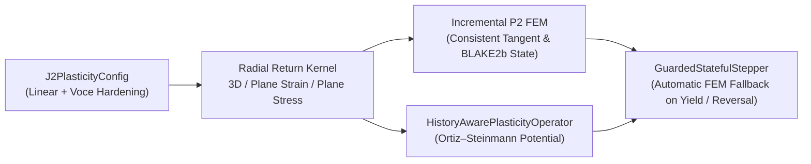
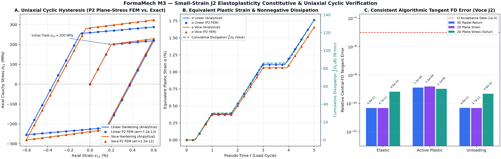
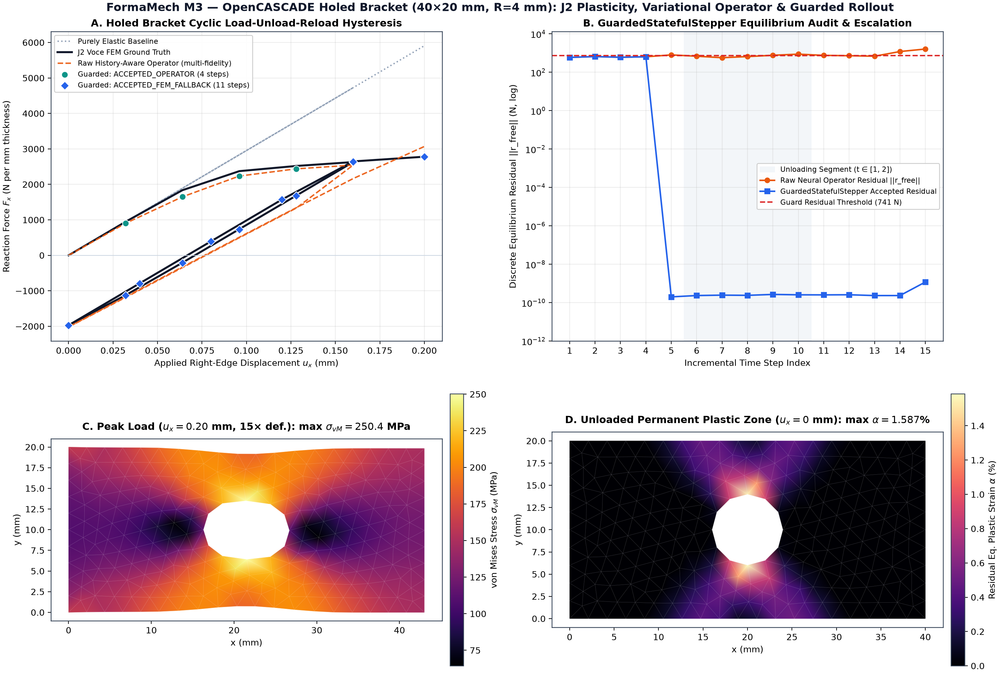
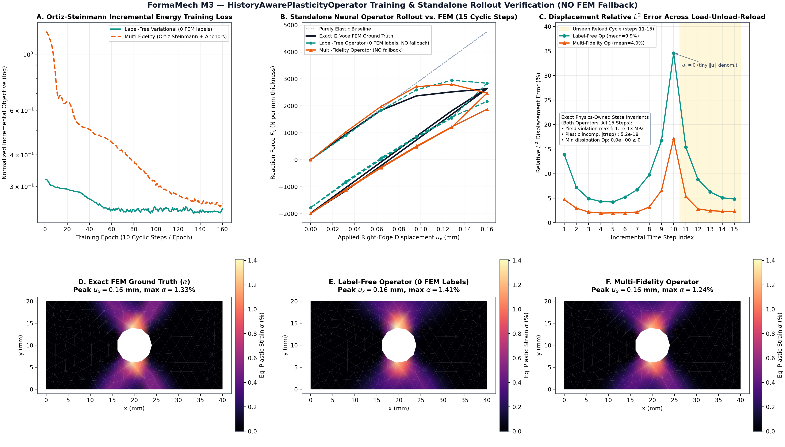

# Small-Strain J2 Elastoplasticity (M3 / Feature 2)

FormaMech extends its stateful mechanics stack (`formamech.stateful`) with
**small-strain J2 elastoplasticity with linear and Voce saturation isotropic
hardening**, supporting **3D**, **2D plane strain**, and **Schur-condensed 2D
plane stress** through one unified radial-return constitutive kernel,
incremental P2 FEM stepper, Ortiz–Steinmann variational neural operator, and
fail-closed `GuardedStatefulStepper`.

> **Epistemic scope (ASME V&V 10):** Newly trained plasticity operators default
> to `claim_level = "NOT_VERIFIED"`. Training explicitly distinguishes pure
> physics-informed variational energy (`variational-energy-label-free`) from
> FEM-anchored multi-fidelity runs (`multi-fidelity-label-efficient`). All
> accuracy metrics establish numerical verification against converged P2 FEM,
> not experimental coupon validation.



## 1. Constitutive formulation & six thermodynamic guards

`J2IsotropicPlasticity` implements the `ConstitutiveModel` protocol with
quadrature-point internal variables:

- `plastic_strain` ($\boldsymbol{\varepsilon}^p \in \mathbb{R}^{3\times 3}$,
  symmetric and deviatoric: $\text{tr}(\boldsymbol{\varepsilon}^p) = 0$)
- `eq_plastic_strain` ($\bar{\varepsilon}^p \ge 0$, accumulated equivalent
  plastic strain)

Hardening law:

$$\sigma_y(\bar{\varepsilon}^p) = \sigma_{y0} + H\bar{\varepsilon}^p + \Delta\sigma_\infty\bigl(1 - e^{-\delta \bar{\varepsilon}^p}\bigr)$$

Every material-point update enforces six explicit admissibility guards:

1. `yield_admissible`: $f = q_{n+1} - \sigma_y(\bar{\varepsilon}^p_{n+1}) \le \text{tol}$
2. `plastic_multiplier_nonnegative`: $\Delta\gamma \ge 0$
3. `plastic_incompressibility`: $|\text{tr}(\boldsymbol{\varepsilon}^p_{n+1})| \le 10^{-10}$
4. `nonnegative_dissipation`: $D_p = \boldsymbol{\sigma}_{n+1} : \Delta\boldsymbol{\varepsilon}^p - \Delta\psi_p \ge 0$
5. `det_f_positive`: $\det(\mathbf{F}) > 0$
6. `finite_response`: all stress, tangent, and energy entries finite.

For 2D plane stress ($\sigma_{33} = 0$), `plane_stress_update()` enforces exact
out-of-plane stress closure via scalar Newton iteration and computes the exact
Schur-condensed 2D consistent algorithmic tangent (with implicit-function-theorem
autograd compatibility for neural operator training).

## 2. Quick start: CLI & Python API

### Verify consistent algorithmic tangents from the CLI

```text
formamech stateful verify-tangent --material j2_material.json --mode plane-stress
formamech stateful verify-tangent --material j2_material.json --mode plane-strain
formamech stateful verify-tangent --material j2_material.json --mode 3d
```

### Run incremental P2 FEM, train an operator, and serve with `GuardedStatefulStepper`

```python
import torch

from formamech.stateful import (
    GuardedStatefulStepper,
    HistoryAwarePlasticityOperator,
    J2IsotropicPlasticity,
    J2PlasticityConfig,
    PlasticityOperatorConfig,
    PlasticityTrainingConfig,
    solve_incremental_fem_trajectory,
    train_plasticity_operator_variational,
)

# 1. Define aluminum-like J2 Voce elastoplasticity
cfg = J2PlasticityConfig(
    youngs_modulus_mpa=70_000.0,
    poisson_ratio=0.33,
    yield_stress_mpa=200.0,
    linear_hardening_mpa=500.0,
    voce_saturation_mpa=60.0,
    voce_rate=25.0,
)
model = J2IsotropicPlasticity(cfg)

# 2. Solve cyclic P2 plane-stress FEM trajectory (loads in mm)
fem_traj = solve_incremental_fem_trajectory(
    mesh=mesh,
    model=model,
    dirichlet_bc=bc_spec,
    load_steps=load_steps,
    kinematics_mode="plane_stress",
)

# 3. Train HistoryAwarePlasticityOperator via Ortiz-Steinmann incremental potential
#    (label-free with reference_displacements=None, or disclosed multi-fidelity when provided)
op = HistoryAwarePlasticityOperator(PlasticityOperatorConfig(hidden_dim=64))
summary = train_plasticity_operator_variational(
    operator=op,
    mesh=mesh,
    model=model,
    dirichlet_bc=bc_spec,
    train_load_steps=load_steps,
    kinematics_mode="plane_stress",
    config=PlasticityTrainingConfig(epochs=200, learning_rate=2.0e-3),
)
print(summary.training_mode, summary.claim_level)
```

## 3. Verified benchmarks & plot walkthroughs

### Benchmark A — Uniaxial cyclic hysteresis & algorithmic tangent verification



- **How to read the plot:**
  - **Panel A** compares 40-step P2 plane-stress FEM axial stress–strain loops against closed-form analytical solutions for both linear and Voce isotropic hardening (`7.17e-13` and `2.21e-12` max relative stress error; zero substepping, max `5–6` Newton iterations per step).
  - **Panel B** verifies monotonic equivalent plastic strain $\bar{\varepsilon}^p$ accumulation (`max err <= 6.66e-15`) and strictly nonnegative incremental plastic dissipation $D_p \ge 0$ across tension, unloading, compression, and reloading.
  - **Panel C** shows central finite-difference tangent verification errors across elastic, active plastic flow, and elastic unloading states in 3D, 2D plane strain, and Schur-condensed 2D plane stress:

| Constitutive Mode (Voce J2) | Elastic FD Err | Active Plastic FD Err | Unloading FD Err |
| :--- | :---: | :---: | :---: |
| **3D Radial Return** | `4.76e-11` | `1.28e-09` | `4.77e-11` |
| **2D Plane Strain** | `4.73e-11` | `1.56e-09` | `4.72e-11` |
| **2D Plane Stress (Schur-Condensed)** | `6.64e-10` | `1.06e-09` | `4.80e-10` |

### Benchmark B — OpenCASCADE holed bracket cyclic rollout & guarded FEM fallback



- **How to read the plot:**
  - **Panel A (Cyclic Hysteresis):** On a 40 × 20 mm OpenCASCADE bracket with central hole ($R = 4\text{ mm}$, `260` nodes, `450` triangles), J2 Voce plasticity caps peak reaction at `2,779.7 N` vs. the elastic baseline (`5,907.7 N`), develops locked-in compressive residual force (`-1,970.4 N`) at full unloading ($u_x = 0$), and tracks an unseen reload overshoot ($0.16 \to 0.20\text{ mm}$).
  - **Panel B (Guarded Routing):** `GuardedStatefulStepper` accepts the neural operator on low-residual loading steps (`4` steps) and automatically escalates peak yielding, unloading, and unseen reload overshoot (`11` steps) to exact P2 FEM, collapsing discrete equilibrium residuals to `~2e-10 N`.
  - **Panels C–D (Stress & Permanent Plastic Bands):** Peak deformed Cauchy von Mises stress reaches `250.4 MPa` around the hole crown, leaving classic 45° permanent plastic shear bands ($\max \bar{\varepsilon}^p = 1.587\%$) after full unloading.

### Benchmark C — Standalone operator verification (0-FEM-label vs. multi-fidelity, no fallback)



- **How to read the plot:** Evaluates the standalone `HistoryAwarePlasticityOperator` over all 15 cyclic steps **without any FEM fallback**, contrasting purely label-free Ortiz–Steinmann variational training (`0` FEM labels) against explicitly disclosed `multi-fidelity-label-efficient` training across loss decay, cyclic reaction loops, per-step displacement rel-$L^2$ error, and predicted 2D equivalent plastic strain shear bands.
