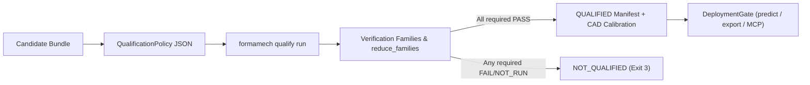

# Continuous Model Qualification and Deployment Gates

FormaMech separates **model training** from **numerical model qualification**.
Newly compiled CAD candidates default to `claim_level = "NOT_VERIFIED"` and do
not inherit verification evidence from shipped specimen bundles. The
qualification pipeline (`formamech qualify`) turns FormaMech's verification
components into a repeatable, fail-closed engineering lifecycle.

> **Epistemic scope (ASME V&V 10):** Qualification establishes *numerical
> verification against a declared discrete FEM reference within the approved
> parameter envelope*. It does not constitute experimental validation, physical
> specimen certification, or regulatory approval.

## 1. Qualification lifecycle



Every qualification run evaluates seven auditable families and reduces them
fail-closed through `piginot.verification.reducer.reduce_families`:

1. **`integrity`**: Verifies bundle manifest SHA-256 and file digests.
2. **`partition_hygiene`**: Enforces non-empty evaluation partitions and zero
   canonical-fingerprint overlap across `TRAIN`, `DEV`, and `HOLDOUT`.
3. **`admissibility`**: Runs Tier 0 zero-FEM checks (`det F > floor`, finite
   fields, exact Dirichlet compliance) across all evaluated cases.
4. **`fem_accuracy_dev`**: Compares displacement rel-$L_2$, recovered first-Piola
   stress rel-$L_2$, and declared QoIs against authoritative converged FEM solves.
5. **`calibration`**: Fits a bundle-bound split-conformal + functional-band
   `CadCalibrationRecord` strictly on `DEV` cases (and checks empirical
   coverage on `HOLDOUT` when configured).
6. **`dwr_trust`**: Verifies live goal-oriented DWR adjoint effectivities against
   true FEM QoI errors on `DEV`.
7. **`holdout_verification`**: Required when `target_claim_level` is
   `HOLDOUT_VERIFIED`; re-evaluates field and QoI accuracy tolerances on unseen
   `HOLDOUT` cases.

## 2. Running qualification from the CLI

Run qualification with a built-in preset (`dev` or `holdout`) or a custom
`formamech.qualification-policy-v1` JSON file:

```text
formamech qualify run bundles/notched-v1-cp-freeze \
  --preset dev \
  --sample-dev 9 \
  --backend torch-fem \
  --output .formamech-runs/qual-notched
```

Outputs written to `--output`:

- `qualification-manifest.json` — RFC 8785 canonical, SHA-256-bound evidence
  manifest (`formamech.qualification-manifest-v1`).
- `qualification-report.md` — Audit-ready Markdown dossier.
- `cad-calibration.json` — Split-conformal & functional-band sidecar fitted on
  `DEV`.

Pass `--emit-qualified-bundle <dest>` to also write a newly hashed bundle copy
carrying the granted claim level (`DEVELOPMENT_VERIFIED` or `HOLDOUT_VERIFIED`,
never above `HOLDOUT_VERIFIED`). If qualification fails, no promoted bundle is
emitted and the CLI exits with code `3`.

To run qualification automatically after `formamech compile`:

```text
formamech compile \
  --spec inputs/problem.json \
  --config inputs/config.json \
  --output run \
  --qualify-policy policy.json
```

## 3. Enforcing deployment gates

Verify a bundle against its qualification manifest:

```text
formamech qualify verify bundles/notched-v1-cp-freeze \
  --manifest .formamech-runs/qual-notched/qualification-manifest.json \
  --min-claim DEVELOPMENT_VERIFIED
```

Enforce the same fail-closed gate during serving, export, and MCP execution:

- `formamech predict <bundle> --request req.json --require-qualified --qualification-manifest manifest.json`
- `formamech export fmu <bundle> --output model.fmu --require-qualified --qualification-manifest manifest.json`
- `formamech export onnx <bundle> --output model.onnx --require-qualified --qualification-manifest manifest.json`
- `formamech mcp serve --workspace . --require-qualified` (and the
  `verify_qualification` MCP tool)

## 4. CI regression detection

Compare an older and newer qualification manifest to flag verdict downgrades,
claim-level downgrades, family regressions, or metric degradation:

```text
formamech qualify diff old/qualification-manifest.json new/qualification-manifest.json --output diff.json
```

Exits with code `0` when no regression is detected and code `3` on regression.

## 5. Python API & container usage

```python
from formamech.qualify import (
    QualificationPolicy,
    diff_qualification_manifests,
    run_qualification,
    verify_qualification_manifest,
)

policy = QualificationPolicy.default_holdout_policy()
manifest = run_qualification(
    bundle_dir="bundles/notched-v1-cp-freeze",
    policy=policy,
    output_dir=".formamech-runs/qual-notched",
    backend_name="torch-fem",
)
print(manifest.verdict, manifest.granted_claim_level)
```

For reproducible CI/CD execution, build the included headless container image
(`docker/Dockerfile`):

```text
docker build -f docker/Dockerfile -t formamech-cli .
docker run --rm -v "$(pwd):/work" -w /work formamech-cli qualify verify bundles/notched-v1-cp-freeze --manifest .formamech-runs/qual-notched/qualification-manifest.json
```
