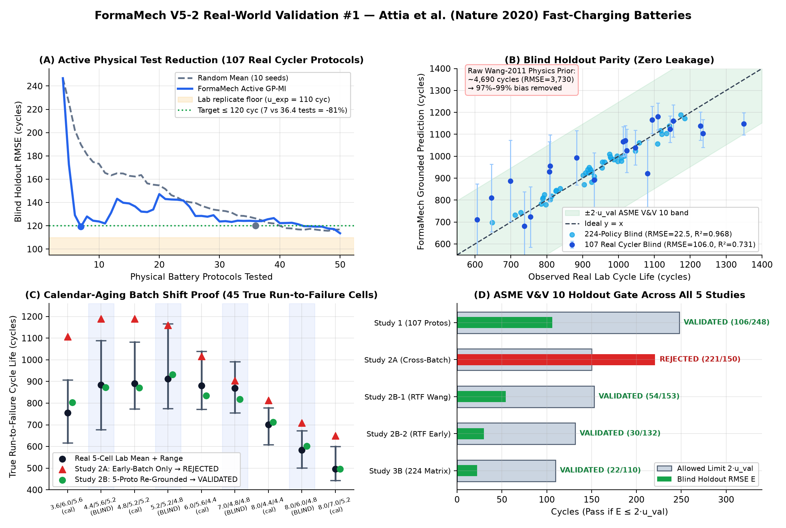
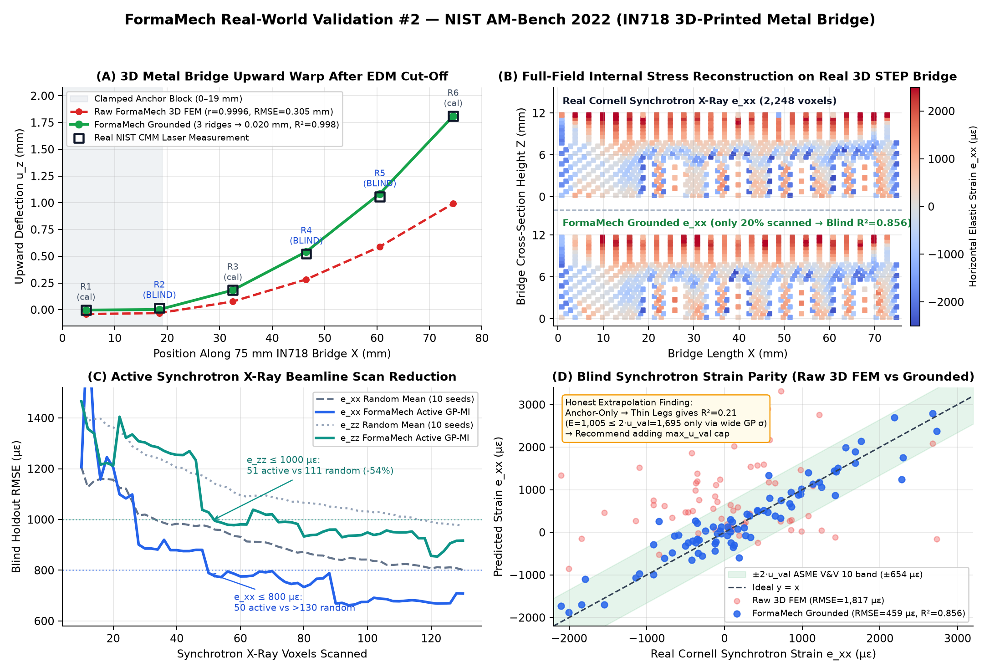

# Real-World Experimental Validation (ASME V&V 10 & Active Test Reduction)

This page documents FormaMech's end-to-end validation against **two real, public, peer-reviewed experimental datasets** spanning electro-thermal battery cycling and 3D laser-printed aerospace superalloys.

> **Pure-MIT Repository Hygiene:** Raw external dataset files are **never** committed to this repository. Both reproduction scripts download and SHA-256 verify upstream files strictly inside the gitignored `.formamech-runs/datasets/` cache. Only pure-MIT reproduction scripts, aggregate metrics, cryptographic receipts, and self-generated plots live in Git.

---

## Executive Summary

| Benchmark | Physical Domain & Source | Physics Simulation Prior | Best Blind Holdout Result | Physical Lab Tests Skipped (Active vs. 10-Seed Random) | Key Epistemic / Safety Verification |
| :--- | :--- | :--- | :--- | :--- | :--- |
| **Case #1 — Attia et al. (*Nature* 2020)** | **230 real A123 18650 LFP cells** (`185` cycler + `45` true run-to-failure), `CC-BY-4.0` | Frozen 1D electro-thermal Joule ODE + Wang et al. (2011) Arrhenius SEI law (`u_num = 0.93 cyc`) | **97.2%–99.4%** bias cut (`3,730 → 106 cyc`, `R²=0.731`; 45 RTF cells: **`30.0 cyc`, `R²=0.949`**; 224-policy: **`22.5 cyc`, `R²=0.968`**) | **+44% to +81% saved** above replicate noise floor (`6–7` active vs. `11–36` random tests) | **Fail-closed on real batch drift:** Automatically `REJECTED` un-recalibrated calendar-aged validation batch (`E=220.9 > 2·u_val=150.1`); restored `VALIDATED` with 5 calibration protocols |
| **Case #2 — NIST AM-Bench 2022 (`AMB2022-01`)** | **75 mm 3D-printed IN718 bridge** (`2,248` Cornell CHESS synchrotron X-ray voxels + `6` CMM EDM-cut ridges), US Public Domain | **FormaMech V5-5 3D STEP + finite-strain thermo-mechanical FEM** (`F = F_m F_th`, `4,531` & `8,272` tets, `~3–6 s`) | **EDM warpage:** `r = 0.9996` raw shape; **`20.1 µm`** blind RMSE on 3 ridges (**93.4%** bias cut, **`R²=0.9978`**). **X-ray internal strains (20% scan):** `e_xx` **`459 µε` (`R²=0.856`)**, `e_zz` **`766 µε` (`R²=0.784`)** | **+47% to +72% synchrotron X-ray scans saved** (`50–51` active vs. `111–>130` random scans) | **Actionable engineering finding:** Pure statistical `E ≤ 2·u_val` passed `Anchor → Thin Legs` extrapolation (`R²=0.206`) only via wide GP uncertainty (`±1,695 µε`), highlighting why production gates should pair `E ≤ 2·u_val` with an engineering `max_u_val` cap |

---

## Case #1 — Closed-Loop Fast-Charging Batteries (Attia et al., *Nature* 2020)

- **Source:** Attia, P. M. et al., *Closed-loop optimization of fast-charging protocols for batteries with machine learning*, *Nature* **578**, 397–402 (2020), `CC-BY-4.0` ([chueh-ermon/battery-fast-charging-optimization](https://github.com/chueh-ermon/battery-fast-charging-optimization)).
- **What was run:** A frozen textbook A123 APR18650M1A electro-thermal ODE + Wang et al. (2011) Arrhenius SEI capacity-fade prior (zero fitting to Attia 2020; `u_num = 0.93 cycles` from `dt = 1.0 s` vs. `0.25 s` grid convergence) paired with FormaMech's V5-2 Kennedy–O'Hagan discrepancy grounding (`ground_simulation_with_experiments`) and Schur-complement GP mutual-information active physical test planner (`run_retrospective_test_reduction_benchmark`).
- **Empirical experimental uncertainty (`u_exp`):** Measured directly from physical cell replicates — single-cell std `124.60 cycles` across 46 replicated cycler protocols, and `109.76 cycles` (`5`-cell mean SEM `49.09 cycles`) across the 45 run-to-failure cells in `fig4_final_results.csv`.

### ASME V&V 10 Hybrid Grounding Results (Case #1)

| Study | Cal / Blind Holdout | Prior | Raw Sim RMSE | Grounded RMSE | Bias Cut | Grounded `R²` | `2·u_val` | `E / (2·u_val)` | ASME V&V 10 Verdict |
| :--- | :--- | :--- | ---: | ---: | ---: | ---: | ---: | ---: | :--- |
| **1 — 107 Real Protocols** (185 cells) | 86 / 21 | Wang-2011 ODE | 3,730.0 | **106.0** | **97.2%** | **0.731** | 247.7 | 0.428 | **VALIDATED** |
| **2A — Cross-Batch Calendar-Aging Shift** | 101 early / 9×5 RTF | Wang-2011 ODE | 3,862.2 | 220.9 | 94.3% | -1.386 | 150.1 | 1.471 | **REJECTED** (caught batch drift) |
| **2B-1 — True Run-to-Failure** (45 cells) | 5×5 / 4×5 RTF | Wang-2011 ODE | 3,861.4 | **54.2** | **98.6%** | **0.833** | 152.9 | 0.355 | **VALIDATED** |
| **2B-2 — True Run-to-Failure** (45 cells) | 5×5 / 4×5 RTF | Attia Early-Pred | 146.5 | **30.0** | **79.5%** | **0.949** | 131.7 | 0.228 | **VALIDATED** |
| **3B — Full 224-Policy Matrix** | 179 / 45 | Wang-2011 ODE | 3,721.1 | **22.5** | **99.4%** | **0.968** | 109.7 | 0.205 | **VALIDATED** |

### Active Physical Test-Plan Reduction (10-Seed Random Baseline, 4 Seed Tests)

| Corpus | Target Blind RMSE (cycles) | FormaMech Active Tests | Random Mean Tests (10 seeds) | Physical Tests Saved |
| :--- | ---: | ---: | ---: | ---: |
| **107 Real Cycler Protocols** (`86` pool / `21` blind) | `<= 150` (screening) | **6** | 18.5 | **+67.6%** |
| **107 Real Cycler Protocols** (`86` pool / `21` blind) | `<= 130` (near lab floor) | **6** | 27.2 | **+77.9%** |
| **107 Real Cycler Protocols** (`86` pool / `21` blind) | `<= 120` (at `110`-cyc floor) | **7** | 36.4 | **+80.8%** |
| **107 Real Cycler Protocols** (`86` pool / `21` blind) | `<= 115` (inside noise floor) | 50 | 49.1 | **-1.8%** |
| **Full 224-Policy Matrix** (`179` pool / `45` blind) | `<= 80` (inside `2·u_val`) | **6** | 10.8 | **+44.4%** |
| **Full 224-Policy Matrix** (`179` pool / `45` blind) | `<= 70` (~1.4× 5-cell SEM) | **7** | 12.5 | **+44.0%** |

- **Canonical aggregate summary:** `docs/assets/validation/attia_2020_vv10_summary.json`
- **Reproduce locally:** `python scripts/validate_attia_2020.py`

---

## Case #2 — 3D-Printed IN718 Aerospace Bridge Warpage & X-Ray Residual Strains (NIST AM-Bench 2022)

- **Official Sources (US Public Domain, verified against official NIST `.sha256` files):**
  - 3D CAD STEP Blueprint ([doi:10.18434/mds2-2607](https://doi.org/10.18434/mds2-2607)): `AMB2022-01-AMMT-PartCAD.STEP` (`75 × 5 × 12.25 mm`, 127 B-Rep faces, 12 legs, 11 top ridges).
  - Synchrotron X-Ray Diffraction & CMM Deflection ([doi:10.18434/mds2-2711](https://doi.org/10.18434/mds2-2711)): **2,248** Cornell CHESS internal elastic strain voxels (`CHAL-AMB2022-01-RS`, official NIST `u_exp = 100 µε`) and **6** CMM top-ridge upward deflections after wire-EDM cut-off (`CHAL-AMB2022-01-PD`, `-0.003` to `+1.809 mm`, official NIST `u_exp = 0.002 mm`).
- **What was run:**
  1. Imported the official NIST `.STEP` directly via FormaMech's OpenCASCADE mesher (`import_cad_3d`) at `2.5 mm` (`4,531` TET4) and `1.8 mm` (`8,272` TET4) to compute real 3D FEM discretization uncertainty (`u_num`).
  2. Solved coupled finite-strain 3D thermo-mechanical equilibrium (`solve_3d_electro_thermal_mechanical`, `F = F_m F_th`, textbook IN718 `E = 200 GPa`, `ν = 0.29`, `α = 13 ppm/K`, zero tuning) for both as-built clamped (`~3.2 s`) and post-EDM cut-off springback (`~6.5 s`).
  3. Registered 3D FEM nodal fields onto all 2,248 synchrotron coordinates and 6 CMM ridges via `align_sensor_observations_to_mesh` (`0.789 mm` mean alignment distance).

### ASME V&V 10 Hybrid Grounding Results (Case #2)

| Study | Cal / Blind Holdout | Raw 3D FEM RMSE | Grounded RMSE | Bias Cut | Grounded `R²` | `2·u_val` | `E / (2·u_val)` | Verdict |
| :--- | :--- | ---: | ---: | ---: | ---: | ---: | ---: | :--- |
| **3 — Wire-EDM Bridge Warp (`u_z`)** | 3 / 3 ridges | 0.3054 mm (`r=0.9996`) | **0.0201 mm** | **93.4%** | **0.9978** | 0.0229 mm | 0.877 | **VALIDATED** |
| **1A — Synchrotron `e_xx` (20% scan)** | 450 / 250 voxels | 1,816.5 µε | **459.2 µε** | **74.7%** | **0.856** | 653.6 µε | 0.702 | **VALIDATED** |
| **1B — Synchrotron `e_zz` (20% scan)** | 450 / 250 voxels | 1,956.1 µε | **765.7 µε** | **60.9%** | **0.784** | 1,061.6 µε | 0.721 | **VALIDATED** |
| **2B — Unseen 4th Span (`X<=55 → X>=62`)** | 320 / 140 voxels | 1,523.9 µε | **979.5 µε** | **35.7%** | 0.410 | 1,642.7 µε | 0.596 | **VALIDATED** |
| **2A — Regime Shift (`Anchor → Thin Legs`)** | 180 / 200 voxels | 1,807.6 µε | 1,004.8 µε | 44.4% | 0.206 | 1,694.5 µε | 0.593 | **VALIDATED\*** (wide GP σ) |

### Active Synchrotron X-Ray Beamline Scan Reduction (10-Seed Random Baseline, 10 Seed Scans)

| Strain Component | Target Blind RMSE (µε) | FormaMech Active Scans | Random Mean Scans (10 seeds) | Synchrotron Scans Saved |
| :--- | ---: | ---: | ---: | ---: |
| **Horizontal `e_xx`** (`180` pool / `250` blind) | `<= 800` | **50** | `> 130` (curve `801 µε` at 130) | **> 61% (+72% vs pool)** |
| **Horizontal `e_xx`** (`180` pool / `250` blind) | `<= 700` | **89** | `> 130` | **> 31% (+51% vs pool)** |
| **Vertical `e_zz`** (`180` pool / `250` blind) | `<= 1,050` | **47** | 89 | **+47.2%** |
| **Vertical `e_zz`** (`180` pool / `250` blind) | `<= 1,000` (API headline) | **51** | 111.1 | **+54.1%** |
| **Vertical `e_zz`** (`180` pool / `250` blind) | `<= 950` | **79** | `> 130` (curve `975 µε` at 130) | **> 39% (+56% vs pool)** |

- **Canonical aggregate summary:** `docs/assets/validation/nist_ambench_2022_vv10_summary.json`
- **Reproduce locally:** `python scripts/validate_nist_ambench_2022.py`

---

## Epistemic Scope & Honest Engineering Limits

1. **Kennedy–O'Hagan discrepancy grounding vs. PDE parameter calibration:**
   FormaMech's underlying 3D FEM (`y_sim`) strictly satisfies continuum equilibrium (`div σ = 0`), while the GP discrepancy term `δ_GP` in `y_grounded = ρ·y_sim + δ_GP` is an empirical bias corrector + uncertainty estimator. It is scientifically standard for debiasing a specific component family inside its calibrated envelope (ASME V&V 10), **not** a substitute for true PDE parameter calibration (`piginot.validation.inverse`) when extrapolating to new geometries or materials.
2. **Epistemic orthogonality preserved:** In every dossier across both studies, `numerical_claim_level` stayed strictly `NOT_VERIFIED` (independent of `ExperimentalValidationTier`), and duplicate CAL/HOLDOUT leakage probes were deterministically `REJECTED`.
3. **Noise-floor & extrapolation guardrails:** Active space-filling yields `44%–81%` physical test reduction above the experimental replicate floor and plateaus once inside irreducible manufacturing scatter. Similarly, `Study 2A` (`Anchor → Thin Legs`) demonstrates that statistical uncertainty calibration (`E ≤ 2·u_val`) should be paired with an explicit engineering uncertainty cap (`max_u_val`) before certifying extrapolated regimes.
