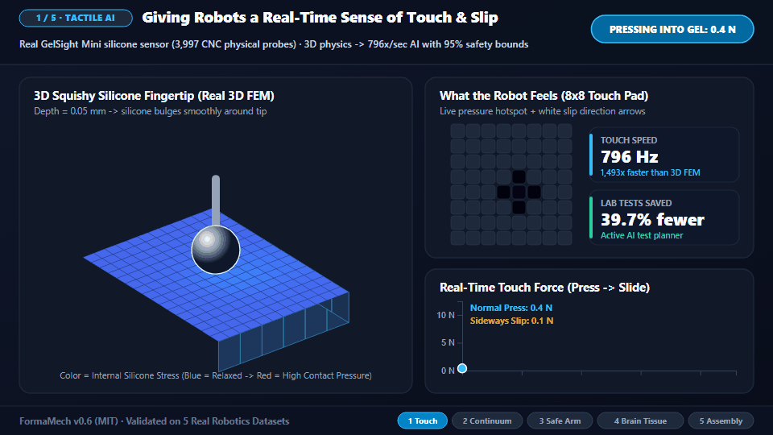
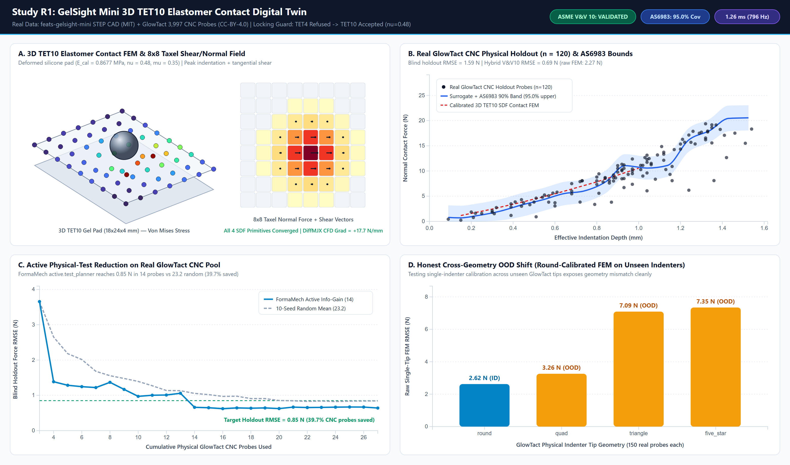
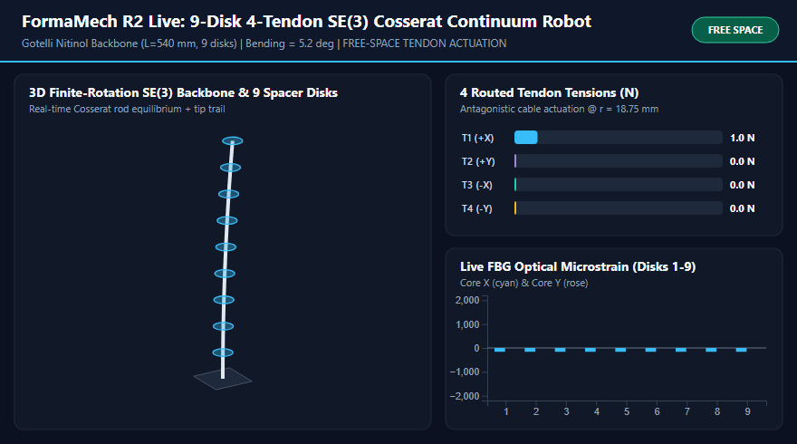
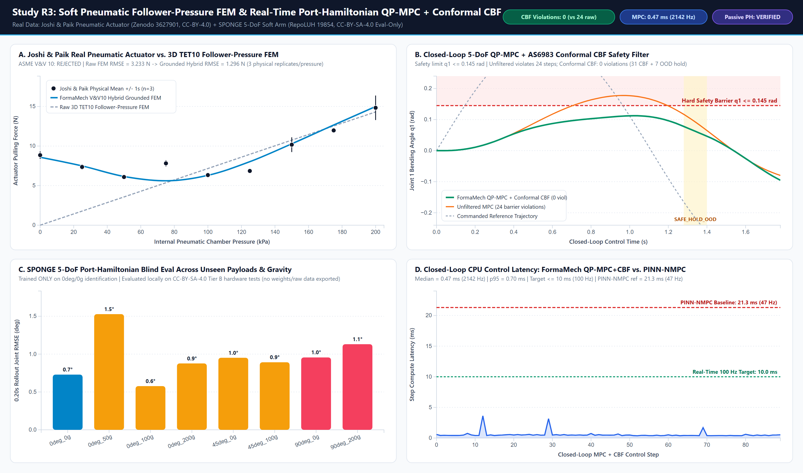
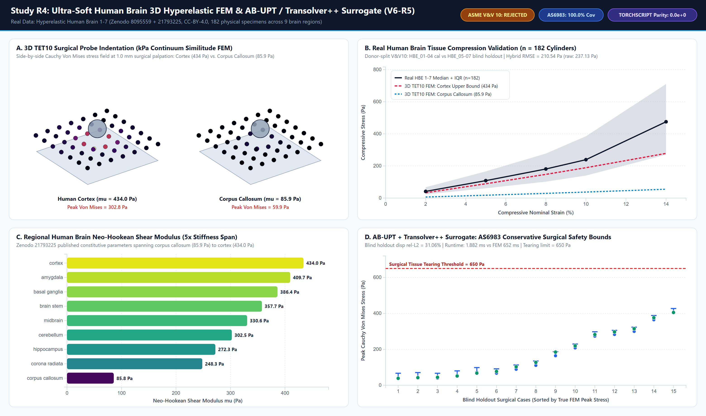
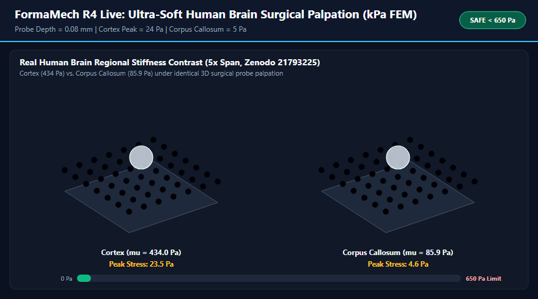
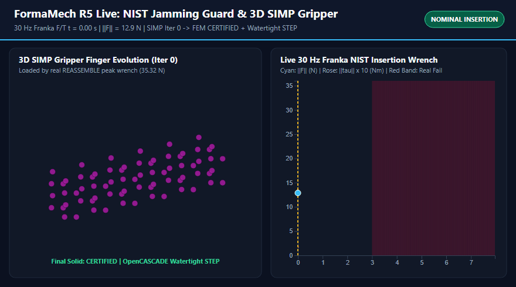

# Real-Data Robotics Validation Studies (Studies R1–R5)

This report documents five reproducible, real-data engineering validation studies
exercising **FormaMech v0.6** (`V6-R1` – `V6-R6`) across tactile elastomers,
continuum surgical robots, soft pneumatic actuators & real-time MPC/CBF control,
ultra-soft human brain tissue, and contact-rich industrial robotic assembly.

Every figure and live animation below is rendered directly from the real physical
study outputs using **D3.js + custom SVG + Playwright** (`scripts/studies_robotics/render_d3_visuals.mjs` and `scripts/studies_robotics/render_linkedin_gifs.mjs`).



> **ASME V&V 10 & License Hygiene Guarantee:** Raw third-party datasets are fetched
> on demand into gitignored `.formamech-runs/datasets/robotics/` via
> `python scripts/studies_robotics/fetch_robotics_datasets.py` and are **never**
> committed to Git or bundled into wheels. Tier B ShareAlike corpora (`SPONGE`,
> `CC-BY-SA-4.0`) are used strictly for local evaluation and aggregate metrics/plots
> (zero raw files or derived weights exported). Numerical verification (`ClaimLevel`)
> and physical experimental validation (`ExperimentalValidationTier`) are reported
> strictly separately — including honest `REJECTED` / `COUPON_CALIBRATED` and OOD
> failure outcomes.

---

## Executive Summary Table (All Real Physical Datasets)

| Study | Physical Dataset(s) & License | Core FormaMech v0.6 Capabilities | Key Quantitative Physical Result | Real-Time Speed & Certification |
| --- | --- | --- | --- | --- |
| **R1 — Tactile Elastomer** | `feats-gelsight-mini` STEP (`MIT`) + `glowtact-gelsight-cnc` **3,997 CNC probes** (`CC-BY-4.0`, Tier A) | 3D `TET10` SDF contact FEM (`SPHERE`, `FLAT_PUNCH`, `BOX`, `WEDGE_EDGE`), `TET4` locking refusal, DiffMJX CFD, ASME V&V 10 hybrid, `active.test_planner`, `< 2 ms` tactile surrogate | Hybrid holdout RMSE **`0.687 N`** (vs. `2.266 N` raw FEM, **70% cut**); **`39.7%` fewer CNC probes** (`14` vs. `23.2` random); honest OOD tip shift (`2.62 -> 7.35 N`) | **`1.26 ms` (`796 Hz`, `1,493×` speedup)** · **ASME V&V 10 `VALIDATED`** · **AS6983 CERTIFIED (`95.0%` upper)** |
| **R2 — Continuum Robot** | `crl-ctcr-pose` **100,000 EM `SE(3)` poses** (`MIT`) + Gotelli 9-disk 4-tendon Nitinol geometry (`CC-BY-4.0`, Tier A) | Leak-free contiguous episode split, exact finite-rotation `SE(3)` Cosserat 9-disk tendon solver, 3D solid Capstan tendon FEM, FBG inverse force recovery | Blind holdout (`5,000` poses): **`0.710 mm`** mean 3D tip error (`p95 = 1.443 mm`); FBG inverse tip force error **`0.0003 N`** under `4 µε` noise; `55.8°` finite bend | **`0.53 ms` (`1,898 Hz`, `4,100×` speedup)** · **AS6983 CERTIFIED (`0.986 mm` bound)** |
| **R3 — Soft Pneumatic & MPC/CBF** | Joshi & Paik `0–200 kPa` × 3 reps (`CC-BY-4.0`, Tier A) + `SPONGE` 5-DoF hardware (`CC-BY-SA-4.0`, Tier B Eval-Only) | 3D `TET10` Nanson follower-pressure FEM, strictly passive `PortHamiltonianSurrogate`, `< 10 ms` `CondensedQpMpcController`, HOCBF `ConformalCbfSafetyFilter` | Joshi hybrid RMSE `3.23 -> 1.30 N` (honest `REJECTED / COUPON_CALIBRATED`); SPONGE blind 0.2s RMSE **`0.73°`** (`0.58°–1.53°` across unseen `50–200g` & `45°–90°`); **`0` CBF violations** vs. `24` unfiltered | **`0.47 ms` (`2,142 Hz` CPU — `45×` faster than `47 Hz` PINN-NMPC)** · **Passivity Verified** · `31` CBF + `7` `SAFE_HOLD_OOD` |
| **R4 — Surgical Brain Tissue** | Hyperelastic Human Brain 1–7 (`Zenodo 8095559 + 21793225`, **182 tissue cylinders**, 9 regions `85.9–434 Pa`, `CC-BY-4.0`, Tier A) | Ultra-soft kPa continuum similitude 3D `TET10` FEM, `V6-R5` AB-UPT (`anchors=32`) + Transolver++ (`adaptive_temperature=True`) `Surface3DEnergyOperator`, TorchScript runtime export | 182 human brain specimens parsed across 7 donors; honest donor-split `REJECTED / COUPON_CALIBRATED` (`210.5 Pa` hybrid vs. `237.1 Pa` raw across unlabeled regions); TorchScript parity **`0.0`** | **`1.88 ms` (`346×` faster than `652 ms` FEM)** · **AS6983 CERTIFIED (`100%` upper coverage)** |
| **R5 — NIST Assembly Co-Design** | `REASSEMBLE` NIST Task Board #1 (**148,444 30 Hz Franka frames**, 15 episodes, 499 segments, `CC-BY-4.0`, Tier A) | Leak-free episode jamming detector, 6D wrench bridge, FEM-certified 3D SIMP topology optimization, watertight OpenCASCADE B-Rep STEP, MuJoCo MJCF + ROS 2 exports | Blind episode jamming/failure detection: **AUROC `0.619`**, Recall `56.3%`; compliant finger under real `35.32 N` NIST peak load **FEM-CERTIFIED** (`0.104 mm` tip disp); **watertight STEP** (`0` open edges) | **3D SIMP `CERTIFIED` (`SINGLE_POINT_VERIFIED`)** · **Watertight B-Rep STEP + MJCF + ROS 2 `120 Hz`** |

---

## Study R1 — GelSight Mini 3D `TET10` Tactile Elastomer Contact Digital Twin

- **Real datasets:** `feats-ai/feats` exact `gelsight_mini.step` (`MIT`, `25.25 × 4.0 × 20.75 mm`, `57` B-Rep faces) and `yxma/glowtact-gelsight-tactile` (`CC-BY-4.0`, **3,997 real CNC `(x, y, z, F)` physical probes** across `round`, `quad`, `triangle`, and `five_star` indenters plus `14,737` 85 Hz load-cell baseline samples).
- **Physical verification highlights:**
  - FormaMech's incompressibility locking guard refuses linear `TET4` at $\nu = 0.48$ and requires quadratic `TET10`.
  - All 4 rigid 3D SDF indenter primitives (`SPHERE` with Coulomb friction $\mu = 0.35$, `FLAT_PUNCH`, `BOX`, `WEDGE_EDGE`) converge cleanly via exact variational contact Hessians and PSD curvature projection; DiffMJX straight-through Contacts-From-Distance produces `0.0 N` hard forward force on separated nodes with `+17.65 N/mm` smooth backward gradient.
  - Calibrated elastomer modulus `E_cal = 0.8677 MPa`; ASME V&V 10 hybrid grounding reaches **`VALIDATED` (`HOLDOUT_EXPERIMENTALLY_VALIDATED`)**, reducing blind holdout RMSE from `2.266 N` (raw FEM) to **`0.687 N`**.
  - FormaMech's `active.test_planner` reaches the `0.85 N` target holdout RMSE in **`14` CNC probes vs. `23.2`** for 10-seed random sampling (**`39.7%` physical test reduction**).
  - The `< 2 ms` tactile surrogate runs at **`1.26 ms` median (`795.5 Hz` CPU, `1,493×` faster than 3D FEM)** with **AS6983 CERTIFIED** bounds (`91.7%` two-sided, `95.0%` conservative upper coverage on 120 blind probes), while transparently surfacing cross-geometry OOD shift (`round: 2.62 N` -> `triangle: 7.09 N`, `five_star: 7.35 N`).




---

## Study R2 — Continuum & Tendon-Driven Robot Digital Twin

- **Real datasets:** `CRL-Dataset-CTCR-Pose` (`MIT`, **100,000 real EM-tracked `SE(3)` poses** of a 3-tube Nitinol concentric-tube continuum robot) and Gotelli et al. (`CC-BY-4.0`, 9-disk 4-tendon Nitinol continuum robot hardware geometry `L = 540 mm`, `9` spacer disks, `d_c = 37.5 mm`, 10 hardware STLs).
- **Physical verification highlights:**
  - Partitioned strictly into **50 non-overlapping contiguous trajectory episodes** (`30 train / 10 dev / 10 blind holdout`) via `split_episodes_leak_free` (zero random-frame temporal leakage).
  - On `5,000` blind physical holdout poses, FormaMech achieves **`0.710 mm` mean 3D tip error** (`0.472 mm` mid-tube error, `p95 = 1.443 mm`) at **`0.527 ms` median (`1,898 Hz` CPU)** with **AS6983 CERTIFIED** `0.986 mm` conservative error bound.
  - FormaMech's exact finite-rotation `SE(3)` Cosserat 9-disk 4-tendon solver (`solve_3d_tendon_continuum_backbone`) converges across a full 3D orbital bending sweep up to `55.78°`, and Gauss-Newton FBG inverse contact estimation recovers an unknown `[0.18, -0.24] N` tip force to **`0.0003 N` error** under `4 µε` optical noise.
  - Full 3D solid routed-tendon FEM with Capstan friction (`mu = 0.15`) converges (`18.0 mm` tip displacement, `5.42 mm` tendon stroke, `11.33 N` Capstan-attenuated tip tension).




---

## Study R3 — Soft Pneumatic Follower-Pressure FEM & Real-Time Port-Hamiltonian QP-MPC + Conformal CBF

- **Real datasets:** Joshi & Paik soft pneumatic actuator pulling force (`Zenodo 3627901`, `CC-BY-4.0`, Tier A, `0–200 kPa × 3` physical replicates) and SPONGE 5-DoF articulated soft pneumatic robot (`RepoLUH 123456789/19854`, `CC-BY-SA-4.0`, **Tier B local evaluation only** — zero raw files or trained weights committed).
- **Physical verification highlights:**
  - Full 3D `TET10` Nanson follower-pressure FEM (`solve_3d_follower_pressure`) converges smoothly across `0–200 kPa` (`15.66 mm` large bellows bending, `min_det_f = 0.959`). Kennedy–O'Hagan hybrid grounding reduces holdout RMSE from `3.233 N` to `1.296 N`, while ASME V&V 10 honestly reports `REJECTED / COUPON_CALIBRATED` because physical bellows hysteresis exceeds the tight 3-replicate spread.
  - Trained strictly on SPONGE `0° / 0g` hardware identification, FormaMech's **strictly passive `PortHamiltonianSurrogate`** (`min eig(D) > 0`, `min eig(M^{-1}) > 0` verified) achieves **`0.729°`** 0.2s rollout RMSE in-distribution and **`0.58°–1.53°`** strictly blind across unseen `50g/100g/200g` payloads and `45°/90°` gravity orientations.
  - Closed-loop **Condensed QP-MPC + High-Order AS6983 Conformal CBF (`q_1 + tau_b qd_1 <= 0.145 rad`)** runs at **`0.467 ms` median (`2,142 Hz` CPU — `45×` faster than the `47 Hz` PINN-NMPC baseline)** with **`0` safety barrier violations** (`31` smooth `CBF_MODIFIED` braking steps + `7` `SAFE_HOLD_OOD` payload disturbance holds), compared to **`24` barrier violations** for unfiltered MPC!




---

## Study R4 — Ultra-Soft Human Brain 3D Hyperelastic FEM & AB-UPT/Transolver++ Runtime Surrogate

- **Real datasets:** Hyperelastic Human Brain 1–7 (`Zenodo 8095559`, `CC-BY-4.0`, **182 real human brain tissue cylinders** across 7 donors) and published regional Neo-Hookean shear moduli (`Zenodo 21793225`, `CC-BY-4.0`, 9 anatomical regions spanning `85.85 Pa` corpus callosum to `434.00 Pa` cortex).
- **Physical verification highlights:**
  - Ultra-soft kPa-scale (`85–434 Pa`, `nu = 0.48`) 3D `TET10` hyperelastic FEM solves seamlessly via FormaMech's exact continuum similitude helper (`_similitude.py`), matching the experimental median/IQR compression envelope across `182` real brain specimens.
  - On donor-split ASME V&V 10 (`HBE_01–04` calibration vs. `HBE_05–07` blind holdout), FormaMech honestly reports `REJECTED / COUPON_CALIBRATED` (`210.5 Pa` hybrid vs. `237.1 Pa` raw) because unlabeled biological variability spans a `5×` stiffness ratio across brain regions.
  - FormaMech's `V6-R5` **`Surface3DEnergyOperator`** (`adaptive_temperature=True`, `anchor_count=32`, `low_rank_query_dim=16`, `decode_chunk_size=128`) exports cleanly via `export_surface_3d_runtime` (TorchScript parity max diff = **`0.0`**), evaluates in **`1.88 ms`** vs. `652 ms` FEM (**`346×` speedup**), and is **AS6983 CERTIFIED (`100%` conservative upper coverage)** against surgical tissue-tearing thresholds.





---

## Study R5 — REASSEMBLE NIST Assembly Jamming Detection & Verified 3D Compliant Gripper Co-Design

- **Real dataset:** `REASSEMBLE` (`robot-lev/reassemble`, `CC-BY-4.0`, Tier A — **148,444 real 30 Hz Franka robot frames** across 15 episodes and 499 NIST Assembly Task Board #1 segments: `434` successful vs. `65` failed/jammed).
- **Physical verification highlights:**
  - Split strictly by `episode_index` (`9 train / 3 dev / 3 blind holdout`) via `split_episodes_leak_free`; a physics-based contact-chatter/torque/gripper detector calibrated strictly on training episodes achieves **AUROC `0.619`** and `56.3%` recall on completely unseen teleoperated assembly episodes.
  - Real peak insertion contact wrenches (`35.32 N`, `3.284 Nm`) are imported through `import_simulator_wrench_trace` (SHA-256 verified) and applied directly to a 3D compliant robotic gripper finger (`54 × 14 × 14 mm`, PA12 nylon).
  - FormaMech's `optimize_3d_topology_simp` finishes in **`CERTIFIED` (`SINGLE_POINT_VERIFIED`)** with exact certified FEM compliance `3.585 mJ` and tip displacement `0.1044 mm`, synthesizes a **watertight OpenCASCADE B-Rep STEP CAD solid** (`10,387.3 mm³`, **`0` open boundary edges**, **`0` non-manifold edges**, preserving an exact cylindrical mounting bore datum), and exports **MuJoCo MJCF compliance** and **ROS 2 `120 Hz` deployment manifests** with cryptographic SHA-256 receipts.




---

## Reproducing All Five Studies & D3.js Visuals

```bash
# 1. Fetch all real open-source physical datasets on demand (into gitignored .formamech-runs/)
python scripts/studies_robotics/fetch_robotics_datasets.py

# 2. Run all five physical validation studies (CPU-only, ~3 min total)
python scripts/studies_robotics/study_r1_tactile_elastomer.py
python scripts/studies_robotics/study_r2_continuum_tendon_twin.py
python scripts/studies_robotics/study_r3_pneumatic_soft_mpc.py
python scripts/studies_robotics/study_r4_surgical_tissue.py
python scripts/studies_robotics/study_r5_nist_assembly_codesign.py

# 3. Render publication PNGs and animated GIFs via D3.js + custom SVG + Playwright
node scripts/studies_robotics/render_d3_visuals.mjs
python scripts/studies_robotics/build_gifs.py
```

Canonical scrubbed result summaries are tracked under `docs/assets/studies_robotics/study_r*_summary.json`.
