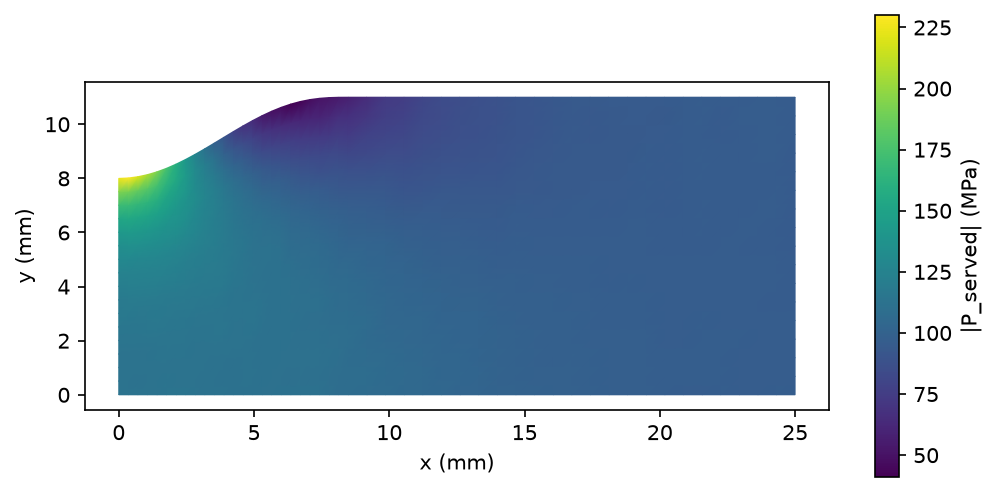

# User guide

This guide shows how to use PI-GINOT 0.1.0. Read the
[limitations](limitations.md) before trusting any number it gives you: every
prediction is checked against FEM solutions of one plane-stress model, inside
a declared input range, and nothing else.

PI-GINOT can be used in three ways. They differ a lot in effort.

| Use | What you provide | What you get | Effort |
| --- | --- | --- | --- |
| [1. Predict with a shipped bundle](#1-predict-with-a-shipped-bundle) | shape and load parameters of one of the two families | displacement, strain, stress, the peak stress and a confidence bound at every mesh vertex, in milliseconds | ready today |
| [2. Train a small model end to end](#2-train-a-small-model-end-to-end-example-1) | nothing (one built-in geometry) | the full loop (FEM, training, verification, bundle) in about 2 minutes on a CPU | ready today; adapt the script for your own case |
| [3. Build a verified model for your own geometry](#3-build-a-verified-model-for-your-own-geometry) | a mesh, a shape parametrisation, an input range | your own bundle with a measured claim level | Python work plus about a day of CPU time; no single command yet |

## Install

You need Python 3.11, 3.12 or 3.13, and Git. Install from the repository; it
also holds the bundles.

```text
git clone --branch v0.1.0 https://github.com/BBahtiri/verified-neural-operators.git
cd verified-neural-operators
python -m venv .venv
```

Activate the environment (`source .venv/bin/activate` on Linux and macOS,
`.venv\Scripts\activate` on Windows), then install what you need:

```text
python -m pip install -e ".[runtime]"            # 1. predict with bundles
python -m pip install -e ".[runtime,fem,ml]"     # 2. and 3. FEM and training as well
python -m pip install -e ".[dev,geometry,physics,fem,ml,runtime]"   # contributors: tests and docs
```

`piginot --version` should print `piginot 0.1.0`. Once the release workflow
has published 0.1.0 to TestPyPI, the package installs without a clone as well:
`python -m pip install --index-url https://test.pypi.org/simple/
--extra-index-url https://pypi.org/simple/ "piginot[runtime]==0.1.0"`. The
bundles still come from the repository's `bundles/` folder.

## 1. Predict with a shipped bundle

A bundle is a trained operator together with everything needed to serve it
safely: the reference mesh, the shape map, the allowed input range (the
*envelope*), the verification report and the limitations. Every file is
hash-checked when it is loaded. Two bundles ship in `bundles/`:

| Bundle | Geometry | Inputs | Claim level |
| --- | --- | --- | --- |
| `bundles/dogbone-v1-s13c-cp-freeze` | DogBone tensile specimen | `L_total` 40–70 mm, `W_grip` 16–26 mm, `W_gauge` 6–14 mm, `R_fillet` 8–20 mm | `HOLDOUT_VERIFIED` |
| `bundles/notched-v1-cp-freeze` | centre-notched plate | `width` 16–30 mm, `notch_radius` 2–8 mm, `notch_depth` 1–5 mm | `DEVELOPMENT_VERIFIED` |

Both take `nominal_axial_strain` from 0.10 to 0.20, and are trained for one
material: `elastic_modulus` 760 MPa and `poisson_ratio` 0.23, a compressible
Neo-Hookean solid in 2D plane stress with 1 mm thickness.

### Check and inspect a bundle

```text
piginot bundle verify bundles/notched-v1-cp-freeze
piginot inspect bundles/notched-v1-cp-freeze --output inspect.json
```

`inspect` lists the inputs and their ranges, any derived bounds (ratios such
as the notch depth over the notch radius), the claim level, the verification
verdict, every outstanding item and the limitations.

### Write a request

A request names every input with an explicit unit. Units of the same
dimension are converted, so `2.2 cm` is accepted for `width`. `queries` is
optional: it lists extra points `[x, y]` in mm where you want the fields as
well as at the mesh vertices.

```json
{
  "inputs": {
    "width": {"value": 22.0, "unit": "mm"},
    "notch_radius": {"value": 4.0, "unit": "mm"},
    "notch_depth": {"value": 3.0, "unit": "mm"},
    "elastic_modulus": {"value": 760.0, "unit": "MPa"},
    "poisson_ratio": {"value": 0.23, "unit": "1"},
    "nominal_axial_strain": {"value": 0.15, "unit": "1"}
  },
  "queries": [[2.0, 5.0], [12.0, 9.0]]
}
```

The model works on a quarter of the specimen, using its two symmetry planes:

- **Notched plate:** `x` runs from the notch centre line (0) to the loaded
  end (25 mm), and `y` runs from the centre line (0) to the free edge (`W/2`).
- **DogBone:** `x` runs from the gauge centre (0) to the loaded end (`L/2`),
  and `y` runs from 0 to `W_grip/2`.

Example requests are in `bundles/requests/`.

### Predict

```text
piginot predict bundles/notched-v1-cp-freeze --request bundles/requests/notched-in-domain.json --output prediction.json
```

The exit code tells you the outcome:

| Exit code | Meaning |
| --- | --- |
| 0 | served (`IN_DOMAIN`) |
| 2 | refused: the request is outside the envelope or invalid |
| 1 | the bundle itself was refused (for example a modified file) |

### Read the result

`prediction.json` holds:

| Field | Meaning |
| --- | --- |
| `verdict`, `reason_codes` | `IN_DOMAIN`, or `REFUSED` with stable reason codes |
| `claim_level` | how far the bundle's accuracy was verified (see below); `NOT_VERIFIED` on any refusal |
| `vertices` | at every mesh vertex: `coordinates` (mm), displacement `u` (mm), deformation gradient `F_2D`, `F33` and `J_3D`, first Piola stress `P_served` (MPa), Cauchy stress `sigma` (MPa), and `confidence` |
| `queries` | the same fields at your query points |
| `qois` | quantities of interest, for example the peak stress at the notch root with its value, vertex and location |
| `mesh` | the triangle connectivity, for plotting |
| `units`, `identities`, `limitations` | units of every field, the hashes of the bundle that answered, and the limitation text |

For the request above, the notched bundle gives a peak first Piola stress
magnitude of 230 MPa at the notch root (x ≈ 0.35 mm, y ≈ 8.0 mm), and
answers in about 0.1 s on one CPU thread. The FEM solve takes about 100 s.

`confidence.stress_error_bound` is the calibrated 90% quantile of the
pointwise stress error, given an equilibrium-residual indicator. It ranks
errors only moderately: it covered 87–88% of HOLDOUT vertices for a nominal
90%. `beyond_calibration` flags points outside the calibrated range.

### What the claim level means

| Claim level | Meaning |
| --- | --- |
| `HOLDOUT_VERIFIED` | the error budget passed on unseen HOLDOUT cases: p90 stress-field error ≤ 5%, peak ≤ 5%, displacement ≤ 2%, including the FEM reference error (DogBone: 2.75%, 4.02%, 0.29%) |
| `DEVELOPMENT_VERIFIED` | measured on DEVELOPMENT and HOLDOUT, but HOLDOUT missed the tolerances. Notched: p90 6.01% stress field and 6.40% peak, up to 10% on the sharpest notches and widest plates; the DEVELOPMENT result was accepted by the decision owner (ADR 0030). Treat it as indicative |
| `NOT_VERIFIED` | no accuracy claim (refusals, and Example 1 bundles) |

### Refusals

PI-GINOT refuses rather than extrapolates. Common reason codes:

| Code | Cause |
| --- | --- |
| `PARAMETER_OUT_OF_BOUNDS` | an input is outside its range (for example a strain of 0.30, or a different material) |
| `DERIVED_QUANTITY_OUT_OF_BOUNDS` | the inputs are each in range but their combination is not (for example a DogBone fillet too small for the grip–gauge step) |
| `MISSING_PARAMETER`, `UNKNOWN_PARAMETER`, `PARAMETER_UNIT_MISMATCH` | the request does not name the bundle's inputs with compatible units |
| `QUERY_OUTSIDE_DOMAIN` | a query point lies outside the specimen shape for these inputs |
| `PREDICTION_INADMISSIBLE_DEFORMATION` | the predicted deformation folds somewhere (`det F <= 1e-12`) |
| `BUNDLE_*` | the bundle files changed or are incomplete; re-clone or re-download it |

### Use it from Python

```python
import json

from piginot.bundle import load_bundle, predict
from piginot.cli import parse_request

bundle = load_bundle("bundles/notched-v1-cp-freeze")
with open("bundles/requests/notched-in-domain.json", encoding="utf-8") as handle:
    inputs, queries = parse_request(json.load(handle))
prediction = predict(bundle, inputs, queries)

print(prediction.verdict.value, prediction.claim_level.value)
result = prediction.document()  # the same dictionary as prediction.json
print(result["qois"][0]["value"], "MPa")
```

### Plot a result

Matplotlib is not a dependency; install it separately (`pip install matplotlib`).

```python
import json

import matplotlib.pyplot as plt
import matplotlib.tri as mtri
import numpy as np

result = json.load(open("prediction.json", encoding="utf-8"))
xy = np.array(result["vertices"]["coordinates"])
cells = np.array(result["mesh"]["cells"])
stress = np.linalg.norm(np.array(result["vertices"]["P_served"]), axis=(1, 2))

figure, axes = plt.subplots(figsize=(8, 4))
image = axes.tripcolor(
    mtri.Triangulation(xy[:, 0], xy[:, 1], cells), stress, shading="gouraud"
)
figure.colorbar(image, label="|P_served| (MPa)")
axes.set_aspect("equal")
figure.savefig("prediction.png", dpi=150, bbox_inches="tight")
```



## 2. Train a small model end to end (Example 1)

Example 1 runs the whole method on one fixed notched geometry (width 23 mm,
notch radius 5 mm, depth 3 mm) and a strain sweep, in about 2 minutes on a
CPU:

```text
python -m pip install -e ".[runtime,fem,ml]"
python -m examples.fixed_mesh_sweep.sweep --output example1-output
```

It solves the P2 FEM reference at six training strains and three held-out
strains, then trains a small energy-form operator from the physics alone. It
checks the operator against FEM on the held-out strains, calibrates the
confidence indicator and builds a bundle that serves a held-out strain and
refuses one outside the range. `example1-output/summary.json` holds:

- the timings;
- the held-out errors, about 1.1–1.3% for the stress field;
- the pass or fail result.

Its bundle is `NOT_VERIFIED`, because the full verification protocol is not
run.

To use your own fixed geometry and load range, copy
`examples/fixed_mesh_sweep/sweep.py` and replace its mesh and strain values.
The script shows each framework call in order. See [Examples](examples.md).

## 3. Build a verified model for your own geometry

The shipped bundles are tied to their families: you cannot give an existing
bundle a new shape. To get a model for your own geometry with a measured claim level, you
define a new *family* and run the same evidence chain that produced the two
shipped bundles. In 0.1.0 this means writing a small Python campaign package.
There is no "upload a mesh and train" command yet.

What you provide:

1. **A reference mesh:** a planar Gmsh v4.1 triangle mesh with named physical
   groups for the boundaries (loaded end, symmetry lines, free edges). It is
   read with `piginot.geometry.read_gmsh(path, unit=Unit.MM)`, which refuses
   meshes it cannot trust: inverted or degenerate elements, unnamed boundary
   facets, 3D or quad cells.
2. **A shape parametrisation:** a morph map that deforms the reference mesh
   from a few parameters. The framework provides RBF and FFD maps
   (`piginot.morphing`), plus the exact DogBone and notched-plate maps as
   examples of a family-specific map.
3. **An input range:** bounds on every parameter, derived bounds on their
   ratios, and the material and load range.

The steps, with the notched-plate campaign (`campaigns/notched_v1/`) as the
template:

| Step | What runs | Notched module |
| --- | --- | --- |
| Family check | hundreds of morphed shapes are checked for validity; a small FEM pilot at the range corners | `pilot.py` |
| Design and HOLDOUT seal | the design of experiments is fixed and a HOLDOUT set is committed before any training | `proposal.py`, `s9.py` |
| FEM production | P2 FEM solves for every TRAIN and DEVELOPMENT case, about 1–2 minutes each on one core | `s10.py` |
| Training | a preregistered training run of the energy-form operator | `s13.py`, `s13_close.py` |
| Verification | error budgets on DEVELOPMENT, then once on HOLDOUT; refusal fixtures; confidence calibration | `s14.py`, `s14_envelope.py` |
| Bundle | build the bundle and check it from a clean install | `s15.py` |

The notched campaign took about a day of CPU time for 200 FEM cases plus
training. Its result shows that the tolerances are not guaranteed: it reached
`DEVELOPMENT_VERIFIED`, not `HOLDOUT_VERIFIED`, largely because of the FEM
mesh's own error at the notch ([S17 results](campaigns/s17-plan.md#4-results)).
The [S17 plan](campaigns/s17-plan.md) and
[ADR 0025](adr/0025-s17-examples-and-second-family.md) describe each step and
its decisions.

## Check the project yourself

```text
python -m pytest                                  # full suite, about 50 minutes on one CPU
python -m pytest tests/test_shipped_bundles.py    # the shipped bundles, a few seconds
python -m mkdocs build --strict -f docs/mkdocs.yml -d ../site
```

Every gate result is committed under `artifacts/gates/` and
`artifacts/campaigns/*/gates/`, and the [benchmarks](benchmarks.md) page lists
the measured numbers. Re-measuring the benchmarks needs the FEM datasets,
which are not in the repository; regenerate them with the campaign's FEM
production step.
