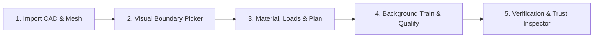
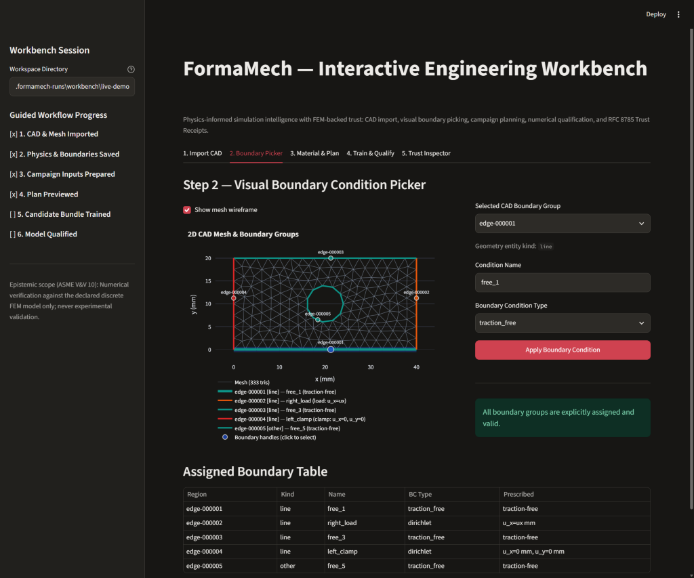

# Interactive 2D Engineering Workbench (`formamech ui`)

The Interactive 2D Engineering Workbench removes the manual JSON and CLI
onboarding barrier while preserving FormaMech's exact canonical file contracts
and epistemic verification boundaries.

Every action taken in the browser writes the same hash-bound project files
(`geometry/`, `physics.json`, `inputs/`, `preview/plan.json`, `run/`,
`qualification/`) that `formamech cad`, `formamech compile`, and
`formamech qualify` read, so any project created in the GUI is 100%
reproducible in headless CI pipelines.

> **Epistemic scope (ASME V&V 10):** Newly compiled candidates remain
> `NOT_VERIFIED` until they pass policy-driven numerical qualification against
> converged FEM. The workbench displays claim levels, deployment gates, and
> admissibility verdicts prominently at every stage.

## 1. Launch the workbench

Install the CAD, verification, and UI extras, then launch the Streamlit app:

```text
python -m pip install -e ".[cad,verify,ui]"
formamech ui --workspace .formamech-runs/workbench/my-bracket --bundle bundles/notched-v1-cp-freeze
```

Or run from the included container image (`docker/Dockerfile.ui`):

```text
docker build -f docker/Dockerfile.ui -t formamech-ui .
docker run -p 8501:8501 -v "$(pwd)/.formamech-runs:/workspace" formamech-ui
```

## 2. Five guided workflow stages



### Stage 1 — Import CAD & Mesh

Upload any planar `.step`, `.stp`, or `.dxf` profile (or generate the built-in
40 × 20 mm OpenCASCADE sample bracket), select length units and mesh size, and
inspect mesh counts, bounding boxes, and extracted curve groups before moving
on.


### Stage 2 — Visual Boundary Picker

Click any boundary segment or midpoint handle directly on the interactive Plotly
CAD canvas (`on_select="rerun"`) to assign explicit `dirichlet`, `symmetry`, or
`traction_free` conditions. The workbench validates FormaMech's straight-line
and circular-arc lifting rules live before allowing plan preparation.



### Stage 3 — Material, Loads & Plan

Choose from all seven built-in hyperelastic constitutive models (Neo-Hookean,
Mooney–Rivlin, Yeoh, Gent, HGO, single-family HGO, GOH), configure parameter
ranges and training budgets, and execute `formamech cad prepare` followed by
`formamech compile --plan-only` to review `preview/plan.json` without hand-editing
JSON.


### Stage 4 — Background Train & Qualify

Launch detached `formamech compile` (with `--resume` and cancel controls) and
`formamech qualify run` jobs directly from the browser. The workbench polls
checkpoint state and streaming log tails while preserving full CLI parity.

### Stage 5 — Verification & Trust Inspector

Load any trained or shipped bundle to inspect 2D displacement magnitude, Cauchy
von Mises stress, `det(F_2D)` admissibility, warm-start FEM diffs, live DWR
`CADTrustReport`s, Qualification Deployment Gate badges, RFC 8785 Trust
Receipts, downloadable Markdown dossiers, and FMI 3.0 `.fmu` exports.


## 3. Reproducing a GUI workspace in CI

Because every browser action writes standard FormaMech artifacts under
`--workspace`, you can run the exact same pipeline headlessly on a build server:

```text
formamech compile --spec <workspace>/inputs/problem.json --config <workspace>/inputs/config.json --output <workspace>/run
formamech qualify run <workspace>/run/candidate-bundle --preset holdout --output <workspace>/qualification
formamech qualify verify <workspace>/run/candidate-bundle --manifest <workspace>/qualification/qualification-manifest.json --min-claim HOLDOUT_VERIFIED
```
