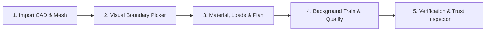
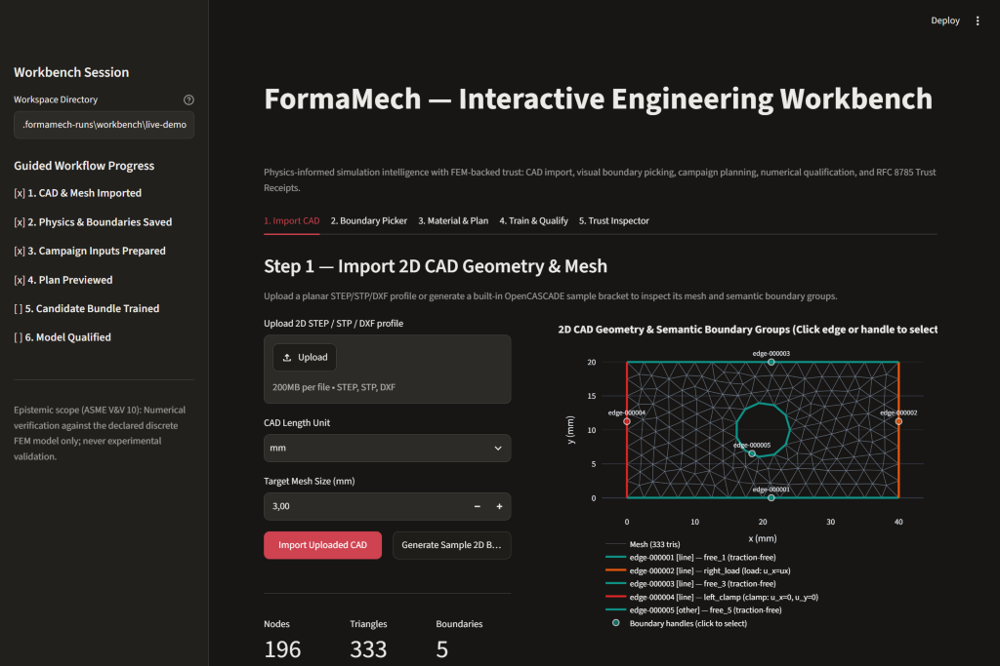
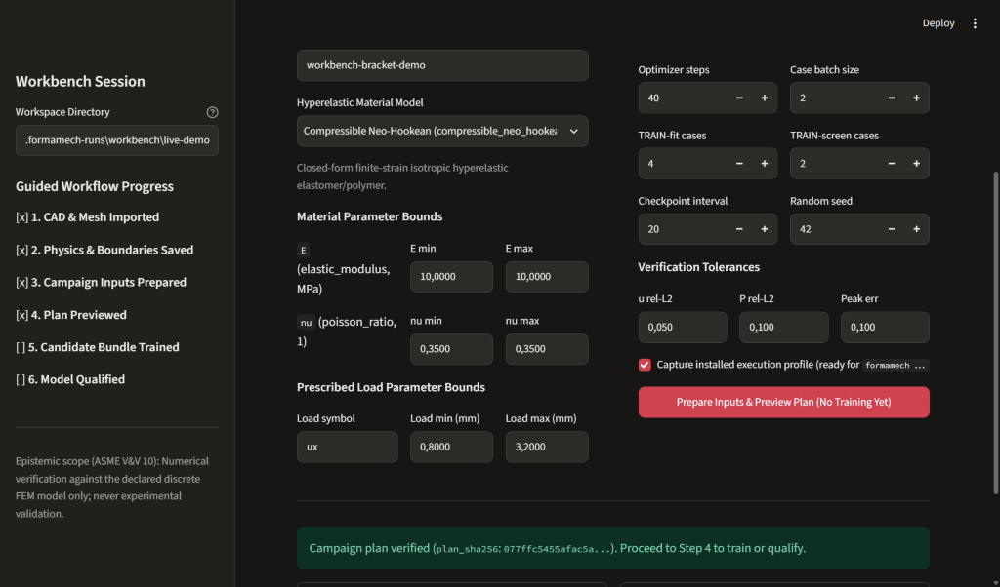

# Interactive 2D Engineering Workbench (`formamech ui`)

The Interactive 2D Engineering Workbench removes the manual JSON and CLI
onboarding barrier while preserving FormaMech's exact canonical file contracts
and epistemic verification boundaries.

The workbench prepares the same hash-bound project files (`geometry/`,
`physics.json`, `inputs/`, `preview/plan.json`, `run/`, `qualification/`) read by
`formamech cad`, `formamech compile`, and `formamech qualify`. Boundary Picker
selection, zoom, and unapplied edits stay in the browser.

> **Epistemic scope (ASME V&V 10):** Newly compiled candidates remain
> `NOT_VERIFIED` until they pass policy-driven numerical qualification against
> converged FEM. The workbench displays claim levels, deployment gates, and
> admissibility verdicts prominently at every stage.

## 1. Launch the workbench

Install the CAD, verification, and UI extras, then launch the Streamlit app.

```text
python -m pip install -e ".[cad,verify,ui]"
formamech ui --workspace .formamech-runs/workbench/my-bracket --bundle bundles/notched-v1-cp-freeze
```

FormaMech wheels and source distributions include the built Boundary Picker.
An installed workbench can serve it offline with Streamlit 1.51 or later. Use
Node.js 24 or later when rebuilding the picker from frontend source.

```text
npm --prefix frontend/boundary-picker ci
npm --prefix frontend/boundary-picker run build
```

## 2. Five guided workflow stages



### Stage 1 — Import CAD & Mesh

Upload a planar `.step`, `.stp`, or `.dxf` profile, choose its length unit and
target mesh size, then select **Import Uploaded CAD**. The mesh summary reports
nodes, triangles, and boundary groups. If meshing fails, open **Technical
details** for the diagnostic. The upload and settings stay available for retry.

**Generate Sample 2D Bracket** opens the 40 × 20 mm example in an empty
workspace. In a populated study, **Open Sample in New Workspace** saves the
example to a unique sibling directory and opens it there.

An uploaded replacement lists the current part and its dependent artifacts.
Choose **Keep current study** to cancel, or **Replace geometry** to mesh the
new part and clear the listed artifacts after a successful import. Finish or
cancel active study jobs before replacing geometry.



### Stage 2 — Visual Boundary Picker

Choose an edge with the keyboard-accessible selector or by clicking a segment
or midpoint in the drawing. The outline, editor, and active assignment row
follow the same edge. Conditions labelled **Suggested from geometry** are
starting points to review.

Edit the condition and select **Apply boundary condition** to save it. The
assignment table shows the applied conditions. You can visit another edge and
return to an unapplied edit during the same browser session. Field errors
appear next to the fields. If another session has changed the study, use
**Reload accepted conditions** and compare your draft before applying again.

### Stage 3 — Material, Loads & Plan

Choose from all seven built-in hyperelastic constitutive models (Neo-Hookean,
Mooney–Rivlin, Yeoh, Gent, HGO, single-family HGO, GOH), configure parameter
ranges and training budgets, and execute `formamech cad prepare` followed by
`formamech compile --plan-only` to review `preview/plan.json` without hand-editing
JSON.

Reopening a workspace restores its saved settings. An applied boundary change
identifies the edited edge and makes the previous plan stale. Choose **Update
plan** to regenerate and review the inputs before training. If preparation
fails, the last complete set of prepared files remains available and the draft
still needs a successful preparation.



### Stage 4 — Background Train & Qualify

Launch detached `formamech compile` and `formamech qualify run` jobs directly
from the browser. **Start Compile Job** and **Resume Compile** require a plan
that matches the current geometry and saved draft. Resume also requires a
compatible checkpoint. You can qualify a selected external bundle independently.

The job monitor updates checkpoints and log tails while a job is active. You
can refresh the status manually or cancel a running job.

### Stage 5 — Verification & Trust Inspector

Load any trained or shipped bundle to inspect 2D displacement magnitude, Cauchy
von Mises stress, `det(F_2D)` admissibility, warm-start FEM diffs, live DWR
`CADTrustReport`s, Qualification Deployment Gate badges, RFC 8785 Trust
Receipts, downloadable Markdown dossiers, and FMI 3.0 `.fmu` exports.


## 3. Reproducing a GUI workspace in CI

Once the workbench has prepared a current plan, run the same pipeline
headlessly with the files under `--workspace`.

```text
formamech compile --spec <workspace>/inputs/problem.json --config <workspace>/inputs/config.json --output <workspace>/run
formamech qualify run <workspace>/run/candidate-bundle --preset holdout --output <workspace>/qualification
formamech qualify verify <workspace>/run/candidate-bundle --manifest <workspace>/qualification/qualification-manifest.json --min-claim HOLDOUT_VERIFIED
```
