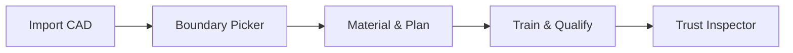
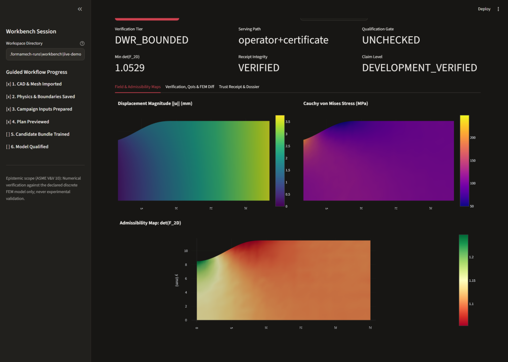

# Interactive 2D Engineering Workbench (`formamech ui`)

The Interactive 2D Engineering Workbench removes the manual JSON and CLI
onboarding barrier while preserving FormaMech's exact canonical file contracts
and epistemic verification boundaries.

The workbench prepares the same hash-bound project files (`geometry/`,
`physics.json`, `inputs/`, `preview/plan.json`, `run/`, `qualification/`) read by
`formamech cad`, `formamech compile`, and `formamech qualify`. Boundary Picker
selection, zoom, and unapplied edits stay in the browser.

> **Epistemic scope (ASME V&V 10):** Newly compiled candidates remain
> `NOT_VERIFIED` until they pass policy-driven numerical qualification against
> converged FEM. The workbench displays claim levels, deployment gates, and
> admissibility verdicts prominently at every stage.

## 1. Launch the workbench

Install the CAD, verification, and UI extras, then launch the Streamlit app.

```text
python -m pip install -e ".[cad,verify,ui]"
formamech ui --workspace .formamech-runs/workbench/my-bracket --bundle bundles/notched-v1-cp-freeze
```

FormaMech wheels and source distributions include the built Boundary Picker.
An installed workbench can serve it offline with Streamlit 1.51 or later. Use
Node.js 24 or later when rebuilding the picker from frontend source.

```text
npm --prefix frontend/boundary-picker ci
npm --prefix frontend/boundary-picker run build
```

## 2. Five guided workflow stages

The study name and **Workbench stage** selector appear at the top of the page.
The same five names appear in **Study progress**. To reopen a study, enter its
path under **Workspace details**. A suggested action takes you directly to the
relevant stage or control. For example, **Update plan** opens **Material & Plan**
when the prepared plan is stale. You can visit any stage from the selector.



### Stage 1 · Import CAD

Upload a planar `.step`, `.stp`, or `.dxf` profile, choose its length unit and
target mesh size, then select **Import Uploaded CAD**. The mesh summary reports
nodes, triangles, and boundary groups. If meshing fails, open **Technical
details** for the diagnostic. The upload and settings stay available for retry.

**Generate Sample 2D Bracket** opens the 40 × 20 mm example in an empty
workspace. In a populated study, **Open Sample in New Workspace** saves the
example to a unique sibling directory and opens it there.

An uploaded replacement lists the current part and its dependent artifacts.
Choose **Keep current study** to cancel, or **Replace geometry** to mesh the
new part and clear the listed artifacts after a successful import. Finish or
cancel active study jobs before replacing geometry.


### Stage 2 · Boundary Picker

Choose an edge with the keyboard-accessible selector or by clicking a segment
or midpoint in the drawing. The outline, editor, and active assignment row
follow the same edge. Conditions labelled **Suggested from geometry** are
starting points to review.

Edit the condition and select **Apply boundary condition** to save it. The
assignment table shows the applied conditions. You can visit another stage and
return to the same selected edge, unapplied edit, and zoom during the same
browser session. Field errors
appear next to the fields. If another session has changed the study, use
**Reload accepted conditions** and compare your draft before applying again.

### Stage 3 · Material & Plan

Choose from all seven built-in hyperelastic constitutive models (Neo-Hookean,
Mooney–Rivlin, Yeoh, Gent, HGO, single-family HGO, GOH), configure parameter
ranges and training budgets, and execute `formamech cad prepare` followed by
`formamech compile --plan-only` to review `preview/plan.json` without hand-editing
JSON.

Reopening a workspace restores its saved settings. An applied boundary change
identifies the edited edge and makes the previous plan stale. **Changes since
last prepared plan** compares applied boundary edits and the form values you
can see against the last successful preparation. New studies show an **Initial
plan summary**. The comparison is read-only. The canonical `physics.json` and
compiler plan remain available below it.

Choose **Update plan** to prepare the proposed settings. A successful update
becomes the comparison baseline. If preparation fails, the last complete set
of prepared files stays available and the comparison still shows the proposed
changes.


### Stage 4 · Train & Qualify

Launch detached `formamech compile` and `formamech qualify run` jobs directly
from the browser. **Start Compile Job** and **Resume Compile** require a plan
that matches the current geometry and saved draft. The **Prepared revision**
beside the controls identifies what they will use while form edits are pending.
Resume also requires a compatible checkpoint. You can qualify a selected
external bundle independently.

The job monitor keeps active jobs visible, with a cancel action for each one.
Filter **Job history** by kind or outcome and choose a **Recorded job** to see
its own log tail, exit status, checkpoint, and report. Your selection stays
in place while jobs update. A failed or cancelled compile offers **Resume
compile** when its recorded checkpoint still matches the current plan and run.
**Report unavailable for this run** means the workbench has no report it can
attribute to that job. New jobs retain their own reports even when a later run
uses the same output directory.

### Stage 5 · Trust Inspector

Load a trained or shipped bundle. **Deployment evidence** shows its identity,
policy, granted claim, and available FMU action. A verified gate enables
**Export qualified FMU**. When no manifest is supplied and there is no default
evidence, **Export unchecked FMU** remains available for exploratory packaging.
Choose the correct manifest or rerun qualification to recover from invalid,
refused, or mismatched evidence. Export rechecks the selected bundle and evidence.
**Receipt integrity** independently reports whether the evaluation receipt is
verified, invalid, or absent. Study progress shows qualification for the
workspace candidate when you inspect a different bundle.

In **Field & Admissibility Maps**, choose **Probe location** to find a vertex,
field extremum, or quantity of interest. Picking a point on the determinant map
updates the same probe. The readout shows coordinates in mm, values, units,
and data sources. Moving the probe uses the displayed result. The surrogate
determinant map marks finite values at or below the active floor and lists the
sample minimum and flagged count. The recorded admissibility verdict and its
failed checks stay visible alongside that summary. **Run Warm-Start FEM &
Compare** switches the evaluation mode to Exact and provides reference fields
where the bundle supports them.

When a background job replaces the selected bundle or its calibration while the
Inspector is hidden, choose **Evaluate selected bundle** to refresh the fields.



## 3. Reproducing a GUI workspace in CI

Once the workbench has prepared a current plan, run the same pipeline
headlessly with the files under `--workspace`.

```text
formamech compile --spec <workspace>/inputs/problem.json --config <workspace>/inputs/config.json --output <workspace>/run
formamech qualify run <workspace>/run/candidate-bundle --preset holdout --output <workspace>/qualification
formamech qualify verify <workspace>/run/candidate-bundle --manifest <workspace>/qualification/qualification-manifest.json --min-claim HOLDOUT_VERIFIED
```
