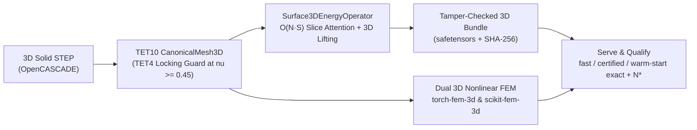
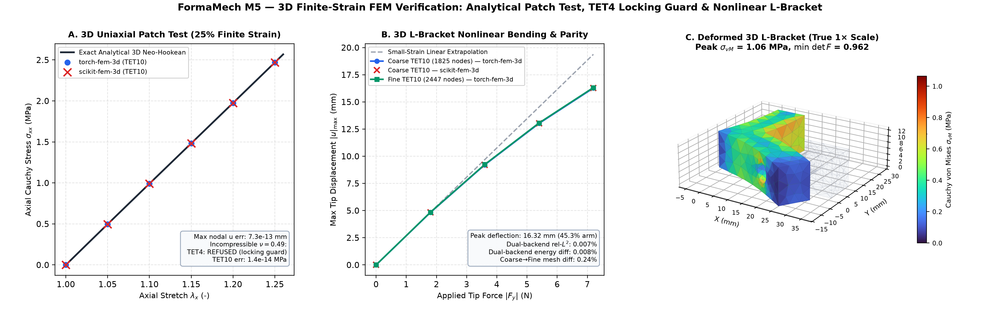
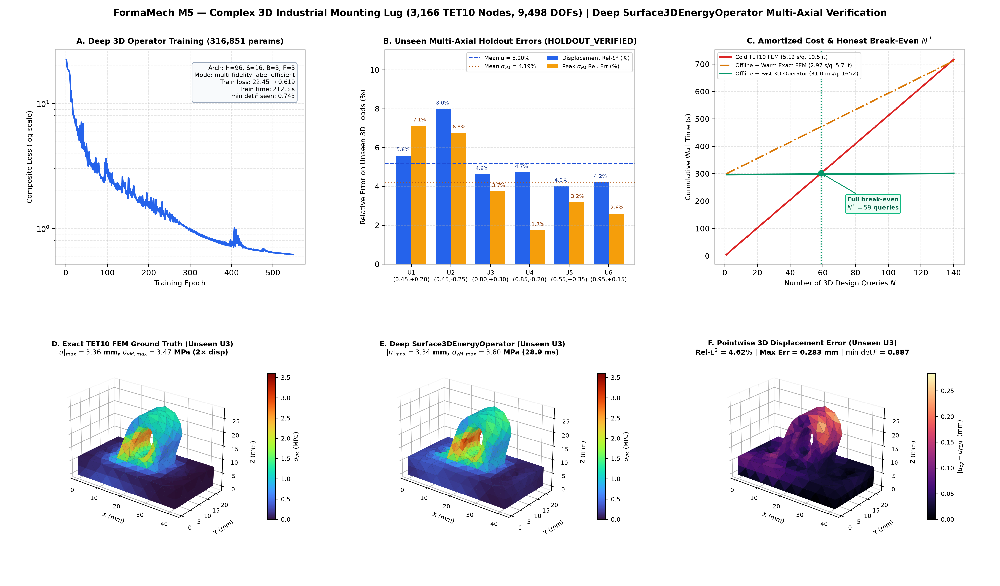

# End-to-End 3D CAD & Nonlinear FEM Workflow (M5 / Feature 1)

FormaMech provides a native cross-platform, pure-MIT 3D solid mechanics
pipeline from OpenCASCADE STEP import and quadratic `TET10` meshing through
two independent nonlinear finite-strain 3D FEM backends and $O(N \cdot S)$
surface-conditioned 3D neural operators (`Surface3DEnergyOperator`).

> **Epistemic scope (ASME V&V 10):** Newly trained 3D operator bundles default
> to `claim_level = "NOT_VERIFIED"` and promote up to `HOLDOUT_VERIFIED` only
> after passing unseen held-out 3D load qualification against converged `TET10`
> FEM (`qualify_3d_bundle`). Multi-fidelity runs using FEM anchors are
> explicitly disclosed (`multi-fidelity-label-efficient`) alongside honest
> amortized break-even query counts $N^*$. Numerical verification does not
> constitute physical experimental validation.



## 1. Core components

1. **3D Solid CAD Import & `TET10` Meshing (`formamech.cad` / `piginot.cad.importing_3d`)**
   - Imports single-solid `.step` / `.stp` files via OpenCASCADE
     (`gmsh.model.occ`), assigns deterministic semantic face tags (`planar`,
     `cylindrical`, `conical`, `toroidal`, `spherical`, `bspline`), remaps Gmsh
     `TET10` edge ordering `(e23 <-> e13)` to positively oriented
     `CanonicalMesh3D`, orients all surface triangles outward, and enforces
     `validate_incompressibility_locking(poisson_ratio)` (refusing linear `TET4`
     at $\nu \ge 0.45$).
   - Includes built-in OpenCASCADE 3D generators (`box`, `l-bracket`, and
     `mounting-lug` clevis component) and SHA-256-bound project persistence
     (`prepare_geometry_3d`, `inspect_geometry_3d`, `load_geometry_3d`).
2. **Dual 3D Finite-Strain Nonlinear FEM Backends (`formamech.fem` / `piginot.fem.backend_3d`)**
   - Registered under `formamech.fem.backends`: **`torch-fem-3d`** (vectorized
     isoparametric `TET4`/`TET10` Total-Lagrangian solver with positive-weight
     tetrahedral Gauss quadrature) and **`scikit-fem-3d`** (`skfem.MeshTet`
     P1/P2 solver).
   - Both reuse FormaMech's exact 3×3 `piginot.physics` finite-strain kernels
     (`energy_density`, `first_piola`, `consistent_tangent`) with linearized
     Dirichlet continuation, finite-rotation potential-energy line search
     (`det(F) > 0`), exact consistent P2 6-node triangle dead-traction vectors,
     and warm-start Newton support.
3. **3D Surface-Token Neural Operator & Qualification (`piginot.training.energy_engine_3d`)**
   - Exact 3D Dirichlet lifting (`PlanarClampLifting3D`, `SoftMinFaceLifting3D`)
     differentiated with exact product-rule autograd
     (`lifted_displacement_and_gradient`) inside batched volumetric 3D Deep Ritz
     potential-energy training (pure `variational-energy-label-free` or
     explicitly disclosed `multi-fidelity-label-efficient`).
   - Tamper-checked `safetensors` persistence
     (`formamech.surface-3d-bundle-v1`), `fast` / `certified` / warm-started
     `exact` serving (`predict_3d_bundle`), held-out unseen qualification
     (`qualify_3d_bundle`, capped at `HOLDOUT_VERIFIED`), and honest amortized
     break-even $N^*$ (`compute_3d_break_even`).

## 2. Quick start: CLI & Python API

### Generate, import, and inspect a 3D STEP solid from the CLI

```text
# 1. Generate the built-in 3D OpenCASCADE industrial mounting lug STEP solid
formamech cad sample-3d --template mounting-lug --output .formamech-runs/lug.step

# 2. Import and mesh into a hash-bound quadratic TET10 3D geometry project
formamech cad import-3d .formamech-runs/lug.step --unit mm --mesh-size-mm 6.2 --element tet10 --output .formamech-runs/geom3d

# 3. Verify SHA-256 digests and inspect 3D face tags, volumes, and mesh counts
formamech cad inspect-3d .formamech-runs/geom3d
```

### Solve 3D nonlinear FEM, train `Surface3DEnergyOperator`, and qualify from Python

```python
import torch

from piginot.cad.importing_3d import (
    classify_faces_by_bbox,
    generate_3d_mounting_lug_step,
    import_cad_3d,
)
from piginot.contracts import MaterialSpec, Quantity, Unit
from piginot.fem.backend_3d import (
    DirichletBC3D,
    FemRequest3D,
    TorchFemBackend3D,
    TractionBC3D,
)
from piginot.geometry.mesh3d import CellType3D
from piginot.operators.surface_operator_3d import Surface3DConfig
from piginot.training.energy_engine_3d import (
    LoadCase3D,
    PlanarClampLifting3D,
    Surface3DTrainingConfig,
    predict_3d_bundle,
    qualify_3d_bundle,
    save_surface_3d_bundle,
    train_surface_3d_operator,
)

# 1. Import 3D STEP solid into quadratic TET10 CanonicalMesh3D
step_path = generate_3d_mounting_lug_step(".formamech-runs/lug.step")
imported = import_cad_3d(step_path, mesh_size_mm=6.2, element_type=CellType3D.TET10)
faces = classify_faces_by_bbox(imported)
clamped = faces["z_min"]
bore = min(
    [f for f in imported.faces if f.kind == "cylindrical" and f.centroid_mm[2] > 10.0],
    key=lambda f: f.area_mm2,
)
loaded = (bore.name,)

# 2. Define 3D compressible Neo-Hookean material and solve a reference case
mat = MaterialSpec(
    name="nh-3d",
    model="compressible_neo_hookean",
    properties={
        "elastic_modulus": Quantity(15.0, Unit.MPA).to_canonical(),
        "poisson_ratio": Quantity(0.35, Unit.ONE).to_canonical(),
    },
)
solver = TorchFemBackend3D()
tbc = (TractionBC3D("bore_load", loaded, (0.30, 0.0, 0.80)),)
fem_res = solver.solve(
    FemRequest3D(
        request_id="lug-ref",
        mesh=imported.mesh,
        material=mat,
        dirichlet_bcs=(
            DirichletBC3D("flange_clamp", clamped, ("x", "y", "z"), (0.0, 0.0, 0.0)),
        ),
        traction_bcs=tbc,
        load_steps=2,
    )
)

# 3. Train Surface3DEnergyOperator (use fem_result=None for 0-FEM-label Deep Ritz,
#    or supply FEM anchor cases for disclosed multi-fidelity training)
bundle = train_surface_3d_operator(
    imported.mesh,
    mat,
    clamped_face_tags=clamped,
    loaded_face_tags=loaded,
    lifting=PlanarClampLifting3D(
        axis="z", plane_coord=0.0, extent_mm=23.0, displacement_scale_mm=2.5
    ),
    train_cases=[LoadCase3D("c1", (0.80, 0.30), tbc, fem_result=fem_res)],
    operator_config=Surface3DConfig(
        parameter_dim=2, hidden_dim=96, slice_count=16, num_blocks=3, num_heads=4
    ),
    training_config=Surface3DTrainingConfig(
        epochs=550, learning_rate=2.5e-3, quadrature_subsample=128
    ),
    dtype=torch.float32,
)
save_surface_3d_bundle(bundle, ".formamech-runs/lug-bundle")

# 4. Serve in fast, certified, or warm-started exact TET10 FEM mode
pred = predict_3d_bundle(
    bundle, LoadCase3D("q1", (0.80, 0.30), tbc), mode="exact", backend=solver
)
print(
    pred.max_displacement_mm,
    pred.peak_von_mises_mpa,
    pred.fem_result.total_newton_iterations,
)
```

## 3. Verified 3D benchmarks & plot walkthroughs

### Benchmarks 1 & 2 — 3D Uniaxial Patch Test, Locking Guard & Nonlinear L-Bracket



- **How to read the plot:**
  - **Panel A (Benchmark 1 — 3D Uniaxial Patch Test):** On a 20 × 10 × 10 mm `TET10` prism (`2,086` nodes, $E = 10\text{ MPa}, \nu = 0.35$) stretched to 25% finite strain ($\lambda_x = 1.25$), both `torch-fem-3d` and `scikit-fem-3d` match `analytical_3d_uniaxial_hyperelastic` to float64 machine precision (**`< 1.8e-15 mm`** at 25% stretch). At $\nu = 0.49$, linear `TET4` is refused fail-closed (`VolumetricLockingError`), while quadratic `TET10` matches exact Cauchy stress to **`1.44e-14 MPa`**.
  - **Panel B (Benchmark 2 — 3D L-Bracket Nonlinear Bending & Parity):** On a 36 × 28 × 12 mm cantilevered 3D L-bracket with through-hole ($E = 12\text{ MPa}, \nu = 0.35$), large tip deflection reaches **`16.32 mm` (`45.3%` of arm length)**, clearly departing from small-strain linear extrapolation. Coarse (`1,825` nodes) $\to$ fine (`2,447` nodes) `TET10` mesh difference is **`0.24%`**, and independent `torch-fem-3d` vs. `scikit-fem-3d` cross-backend parity is **`0.0066%` displacement rel-$L^2$** (`0.0082%` strain energy).
  - **Panel C (3D Deformed Field):** True 1×-scale deformed fine `TET10` L-bracket overlaid on the undeformed wireframe ghost, capturing peak Cauchy von Mises stress (`1.06 MPa`) around the re-entrant corner and through-hole ($\min\det\mathbf{F} = 0.962$).

### Benchmark 3 — Complex Deep 3D PI-GINOT (`Surface3DEnergyOperator`) on Industrial Mounting Lug



- **Setup:** OpenCASCADE **3D Industrial Mounting Lug / Clevis** (stepped flange with 2 vertical bolt holes + upright rounded clevis boss with horizontal through-bore; **`3,166` `TET10` nodes / `9,498` DOFs / `1,623` elements**; clamped bottom flange $z = 0$). A **`316,851`-parameter** `Surface3DEnergyOperator` (`H=96, S=16, B=3, heads=4, F=3`) was trained for **`550` full-batch Adam steps** (`212.3 s` on CPU) over `16` multi-axial `TET10` FEM anchors ($4 \times 4$ grid in $(t_z, t_x) \in [0.30, 1.00] \times [-0.40, +0.40]\text{ MPa}$, `84.5 s` offline FEM) plus `4` label-free volumetric Deep Ritz collocation points (`multi-fidelity-label-efficient`), then qualified across **6 completely unseen** multi-axial 3D loads (`U1`–`U6`).
- **How to read the plot:**
  - **Panel A (Training Convergence):** Log-scale composite loss decays smoothly from `22.45 -> 0.619` over 550 steps with $\min\det\mathbf{F} = 0.748 > 0$ throughout.
  - **Panel B (Unseen Holdout Errors — `HOLDOUT_VERIFIED`):** Across all 6 unseen multi-axial 3D loads, mean displacement rel-$L^2$ error is **`5.20%`** (`4.03%–7.99%`) and mean peak Cauchy von Mises stress error is **`4.19%`** (`1.74%–7.12%`).
  - **Panel C (Amortized Cost & Honest Break-Even $N^*$):** Fast 3D neural inference runs in **`31.0 ms` (`165.4×` faster than `5.12 s` cold `TET10` FEM)**, breaking even at **`N* = 42` queries** (training only) or **`N* = 59` queries** including all 16 offline FEM anchor solves. Warm-starting exact `TET10` FEM (`mode="exact"`) cuts Newton iterations from **`10.5` to `5.7` (`-46%`)** and wall time to `2.97 s` while recovering exact `< 1e-11` FEM equilibrium.
  - **Panels D–F (3D Field Comparison on Unseen `U3`, $t_z = 0.80, t_x = +0.30\text{ MPa}$):** Exact `TET10` FEM (`|u|_max = 3.36 mm`, `sigma_vM = 3.47 MPa`) vs. `Surface3DEnergyOperator` (`|u|_max = 3.34 mm`, `sigma_vM = 3.60 MPa` in **`28.9 ms`**) on identical colorbars, alongside the 3D pointwise displacement error map (`Rel-L2 = 4.62%`, `Max Err = 0.283 mm`, `min det F = 0.887`).

| Unseen Case | Bore Traction $(t_z, t_x)$ (MPa) | Disp. Rel-$L^2$ Err | Peak $\sigma_{vM}$ Err | Max Nodal Err (mm) | Fast Time (ms) | Cold / Warm FEM Iters |
| :---: | :---: | :---: | :---: | :---: | :---: | :---: |
| `U1` | `(0.45, +0.20)` | `5.59%` | `7.12%` | `0.189` | `41.2` | `10` / `5` |
| `U2` | `(0.45, -0.25)` | `7.99%` | `6.76%` | `0.301` | `29.8` | `10` / `5` |
| **`U3`** | **`(0.80, +0.30)`** | **`4.62%`** | **`3.74%`** | **`0.283`** | **`25.9`** | **`11` / `6`** |
| `U4` | `(0.85, -0.20)` | `4.72%` | `1.74%` | `0.264` | `27.3` | `11` / `6` |
| `U5` | `(0.55, +0.35)` | `4.03%` | `3.19%` | `0.246` | `30.9` | `11` / `6` |
| `U6` | `(0.95, +0.15)` | `4.22%` | `2.60%` | `0.228` | `30.6` | `10` / `6` |
| **Mean** | — | **`5.20%`** | **`4.19%`** | **`0.252`** | **`31.0`** | **`10.5` / `5.7`** |
