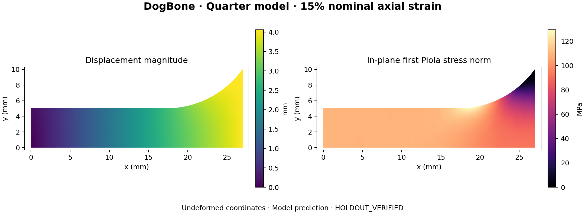
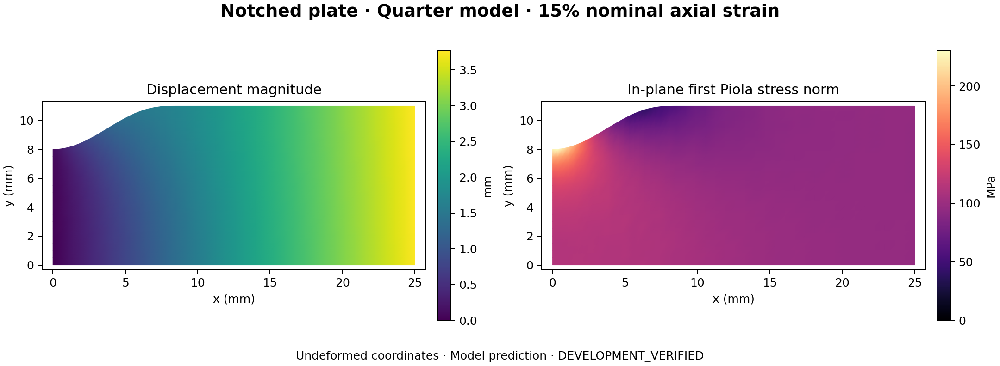
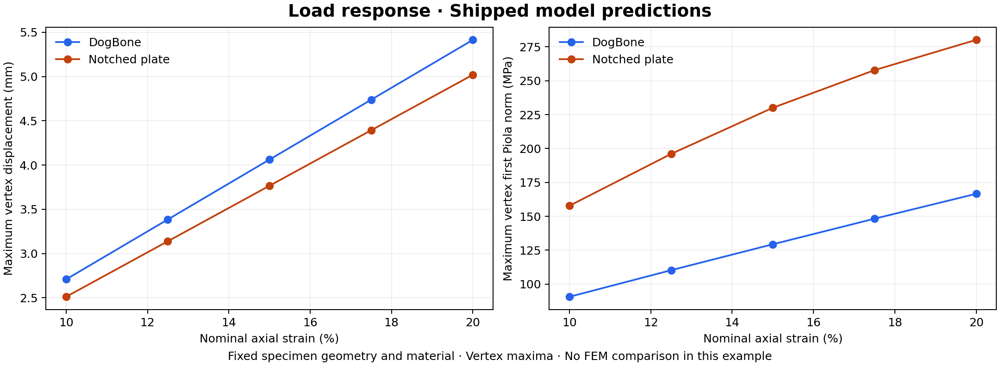

# Prediction plots: specimens and your own CAD

Generate displacement/stress figures and load-response curves with the two
shipped models. This source example performs ten fast predictions on CPU:
five strain values for each specimen, with geometry and material fixed.
It performs no training or FEM solves and uses no private S29 results.

## Run the demo

From the repository root, in your activated virtual environment:

```text
python -m pip install -e ".[runtime,plot]"
python -m examples.prediction_plots --output .piginot-runs/prediction-plots
```

Choose a new output directory for each run. The demo verifies the shipped
bundles while loading them, checks each prediction's envelope verdict, and
writes these files:

| File | Contents |
| --- | --- |
| `dogbone-fields.png` | DogBone displacement magnitude and first-Piola stress norm |
| `notched-fields.png` | Notched-plate displacement magnitude and first-Piola stress norm |
| `load-response.png` | Maximum vertex displacement/stress against nominal axial strain |
| `dogbone-prediction.json`, `notched-prediction.json` | Full vertex predictions at 15% nominal axial strain |
| `summary.json` | The five response samples per model, original inputs, bundle manifest identities and claim levels |







The field plots show each model's **quarter specimen on undeformed coordinates**.
Displacement is the vector magnitude in mm. Stress is the Frobenius norm of the
in-plane first-Piola tensor in MPa; it is not von Mises stress. The response
curve uses the maximum over mesh vertices, which is distinct from a named
notch-root quantity of interest. It varies only nominal axial strain, from
10% to 20%. The curves connect model predictions; they contain no FEM reference
or error estimate.

The figures retain the models' existing claim levels. They do not establish a
claim for another geometry, material or load range. See the
[limitations](../../docs/limitations.md) when interpreting numerical output.

## Plot your own prediction

The reusable plotter accepts JSON from `piginot predict`, including
`NOT_VERIFIED` CAD candidates. For example, replot the saved demo as SVG:

```text
python -m examples.prediction_plots.fields --prediction .piginot-runs/prediction-plots/notched-prediction.json --output .piginot-runs/notched.svg --title "Notched plate"
```

Replace `--prediction` with the path to your CAD prediction JSON. Accepted
outputs are PNG, SVG and PDF; parent folders are created. This command only
reads saved fields and needs the `plot` extra, without loading a model,
Torch or FEM. From outside the checkout, run the same script by its full path:

```text
python /path/to/verified-neural-operators/examples/prediction_plots/fields.py --prediction prediction.json --output fields.png --title "My CAD part"
```

The plotter uses the saved triangle connectivity, preserving holes and cutouts.
It requires an `IN_DOMAIN` result, finite vertex fields, valid triangles,
displacements in mm and stress in MPa. Coordinates follow the canonical mm
contract; an explicitly different coordinate unit is refused. A malformed or
refused prediction produces an error instead of a figure. The input JSON is
preserved, including when an output path aliases it.

See the [own-CAD workflow](../../docs/campaigns/own-cad-workflow.md) to create a
candidate and its FEM comparisons. [Matplotlib's triangular-field plotting](https://matplotlib.org/stable/api/_as_gen/matplotlib.pyplot.tripcolor.html)
describes the rendering used here. Keep new model outputs under the ignored
`.piginot-runs/` directory or outside the source checkout.
