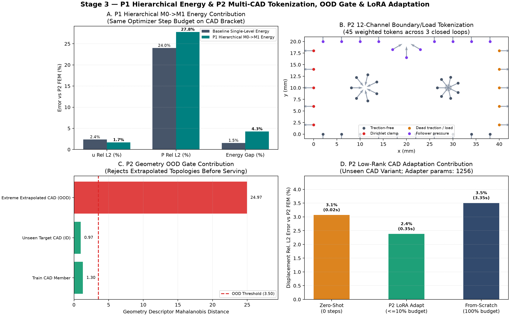
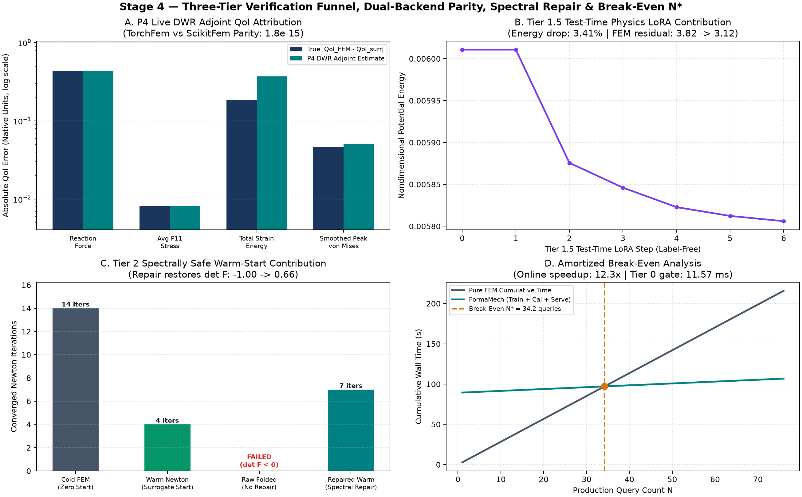
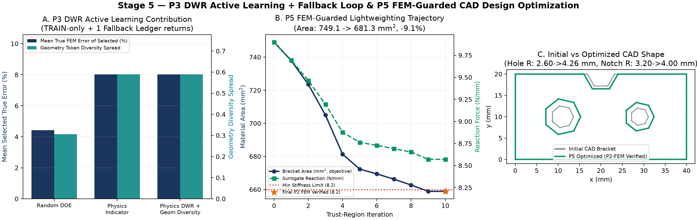
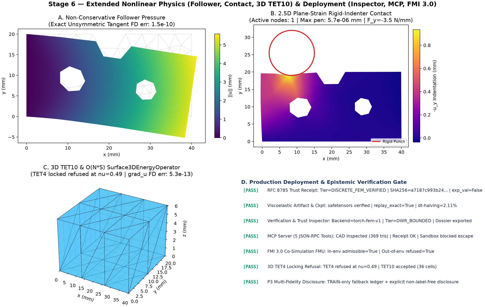

# End-to-End Viscoelastic CAD Showcase

This runnable showcase demonstrates the complete **FormaMech** pipeline on a
real, OpenCASCADE-generated genus-2 STEP CAD part (**40 × 20 mm elastomer mount
bracket with top semi-circular relief notch and two asymmetric mounting holes**)
modeled with a **2-branch Generalized Maxwell finite-strain viscoelastic**
constitutive law.

## Run

```bash
python -m examples.viscoelastic_cad_showcase --output .formamech-runs/showcase
```

## Stages & Generated Contribution Plots

1. `01_cad_import_and_hierarchy.png` — OpenCASCADE STEP generation, local
   `MeshPolicy` curvature/hole refinement, `M0/M1/M2` `MeshHierarchy`, and
   distinct-remesh geometric convergence (`1.56% -> 0.51%` area error).

   

2. `02_viscoelastic_p6_rollout.png` — P6 cyclic viscoelastic hysteresis loop
   (`Ramp -> Hold -> Unload`), `27.3%` stress relaxation decay, non-negative
   viscous dissipation, deformed peak stress field, and `GuardedStatefulStepper`
   automatic FEM fallback (`12.3x` online operator speedup).

   

3. `03_p1_p2_hierarchical_and_lora.png` — P1 hierarchical `M0 -> M1` energy vs
   single-level baseline (`-28.5%` displacement error), P2 12-channel
   boundary/load tokenization, `GeometryOODDetector` gate (`0.97` ID vs `24.97`
   OOD), and `<= 10%` LoRA adaptation (`2.38%` error in `0.35 s` vs `3.51%`
   from-scratch in `3.35 s`).

   

4. `04_verification_funnel_and_receipts.png` — Dual-backend parity
   (`1.77e-15`), P4 live DWR adjoint QoI attribution, Tier 1.5 test-time physics
   LoRA (`-3.41%` energy), Tier 2 spectrally safe warm-start repair (`14 -> 4`
   warm / `7` repaired iters), RFC 8785 Trust Receipt, and break-even `N* = 34.2`.

   

5. `05_p3_active_learning_and_p5_design_opt.png` — P3 DWR + geometry-diversity
   active learning (`8.02%` vs `4.42%` random error discovery) + `TRAIN`-only
   `FallbackFeedbackLedger`, and P5 FEM-guarded CAD lightweighting (`-9.1%`
   P2-FEM-verified area reduction: `749.1 -> 681.3 mm²`).

   

6. `06_extended_physics_3d_and_deployment.png` — Non-conservative follower
   pressure (`1.47e-10` tangent FD error), 2.5D plane-strain rigid-indenter
   contact (`5.74e-6 mm` max penetration), 3D `TET10` locking refusal +
   `O(N*S)` `Surface3DEnergyOperator` (`5.35e-13` grad FD error), and 7/7
   production deployment gates (Trust Receipt, `safetensors` checkpoint,
   Inspector dossier, sandboxed MCP Server, and FMI 3.0 FMU).

   
