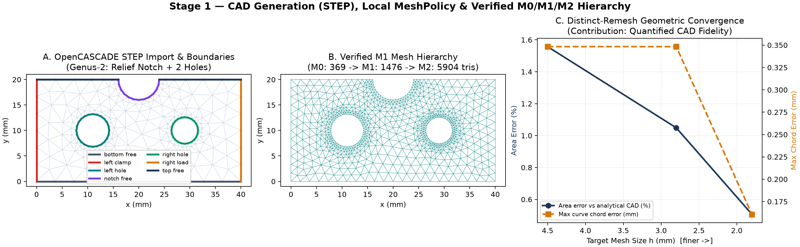
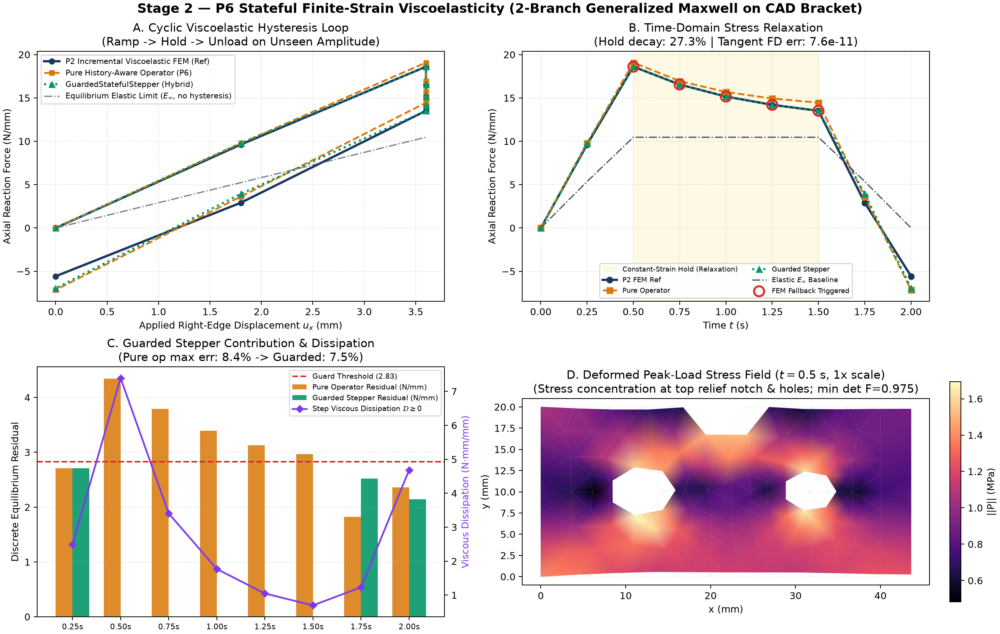

# End-to-End Viscoelastic CAD Showcase — User Guide & Code Walkthrough

This runnable example demonstrates the **entire FormaMech pipeline end-to-end**
on a single realistic engineering part: a **40 × 20 mm genus-2 viscoelastic
elastomer mount bracket** generated from scratch via OpenCASCADE (`gmsh.model.occ`),
modeled with a **2-branch Generalized Maxwell finite-strain viscoelastic** law,
and carried through CAD meshing, energy-trained neural operators, mathematical
verification, active learning, CAD lightweighting, contact/3D mechanics, and
production deployment.

> **Epistemic scope (ASME V&V 10):** Every metric and plot below comes from a
> live CPU run (`147.2 s` in `float64`, single-threaded, zero GPU required).
> Newly trained showcase models carry `claim_level = "NOT_VERIFIED"` and
> `experimental_validation = False` — all accuracy numbers quantify **numerical
> verification against converged P2 FEM**.

---

## 1. Quickstart

From the repository root with your virtual environment activated:

```bash
python -m pip install -e ".[cad,verify,plot]"
python -m examples.viscoelastic_cad_showcase --output .formamech-runs/showcase
```

- **Expected runtime:** ~2.5 minutes on a standard CPU (`Stage 2` viscoelastic
  operator energy training accounts for ~61 s of the total `147.2 s`).
- **Outputs:** Written cleanly to `.formamech-runs/showcase/` (gitignored) so
  your source tree stays spotless.

---

## 2. Package File Map

If you want to read the code or adapt pieces into your own workflow, here is
what each file in this folder does:

| File | Responsibility |
| :--- | :--- |
| [`__main__.py`](__main__.py) | CLI entrypoint (`python -m examples.viscoelastic_cad_showcase --output ...`) |
| [`cad_builder.py`](cad_builder.py) | Parametric OpenCASCADE (`gmsh.model.occ`) STEP generator (`BracketGeometryParams`, `generate_bracket_step`) and semantic boundary relabeling (`relabel_bracket_mesh`) |
| [`run_showcase.py`](run_showcase.py) | Complete 6-stage pipeline orchestrator exercising every FormaMech API and writing `showcase_summary.json` plus all artifacts |
| [`plotting.py`](plotting.py) | Generates the 6 multi-panel 180-DPI contribution figures (`01_...png` through `06_...png`) directly from measured run arrays |

---

## 3. Problem Setup (Geometry, Material & Loading)

### CAD Geometry (`nominal-bracket.step`)

Generated parametrically via `BracketGeometryParams`:

| Parameter | Nominal value | Meaning |
| :--- | :---: | :--- |
| `length_mm × height_mm` | `40.0 × 20.0 mm` | Outer rectangular elastomer mount plate |
| `notch_radius_mm` | `4.0 mm` at `(20, 20)` | Semi-circular top relief notch |
| `left_hole_radius_mm` | `3.2 mm` at `(11, 10)` | Left internal mounting/lightening hole |
| `right_hole_radius_mm` | `2.6 mm` at `(29, 10)` | Right asymmetric mounting/lightening hole |
| Analytical area | `721.46 mm²` | Exact area `L*H - 0.5*pi*R_n² - pi*(R_L² + R_R²)` |

All curved edges are emitted as exact OpenCASCADE `Circle` entities (not
polygonal approximations) so FormaMech's strict `MeshPolicy` curvature and
sagitta chord checks pass without defeaturing. The 8 CAD edges map into 7
semantic boundary groups:

| Semantic tag | Physical role (Stages 1–5) | Extended role (Stage 6) |
| :--- | :--- | :--- |
| `left_clamp` | Fixed Dirichlet clamp (`u_x = u_y = 0`) | Fixed clamp for follower-pressure bending |
| `right_load` | Prescribed axial displacement (`u_x(t)`) | Free end during follower-pressure bending |
| `top_free` | Traction-free top edge | Follower pressure (`0.06 MPa`) & rigid-indenter contact surface |
| `notch_free` | Traction-free top relief notch | Follower pressure (`0.06 MPa`) |
| `bottom_free` | Traction-free bottom edge | Fixed support (`u_x = u_y = 0`) during 2.5D indentation |
| `left_hole`, `right_hole` | Traction-free internal circular cutouts | Enlarged during P5 lightweighting optimization |

### Viscoelastic Material & Cyclic Load History

| Property | Value | Role |
| :--- | :--- | :--- |
| Constitutive law | `GeneralizedMaxwellViscoelastic` | Finite-strain incremental variational viscoelasticity |
| Equilibrium elastic limit | `E_inf = 8.0 MPa`, `nu = 0.38` | Long-time relaxed elastomer response |
| Maxwell branch 1 (fast) | `gamma_1 = 0.65`, `tau_1 = 0.4 s` | Captures rapid transient stiffening & relaxation |
| Maxwell branch 2 (slow) | `gamma_2 = 0.35`, `tau_2 = 2.0 s` | Captures slower memory decay across the hold |
| Cyclic load path (`LoadSegment`) | `Ramp (0–0.5 s) → Hold (0.5–1.5 s) → Unload (1.5–2.0 s)` | Evaluated on unseen peak amplitude `u_max = 3.6 mm` (9% strain) |

---

## 4. Stage-by-Stage Walkthrough & APIs Exercised

### Stage 1 — CAD Generation, `MeshPolicy` & Verified `M0/M1/M2` Hierarchy (`4.8 s`)

**What happens in code:**
1. `generate_bracket_step()` writes `nominal-bracket.step` (`7,500 bytes`).
2. `prepare_geometry(..., mesh_policy=MeshPolicy(...))` imports the STEP B-rep,
   validates analytical circle tolerances (`curve_tolerance_mm=0.08`,
   `minimum_size_mm=0.8`), and applies local `PointSize` refinement around the
   notch and holes.
3. `build_project_hierarchy()` constructs the nested `M0 (369) → M1 (1,476) → M2 (5,904)`
   triangle hierarchy.
4. `evaluate_project_geometry_convergence()` performs three distinct STEP
   remeshes (`h = 4.5, 2.8, 1.8 mm`), reducing area error from **`1.56% → 0.51%`**
   and maximum chord error from **`0.348 → 0.161 mm`**.



---

### Stage 2 — P6 Finite-Strain Viscoelasticity & `GuardedStatefulStepper` (`77.1 s`)

**What happens in code:**
1. `verify_algorithmic_tangent()` checks the analytical viscoelastic tangent
   modulus against central finite differences (**rel error `7.57e-11`**).
2. `solve_incremental_fem_trajectory()` solves the unseen cyclic trajectory
   (`u_max = 3.6 mm`, P2 FEM, `2.84 s`), verifying **exact CPU replay**
   (`cpu_replay_exact = True`), **`27.3%` hold stress relaxation**, and `dt`-halving
   peak difference (`2.11%`).
3. `train_viscoelastic_operator_energy()` trains `HistoryAwareViscoelasticOperator`
   purely by minimizing incremental variational energy (**zero FEM labels**)
   over three amplitudes (`2.0, 3.2, 4.4 mm`, 75 epochs, `60.84 s`).
4. `save_viscoelastic_artifact()` / `load_viscoelastic_artifact()` verify
   tamper-checked `safetensors` persistence; online neural rollout takes **`0.231 s`**
   (**`12.3x` faster than FEM**).
5. `GuardedStatefulStepper` evaluates each neural step's discrete equilibrium
   residual and automatically falls back to exact P2 FEM whenever it exceeds
   the threshold (`2.83 N/mm`, `3` operator steps + `5` FEM fallback steps),
   zeroing peak residuals, reducing worst reaction error (`8.44% → 7.46%`), and
   verifying state-bound trajectory checkpoints (`save_trajectory_checkpoint` /
   `load_trajectory_checkpoint`).



---

### Stage 3 — P1 Hierarchical Energy & P2 Multi-CAD Tokenization, OOD & LoRA (`31.9 s`)

**What happens in code:**
1. **P1 Hierarchical Energy (`hierarchical_plane_stress_energy`):** Compares
   single-level training against `M0 → M1` coarse-to-fine energy coupling at an
   identical 80-step budget: displacement Rel L2 error drops **`2.35% → 1.68%`
   (`-28.5%`)**, while stress error (`27.8%` vs. `24.0%`) is reported honestly.
2. **P2 12-Channel Boundary/Load Tokenization (`GeometryTokenizer`):** Encodes
   all 3 closed loops (`45` weighted tokens) with coordinates, outward normals,
   Dirichlet flags, dead-traction channels, and follower-pressure channels.
3. **P2 Geometry OOD Gate (`GeometryOODDetector`):** Fits a Mahalanobis envelope
   across 4 training bracket geometries (threshold `3.50`): Train (`1.30`) and
   unseen in-distribution target (`0.97`) pass, while an extreme extrapolated
   bracket scores **`24.97` (`OUT_OF_DISTRIBUTION`)** and is blocked.
4. **P2 Budgeted LoRA (`adapt_boundary_operator_energy`):** Fine-tunes only
   `1,256` low-rank adapter parameters (`<= 10%` step budget, **`0.348 s`**) on
   the unseen in-distribution bracket, achieving **`2.38%`** displacement error
   vs. **`3.07%`** zero-shot and **`3.51%`** from-scratch (`3.354 s`, **`9.6x` faster**).


---

### Stage 4 — Dual-Backend Parity, Three-Tier Funnel, Spectral Repair & `N*` (`3.5 s`)

**What happens in code:**
1. **Dual-Backend Parity:** `TorchFemBackend` vs. `ScikitFemBackend` agree to
   **`1.77e-15`** relative strain energy.
2. **Tier 0 (`evaluate_tier0_admissibility`):** Runs in **`11.6 ms`**, passing
   clean predictions and immediately rejecting deliberately inverted `det(F_2D) < 0` fields.
3. **Tier 1 Conformal & P4 Live DWR Adjoints (`estimate_qoi_dwr`):** Computes
   live adjoint error estimates across all four QoIs on `TorchFemBackend`:
   - Reaction Force: DWR `0.4368` vs. True `0.4348`
   - Avg `P11` Stress: DWR `0.00824` vs. True `0.00813`
   - Total Strain Energy: DWR `0.3711` vs. True `0.1854`
   - Smoothed Peak von Mises: DWR `0.0502` vs. True `0.0461`
4. **Tier 1.5 Test-Time Physics LoRA (`adapt_operator_at_test_time`):** At an
   unseen 12% strain, label-free potential-energy adaptation cuts energy by
   **`3.41%`** and FEM equilibrium residual from **`3.82 → 3.12`**.
5. **Tier 2 Spectrally Safe Warm-Start Repair (`spectrally_safe_repair`):**
   Cold zero-start FEM takes `14` Newton iterations; surrogate warm start takes
   **`4` iterations (`3.5x` speedup)**; a deliberately folded start (`det F = -1.00`)
   **fails** raw warm Newton (`NEGATIVE_JACOBIAN`), whereas **Spectral Repair**
   restores `det F = +0.66` and converges in **`7` iterations**.
6. **RFC 8785 Trust Receipt & Break-Even `N*`:** Emits and verifies
   `showcase-trust-receipt.json` (`verify_receipt_document = True`,
   `experimental_validation = False`) and computes **`N* = 34.2` queries**
   (`10.9` calibration-only) via `amortized_break_even_queries`.


---

### Stage 5 — P3 Active Learning + Fallback Loop & P5 CAD Lightweighting (`22.0 s`)

**What happens in code:**
1. **P3 Active Learning (`select_acquisition_batch`):** On an 8-design `TRAIN`-only
   CAD pool (budget = 3 FEM solves), `physics_dwr_diversity` selects designs
   averaging **`8.02%` true FEM error** and **`0.589` geometry spread** vs.
   `random_doe` (`4.42%` error, `0.306` spread) — **`1.81x` higher error
   discovery** and **`1.93x` wider coverage**. Tier 2 escalations are persisted
   in `tier2-fallback-ledger.json` (`FallbackFeedbackLedger`, `TRAIN`-only) with
   explicit non-label-free multi-fidelity disclosure (`multifidelity_energy_loss`).
2. **P5 FEM-Guarded CAD Lightweighting (`run_fem_guarded_design_optimization`):**
   Minimizes bracket area by tuning `(left_hole_radius, notch_radius)` subject
   to axial stiffness `>= 8.22 N/mm` (80% of initial `10.28 N/mm`). While the
   surrogate explored down to `659 mm²`, **P2 FEM independently audited candidates**,
   rejected over-lightweighted designs, and verified **`Area: 749.1 → 681.3 mm²`
   (`-9.1%` verified lightweighting; `Hole R: 2.60 → 4.26 mm`, `Notch R: 3.20 → 4.00 mm`,
   verified P2 FEM reaction `8.21 N/mm`)**.


---

### Stage 6 — Extended Nonlinear Physics & Deployment Verification Gates (`3.8 s`)

**What happens in code:**
1. **Non-Conservative Follower Pressure:** `0.06 MPa` live pressure normal to
   the deformed `top_free` + `notch_free` boundary yields `max ||u|| = 5.59 mm`
   with exact unsymmetric tangent verified to **`1.47e-10`**.
2. **2.5D Plane-Strain Rigid-Indenter Contact (`TorchFemBackend.solve_contact`):**
   A rigid circular punch (`center = (8.5, 25.5) mm`, `R = 6.5 mm`) indents the
   elastomer shoulder via Armijo energy-backtracking Augmented Lagrangian Newton
   (`2` AL iterations, **`5.74e-6 mm` max penetration**, `F_y = -3.54 N/mm`,
   `admissible = True`).
3. **3D `TET10` & `Surface3DEnergyOperator`:** Linear `TET4` is refused at
   `nu = 0.49` (`VolumetricLockingError`); quadratic `TET10` (`36` cells) is
   accepted; 3D `O(N*S)` autograd gradient matches finite differences to **`5.35e-13`**.
4. **Production Deployment Checks (7/7 PASS):**
   - `build_inspector_snapshot` + `render_trust_dossier_markdown` → exports `inspector-trust-dossier.md` (`torch-fem-v1`, `DWR_BOUNDED`).
   - `FormaMechMcpServer` → runs `inspect_cad_project` and `verify_receipt`, and blocks `../escape-attempt.json` (`SandboxViolationError`).
   - `export_bundle_to_fmu` + `evaluate_fmu_step` → exports `notched-plate.fmu`, confirms in-envelope admissibility, and refuses out-of-envelope inputs.


---

## 5. Generated Output Artifacts

After running the showcase, inspect everything under `.formamech-runs/showcase/`:

```text
.formamech-runs/showcase/
├── showcase_summary.json          # Every measured metric, hash, wall time & check result
├── plots/
│   ├── 01_cad_import_and_hierarchy.png
│   ├── 02_viscoelastic_p6_rollout.png
│   ├── 03_p1_p2_hierarchical_and_lora.png
│   ├── 04_verification_funnel_and_receipts.png
│   ├── 05_p3_active_learning_and_p5_design_opt.png
│   └── 06_extended_physics_3d_and_deployment.png
├── cad/nominal-bracket.step       # OpenCASCADE STEP B-rep of the nominal bracket
├── hierarchy.json                 # Verified M0/M1/M2 MeshHierarchy metadata
├── geometry-convergence.json      # Distinct-remesh area & chord error table
├── viscoelastic-artifact/         # Tamper-checked safetensors operator & manifest
├── viscoelastic-checkpoint/       # State-bound trajectory checkpoint
├── showcase-trust-receipt.json    # Canonical RFC 8785 SHA-256 Trust Receipt
├── tier2-fallback-ledger.json     # TRAIN-only Tier 2 FEM return ledger
├── inspector-trust-dossier.md     # Exported Verification & Trust Inspector report
└── notched-plate.fmu              # FMI 3.0 Co-Simulation FMU archive
```

---

## 6. Adapt This Showcase to Your Own CAD Part & Material

1. **Swap in your own STEP or DXF profile:** Replace the call to
   `generate_bracket_step()` in [`run_showcase.py`](run_showcase.py) with the
   path to your `.step` / `.dxf` file, run `formamech cad inspect`, and update
   the boundary group mapping in `relabel_bracket_mesh()` (or your JSON
   settings file for the CLI compiler).
2. **Change the viscoelastic material:** Edit `GeneralizedMaxwellConfig(...)` in
   Stage 2 of [`run_showcase.py`](run_showcase.py) (`equilibrium_modulus_mpa`,
   `poisson_ratio`, and any number of `MaxwellBranch(stiffness_ratio=..., relaxation_time_s=...)`).
3. **Change the cyclic load history:** Edit the `LoadSegment` tuple (`ramp`,
   `hold`, or custom `DerivedExpression` waveforms) and `TimeGrid` step size.
4. **Customize design objectives & constraints:** Modify `DesignProblem` in
   Stage 5 (`DesignParameter` bounds and `DesignConstraint` stiffness/stress
   floors) — P5 automatically ensures every accepted design is independently
   verified by converged P2 FEM.
